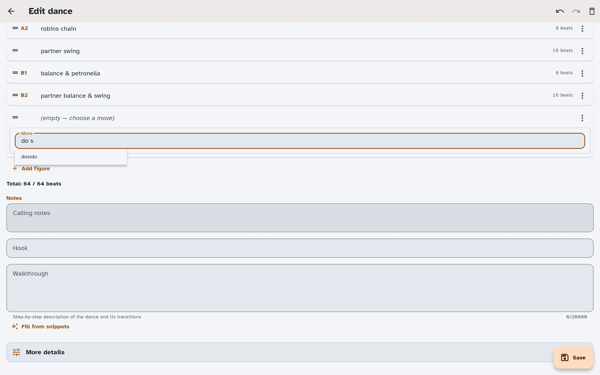

# Write & edit dances

Sooner or later you will want to put a dance in yourself — a dance you wrote, one
a friend taught you at a festival, or one that came in from an
[import](./imports.md) with a [figure](./glossary.md#figure) the app could not
quite read. This guide
covers the dance editor: how figures go in, where the notes and credits live, and
how the app keeps your work safe while you type.

> **Finding your way around these words.** On-screen buttons and screens are
> written in **bold** — like **New dance**, **Save**, and **Figures**. The first
> time a dance term appears it links to [App terms](./glossary.md), so you can
> get a plain-language definition without losing your place.

If you have not entered a dance before, the
[Getting started guide](./getting-started.md#add-your-first-dance) walks through
one end to end. This guide is the fuller reference.

## Open the editor

There are three ways in:

- **New dance**, from your [collection](./glossary.md#collection) — starts a blank
  dance. The screen is titled **New dance**.
- **Edit**, from a dance's detail view — opens that dance. The screen is titled
  **Edit dance**.
- **Import and edit**, on a row in the [import review](./imports.md) list — brings
  that one dance in straight away and opens it, so you can fix a stubborn figure
  while the rest of the import waits for you. It is not covered by the import's
  **Undo**.

The editor is a full screen with **Save** in the corner. The **title** is the only
required field; everything else can stay empty until you know it.

## Enter the figures

**Figures** is the heart of the editor. Each figure is one row, in the order the
dance is called, and the app tracks how many [beats](./glossary.md#beats) they add
up to as you go.

### Type and press Enter

Figure entry is keyboard-first. Choose **Add figure** (or **Add first figure** on
an empty dance). When the dance can also hold a meanwhile or a modifier, the
button opens a small menu: press Space or Enter on it and focus lands on **Add
figure**. Press Enter to choose it, use the up and down arrow keys to reach the
other choices, and press Escape to close the menu.

With **Free-text entry** off, **Add figure** adds a row with its **Move** box
focused. As you type there, the app offers matching [moves](./glossary.md#move);
press Enter to accept one and it is added with that move's default settings.
Typing `sw` and pressing Enter, for example, gives you a swing.

With **Free-text entry** on, **Add figure** opens **Type a figure** instead: one
box that takes a whole line and offers no move suggestions. Press Enter and the
line is added; `sw` typed there on its own is a custom figure, not a swing. See
[Free-text entry](#free-text-entry) below.

Anything the app cannot recognise is still kept — it becomes a **custom figure**,
holding your text. Nothing you type is ever thrown away because the app did not
understand it; the only change is that role words are saved as role terms and
shown in your own dialect (see below).

*The dance editor while entering figures, with recognized rows and the running
beat total visible below the list.*

The box stays open after each figure so you can keep going: type, Enter, type,
Enter. Choose **Done**, press Escape, or press Enter on a blank box when you
are done.

### Free-text entry

Turn on **Free-text entry** in
[Settings](./settings.md#dance-details--shorthands) ▸ **Dialect** ▸
**Dance details & shorthands** and the same box accepts a whole line at a time
instead of one move at a time. Type `neighbor balance & swing` and you get one
figure, a swing with a balance; type `16 circle left 3/4` and you get a
sixteen-beat circle left three-quarters. A line that states no count starts
with the figure's usual beats, and they follow the figure if you change its
options. A line under the
box tells you how many figures it added and invites you to type another (a
screen reader announces the count too); it goes away when you start typing.

The same works on a figure that is already in the dance. Open it, type a line
into its move over what is there, and press Enter: if the line is not simply the
name of a move, it is read the same way and the figure is replaced by what you
typed, in its place. A line that reads as several figures replaces the one
figure with all of them. Typing a move's name and choosing it still works as
before. With **Free-text entry** off, a line typed there is kept as a custom
figure holding your text.

With **Free-text entry** on, a new dance starts with no figures, so there are no
placeholders to delete first, unless you have saved your own
[starting figures](#start-new-dances-the-way-you-work).

It also understands common phrasings such as `N swing`, `neighbours balance and
swing`, `half hey, ladies start by the right` and
`allemande left 1 1/2 with neighbor`. When the app reads the start of a line
as a figure, the rest of the line becomes that figure's note
(`neighbors swing slowly` is a swing with the note "slowly"). That happens only
when the rest cannot change what the figure is. If the rest is `and back`, a bare
number (`neighbors swing 16`), a turn amount (`petronella twice`,
`circle left 3/4 and pass through`), or another move after a comma, `and` or
`then` (`partners balance and swing, end facing down`), the whole line is kept
as a custom figure, marked unparsed. Otherwise you would get a figure with the
wrong beats or turn, with the rest hidden in its note. Use the leading
`16 neighbors swing` form to set the beats.

Any move's own name typed on its own works, whatever your dialect: `hey`, `mad
robin`, `contra corners`, `give & take` (or `give and take`, `give-and-take`),
in capitals or not, with or without a full stop, comma or exclamation mark
after it (`hey.`). Your dialect's own name for a move works too. A name on its
own gives the figure with its usual options, which you can then change.
Put `ones`, `twos`, `partners`, `neighbors`, `everyone`, `role1s`, `role2s` (or
the singular `partner` or `neighbor`) in front of the name of a move that takes
dancers and they are the dancers: `neighbor pass by`, `ones arch and dive`. A
move that does not take dancers that way (`hey`, `slice`), a word the app does
not know in the dancer's place, or anything else on the line stays a custom
figure unless the line is read as above. The app also reads `hey for four`,
`half hey`, `full hey`, `turn as a couple`, turn amounts in words
(`allemande right once and a half`), and older role words such as `ravens` by
what they mean (`ravens chain` is the same as `robins chain`), unless your own
role terms use that word, in which case it means your role. `hey for four` (or
`hey for 4`) is a full hey, 16 beats, unless you give it a count of 8, as in
`(8) hey for four`, which makes it a half hey.

A count can also be written in brackets, `(16) circle left` or `[16] circle
left`, and goes at the end as well: `circle left (16)` or `circle left [16]`.
Any of these can say `beats`: `neighbor swing (16 beats)`,
`neighbor swing 16 beats` or `16 beats neighbor swing`. A count in bars
(`circle left 4 bars`, `circle left (4 bars)`, `4 bars circle left`) is kept as
a note on the figure ("4 bars") and the rest of the line is read as usual,
because how many beats a bar holds depends on the dance's music. The figure
keeps the beats it has when you pick it from the list. If the rest of the line
is not read as a figure, the whole line is kept as a custom figure, as you
typed it.
A count is never dropped: if the line states one the app cannot use (a second
count on the same figure), the line is kept whole as a custom figure. A line
kept as a custom figure keeps your words as you typed them, count included, and
the count you gave is also its beats.

A count too long to be beats, five digits or more (`circle left 10000 beats`,
`(10000) circle left`), is not used as one. The figure is read as usual and takes
the beats it has when you pick it from the list, and the number is kept in the
figure's note (`10000 beats`) so you can see it was typed. If the rest of the
line is not read as a figure, the whole line is kept as a custom figure, as you
typed it. A count that is shorter but more than the 64 beats a figure can take
(`circle left (100)`) keeps the whole line as a custom figure too.

Pasting several lines into the box keeps them as one line, with a space where
each line break was; type or paste one figure line at a time to get one figure
per line.

A `;` between figures makes a list, and each part is read as its own figure:
`circle left 3/4; turn alone` gives two figures, in order. A count stays with
the part it follows: `circle left (8); turn alone` gives the circle 8 beats, and
`circle left; turn alone (4)` gives the turn 4. If any part cannot be read as a
figure, or a count cannot be matched to a figure (a part that became a note on
the one before it), the whole line is kept as one custom figure instead. A `||`
makes its two sides a [meanwhile](./glossary.md#meanwhile):
`circle left || neighbor swing` gives one meanwhile group whose sides are the
circle and the swing.

As always, anything it cannot parse is kept as a custom figure rather than
dropped.

### Figure shorthands

If you type the same run of figures over and over, teach it to the app once as
a [shorthand](./glossary.md#shorthand).
Choose **Figure shorthands** in **Settings** ▸ **Dialect** ▸ **Dance details &
shorthands**, then **New shorthand**:

- **Shorthand** is the exact line (or the exact part of a `;` list) you will
  type during free-text entry. It is
  matched without regard to capitals, so `NBS` and `nbs` are the same shorthand.
  A shorthand can be up to 64 characters long.
- **Expands to** is the figure or figures it inserts, in order, up to 64
  figures. You build them
  exactly the way you build a normal figure, with the same options and the same
  checks.

A shorthand also works with a beat count and in a `;` list:

- `16 pbs` and `pbs (16)` add the shorthand with 16 beats. The count is applied
  when the shorthand is a single figure. A shorthand for several figures is
  added exactly as saved and the count is ignored, since there is no one figure
  to give it to. A token that includes a number, such as `3 swings`, is matched
  as typed, before any count is looked for. A count follows the same rules as
  on any figure line: more than the 64 beats a figure can take (`pbs (100)`)
  keeps the whole line as a custom figure, as you typed it, and a count of five
  digits or more (`pbs (10000)`) is kept in the figure's note, with the beats the
  shorthand was saved with.
- `pbs; ladies chain` adds the shorthand's figures, then the next figure. Each
  part can have its own count. As with any `;` list, if one part is neither a
  shorthand nor a figure the app understands, the whole line is added as one
  custom figure instead.

The same counts work on the shorthands for [your own figures](#your-own-figures)
and for combinations, described below, whether typed into the free-text box or
into the Move box of a row you are changing. `16 zm` and `zm (16)` add your
figure with 16 beats, in place of the beats the shorthand was saved with, since
it is one figure, and a count over 64 keeps the line as a custom figure, as
above. A count typed with a combination is ignored: it is added with the beats
it was saved with. A shorthand for a
plain figure with the same token as the one left after the count is taken off
wins, as it does for a whole line.

They also work as one part of a `;` list, mixed with shorthands of any kind and
with ordinary figures: `zm; ladies chain`, `ladies chain; zm` and
`16 zm; ladies chain` each add a row per part, in the order typed, in the
free-text box or in place of the row whose **Move** box you typed into. Each
part takes its own count as above. A combination is one row and counts as one
part, however many figures it holds. A list can have at most 64 parts. As with
the shorthands above, it is all or nothing: if one part is not a shorthand, a
figure the app understands or a shorthand that can be used, the whole line is
added as one custom figure instead.

Shorthands are your own; each one has to be unique, and the app tells you if you
reuse a token that is already taken. Shorthands are matched before the app tries
to read a line as a figure, so a shorthand named for something the app already
understands, such as `swing`, replaces that reading every time you type it. The
editor warns you when your shorthand is such a word, but still lets you save
it. The app keeps up to 500 of these
shorthands; once you have that many, **New shorthand** tells you so, and you
can add another after deleting one. Shorthands only apply while **Free-text
entry** is on.

With **Custom Figures** on, the same screen also lists **Shorthands for your own
figures**. Choose **New shorthand for one of your figures**, type the
shorthand, pick one of your [own figures](#your-own-figures), a combination or
a new figure, and choose the value for each of its parameters; for a new
figure, its beats too (left as they are, they follow the figure's own default
beats). Typing that shorthand as a whole line adds a row for your figure with
those values, as if you had picked it: a combination becomes the figures it
stands for when you save the dance, and a new figure stays one figure in your
wording. Its token is unique among all your shorthands, of every kind. If its
figure has been deleted, or changed so that it no longer accepts the values,
the shorthand says so and typing it is read as an ordinary line. Turning
Custom Figures off hides these shorthands and stops them working; it doesn't
delete them. Each of the two kinds, for combinations and for new figures, keeps
up to 500 of its own, separate from the 500 figure shorthands.

A shorthand of any kind works in an existing figure's **Move** box too: with
**Free-text entry** on, type it there and press Enter, and the figure is
replaced by what the shorthand stands for, in the same place in the dance. If
the shorthand can't be used (its figure or combination has been deleted, or no
longer accepts the values), what you typed is read as an ordinary line
instead, the same as for any other text typed there.

### Adjust a figure

Select a figure to open it. What you can change depends on the move:

- **Parameters** — most moves have a few (which role, how far, which way round).
  Common ones show straight away; choose **More options** to see the rest, and
  **Fewer options** to fold them back.
- **Beats** — every figure has a beat count you can raise or lower.
- **Progression** — mark the figure the dance
  [progresses](./glossary.md#progression) on. Moves that can carry the
  progression say so.
- **Add note** — a short note attached to that figure alone.

A figure whose move this version of the app does not know — one added by a newer
version, for example — is shown read-only, with a plain explanation. Its data is
kept untouched, it edits normally again once the app knows the move, and you can
still reorder and delete it in the meantime.

### Custom figure

A custom figure has two fields: **Custom figure text** and **Beats**.

The **Beats** field sets how many beats the custom figure occupies — use it the
same way you would for any other figure.

The **Custom figure text** field also accepts two formatting marks, with buttons
for both:

- `*text*` for **bold**
- `_text_` for underline

As you type, the app styles what it recognises: move names get a dotted
underline, role terms are underlined, and
[discouraged terms](./dialects.md) are struck through. The styling is only a
hint: it does not change your text while you type. Role words are rewritten
when you save, as described next.

Role words you type here (such as "Larks" or "Leads") are saved in a neutral
form, shown in your own [dialect](./dialects.md), and found by role searches.
They come back in lower case: "Larks chain wide" shows as "larks chain wide",
and "LADIES chain" shows as "robins chain" under Larks and Robins.
(If you turn on **Capitalize figures** in [Settings](./settings.md), the first
letter is shown capitalized.)
Custom text saved before this change updates the next time you save the dance
while the same dialect is active; text typed in a different dialect may need a
manual edit. The same rewriting applies to the everyday and older role words
"man", "men", "woman", "women", "lady", "ladies", "gent" and "gents" inside custom
figure text (for example, "the man and lady swing"), and to the role names of
the built-in dialects ("lark", "robin", "gentlespoon", "ladle" and their
plurals). They are saved as role terms and shown in your dialect's words.
Words that are also move words are not turned into role terms, here and in
figure notes. The move name "mad robin" is kept as the move name and saved in
lower case, so "Mad Robin twice" comes back as "mad robin twice". If your
dialect uses Leads and Follows, "lead" and "follow" used as verbs ("Ones lead
down the hall", "follow your partner up the hall") are kept exactly as you
typed them. "Leads chain" and "the lead on the left" still use the role. Text saved by an earlier version is not repaired automatically.

### Your own figures

With **Custom Figures** on (see [Settings](./settings.md)), the figures you
built for the dance's form, in the [Glossary](./glossary.md) or from
**Settings › Experimental › Your figures**, are offered when
you choose a figure's move, listed first and marked with a person icon
(announced as **Custom** by screen readers). They are found by their name or by
any of their other names. A figure you built has one of two kinds, and each
works differently in a dance. (The Glossary can also hold **Term** entries,
which are never offered in a dance.) You can start a figure of your own from one
that comes with the app, and rename it or switch to the app's version if a later
release adds a figure with the same name; see
[Glossary and custom figures](./settings.md#glossary-and-custom-figures).

#### A combination

A combination is offered for a figure in the list itself, not inside a
meanwhile or modifier group.

A combination you pick stays one row while you edit: it shows its name and
the value you chose for each of its parameters, and opening it lets you change
those values (only values the combination accepts are offered), mark the
progression, and add a note. It says how many figures, and how many beats, it
becomes.

When you save the dance, the row is replaced by the figures it stands for,
filled in with your values, as the combination is defined at that moment, so
an edit made in the Glossary since you picked it applies. Your note goes on the
first of them and the progression mark on the last. After that they are
ordinary figures: the saved dance does not remember that they came from one of
yours, and changing or deleting your combination later does not change it.

If your combination has been deleted, has changed so that it can no longer be
expanded, or no longer accepts the values on the row, the row says so, and
saving keeps it as a [custom figure](#custom-figure) with its name, its beats,
and the row's note and progression mark. The values you chose for its
parameters are not kept. A row that is one of your combinations cannot be
grouped as a meanwhile or modifier. Turning Custom Figures off stops them being
offered, but a row you already picked is still expanded when you save.

#### A new figure

A new figure is offered for a figure in the list and inside a meanwhile or
modifier group.

A new figure you pick stays one figure, in the dance and once it is saved. It
starts with its defaults and its default beats. Opening it lets you choose the
value of each of its parameters and its beats (inside a group, the group's
beats count), mark the progression, and add a note. It reads in the dance with
its own wording, filled in with your values.

The dance keeps following your figure: when you change its wording in the
Glossary, every dance that uses it reads the new way, on this device. Saving
the dance also stores how it reads at that moment, which is what a device
without your figure, or with an older version of the app, shows. If you change
that line on such a device, it becomes an ordinary [custom
figure](#custom-figure) there and stops following your figure.

If your figure has been deleted, the row says so and keeps the line it had.
Deleting a figure from the Glossary changes each dance that uses it to that
line, as a custom figure. Turning Custom Figures off stops new figures being
offered, but a dance that already uses one still reads with its wording.

### Reorder, cut, and duplicate

Each figure row has a drag handle and an actions menu. From the keyboard, Tab to
the row's **⋮** button and press Space or Enter to open it; the arrow keys move
between actions, Enter runs one, and Escape closes the menu:

| Action | What it does |
|---|---|
| **Move up** / **Move down** | Shifts the figure one place |
| **Cut** | Lifts the figure out, ready to place elsewhere |
| **Duplicate** | Adds an identical figure |
| **Group with next as meanwhile** | Joins it to the next figure as simultaneous action |
| **Group with next as modifier** | Makes the first figure the core and the next figure a modifier |
| **Mark progression** / **Clear progression** | Sets or clears the progression |
| **Delete** | Removes the figure |

After **Cut**, a banner names the figure that is waiting and **Paste here**
points appear between the rows — before the first figure, after any figure, and
at the end of the list — so you can drop it exactly where you want. Every move,
duplication, and deletion is announced for screen readers, and deletions can be
undone.

### Meanwhile figures

Some dances have two things happening at once — the ones on the ends do one
thing while the middles do another. Choose **Group with next as meanwhile** and
the two figures become a [meanwhile](./glossary.md#meanwhile) group, labelled
with how many sides it has and sharing one set of beats.

You can also choose **Add meanwhile** from the list's **Add** menu to create the
group first. It starts with your **Meanwhile defaults** (see
[Start new dances the way you work](#start-new-dances-the-way-you-work)), or two
stand-still sides if you have not set any. If you have cleared those defaults
you get two blank sides, and a single default side is paired with one blank
one. The group is saved with the dance once at least two of its sides are
filled in.

Inside the group, each side is labelled **Side 1**, **Side 2**, and so on, and has
its own controls to move up, move down, or **Remove this side**. **Add side** adds
another side, up to six.

A note you add to one side, or to one figure of a modifier group, is shown in
brackets after that figure wherever the dance is shown: in the list, on the
dance's page, in Perform and when printed. For example,
`robins allemande right once (1 1/2) while larks orbit`.

### Modifier figures

Use **Group with next as modifier** when one figure describes the main action
and the next describes how it is performed. The first figure is labelled
**Core** and the figures after it **Modifier**, in order. **Add modifier**
creates a modifier group from your **Modifier defaults**.

You can put a meanwhile group inside a modifier group, or a modifier group inside
a meanwhile group, one level deep. The app does not allow a group inside another
of the same kind, or nesting any deeper.

### Keep an eye on the beats

Under the figure list the app shows a running **Total** against what the dance's
[phrase structure](./glossary.md#phrase-structure) expects, and says **Over by**
or **Under by** when the two disagree. It is a nudge, not a rule — you can save a
dance whose beats do not add up, and sometimes that is the honest transcription.
A saved dance whose beats do not add up shows the same warning above its figures
on the dance's page, because the section labels (A1, A2, B1, B2) are then worked
out from the wrong total. Perform and printing do not show it.

## Details, notes, and credits

### Details

- **Title** — required.
- **Authors** — the [choreographer](./glossary.md#choreographer) or
  choreographers. Type to find an existing author or create a new one.
- **Type** — **Contra**, **English (ECD)**, or **Square**. It sets the icon on
  the dance's row in your collection and what the **Type** filter finds. A new
  dance starts with your default type (see
  [Start new dances the way you work](#start-new-dances-the-way-you-work)); change
  it here for any one dance.
- **Formation** and **Formation detail** — the shape the dance is danced in, plus
  anything worth adding in words.
- **Mixer** — tick this when the dance is a
  [mixer](./glossary.md#mixer): one where you change partners each time through.
  It's kept separate from the formation, because a mixer can be danced in many
  shapes and not every circle is a mixer.
- **Phrase structure** — leave it blank for the standard A1 A2 B1 B2, or write
  your own (the field suggests `6*8*2` as an example). The app checks that what you
  write is a valid structure, and uses it for the beat count above.

### Notes

- **Calling notes** — how you call it, what to watch for.
- **Hook** — one line on why you would call this dance.
- **Walkthrough** — the step-by-step teach.

### Walkthrough

You can write the [walkthrough](./glossary.md#walkthrough) as free prose, or
build it from your figures.

Each figure can carry an **Add walkthrough step** description. What you write
there is *saved as your default for that figure and reused wherever it appears* —
so the way you teach a hey is written once and follows you into every dance with a
hey.

Two things follow from that:

- **Fill from snippets** assembles a walkthrough from the saved
  [snippets](./glossary.md#snippet) of the dance's figures. If it would
  overwrite something, the app asks first. If none of the figures has a snippet
  yet, it says so rather than emptying the field.
- If you edit a step so it no longer matches your saved snippet, the app asks
  **Update your saved snippet?** — choose **Use everywhere** to update the default,
  or **Just this dance** to keep the change local.

Your whole library of snippets lives at **Settings** ▸ **Dialect** ▸ **Dance
details & shorthands** ▸ **Walkthrough snippets**, where you can review and edit
them. Editing one there updates the default used everywhere.

### More details

**More details** expands to everything else a dance can carry:

| Field | Notes |
|---|---|
| **Level** and **Status** | How hard it is, and where it is in your workflow |
| **Mixed level** | For dances that span the difficulty scale |
| **Rating** | Your own star rating, with **Clear rating** to unset it |
| **Composed** / **Revised** | A year, optionally with a month and day |
| **Tags** | Your own labels |
| **Tunes** | Tunes you like with this dance |
| **Links** | A URL with an optional label, marked **Source**, **Video**, or **Other** |
| **Published sources** | Citations, with optional page and number |
| **Related dances** | Cross-references to other dances, each with an optional note |
| **Custom fields** | Any [custom fields](./glossary.md#custom-field) you have defined — see [Collection & search](./collection.md#make-your-own-fields) |

To tie a whole family of dances together — several variations of one dance, say —
turn on **Include in related-dance group** for the link. Every dance in the group
is then linked to every other one. Removing a group link breaks up that whole
group, while ordinary related-dance links are left alone.

If the editor spots wording it considers discouraged, it collects it under
**Warnings** with the term named. Nothing is blocked; it is there so you can
decide.

### Author and source details are shared

Choose to edit an author's details and you get **Choreographer details** — name,
website, email, location, notes, and whether they are deceased. The dialog is
explicit about two things, and both matter:

- These details are **shared across every dance credited to that author**, so
  correcting a spelling here corrects it everywhere.
- **Email and location are private, and so is the deceased mark.** They are
  stored only on this device and are never shared or exported. See
  [Share, print & export](./sharing.md#what-stays-private) for exactly what
  leaves the app.

**Source details** works the same way: a source's details are shared across every
dance that cites it, and editing them here updates the source everywhere it is
referenced.

## Undo, drafts, and saving

### Undo and redo

**Undo** and **Redo** sit in the editor's top bar, with keyboard shortcuts:

| Action | Linux / Windows | macOS |
|---|---|---|
| Undo | Ctrl-Z | Cmd-Z |
| Redo | Ctrl-Shift-Z or Ctrl-Y | Cmd-Shift-Z |

### Your work is kept while you type

The editor keeps a draft as you work. If the app closes before you save —
a crash, a flat battery, a phone that decides to reboot — the next time you open
that dance the app offers you the draft back:

> **Unsaved draft** — You have an unsaved draft for this dance. Would you like to
> restore it?

Choose **Restore** to pick up where you left off, or **Discard** to start from the
last saved version. Drafts stay on your device; they are never uploaded, shared,
or included in exports.

### Leaving without saving

If you try to leave with unsaved changes, the app asks **Discard changes?** —
**Keep editing** returns you to the dance, **Discard** leaves it as it was last
saved.

### Save and delete

**Save** writes the dance and returns you to where you came from; the change shows
in your collection straight away. If a save fails, the app says so and leaves your
work in the editor so you can try again.

**Delete dance** (in the top bar, on an existing dance) removes the dance. As
everywhere else in the app, deletion is a soft delete with an **Undo** offered
right away — see
[Keep your collection tidy](./collection.md#keep-your-collection-tidy).

## Start new dances the way you work

If most of your dances share a shape, set that shape once. **Settings** ▸
**Defaults** ▸ **Dance-authoring defaults** decides what a **New dance** starts
as:

- **Type**, **Formation**, and **Progression** — what a new dance begins with.
- **Default phrase structure** — seeded into new dances; blank means the standard
  4×16 (A1 A2 B1 B2).
- **Starting figures** — the figures a new dance starts with. It defaults to
  eight stand stills of eight beats each, or to no figures while **Free-text
  entry** is on; clear it for a completely blank dance.
- **Meanwhile defaults** and **Modifier defaults** — the figures a new
  [meanwhile](#meanwhile-figures) or [modifier](#modifier-figures) group starts
  with.
- **Move defaults** — your preferred parameter values, applied whenever you insert
  that move. These override the move's built-in defaults, and you can still change
  any parameter on the figure afterwards.
- **Aggressively recompute figure beats** — off by default, so a beat count you
  typed yourself is left alone, except that switching a balance option on or off
  adds or removes 4 beats. Turn it on and changing a figure's
  move, or an option that affects its timing, recalculates its beats straight
  away, even over a count you typed.

Every one of these is only a starting point; you can change any of them on any
dance.

## Fix figures an import could not read

Imported dances sometimes arrive with figures kept as plain custom text because
the app could not recognise them at the time. As the app's figure
recognition improves, those can often be upgraded.

In [Settings](./settings.md#import) ▸ **General** ▸ **Import**, find **Re-check
custom figures** and choose **Re-check…**. The app scans your collection and
shows you what it *could* upgrade before anything changes: how many figures, in
how many dances, and which ones. You confirm, and only then does anything
happen.

Your tags, ratings, notes, and everything else on each dance are kept exactly as
they are — only figures that now recognise a known move are replaced. If there is
nothing to upgrade, the app tells you that and leaves your collection alone.

A dance whose stored figures the app cannot read at all is left out of the scan
rather than upgraded, and its stored text is not touched. The dance's own page
tells you when its figures cannot be read.

## Where to go next

- **Find and organize what you have entered:**
  [Collection & search](./collection.md)
- **Bring dances in rather than typing them:**
  [Imports & migration](./imports.md)
- **Put figures into your own words:** [Dialect](./dialects.md)
- **Build an evening from your dances:** [Programs & matrix](./programs.md)
- **Hand a dance to someone else:** [Share, print & export](./sharing.md)
- **Using assistive technology or large text?** The
  [Accessibility guide](./accessibility.md) covers screen readers, text size,
  high contrast, and keyboard use.

Not sure what a word means? [App terms](./glossary.md) has plain definitions
for every term used across these guides.
