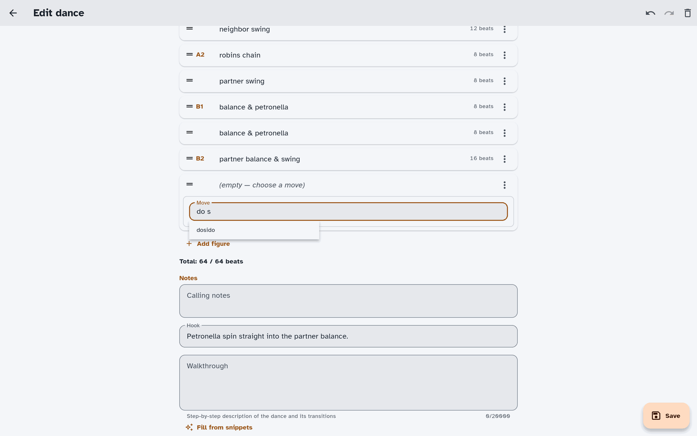

# Write & edit dances

Sooner or later you will want to put a dance in yourself — a dance you wrote, one
a friend taught you at a festival, or one that came in from an
[import](./imports.md) with a [figure](./glossary.md#figure) the app could not
quite read. This guide
covers the dance editor: how figures go in, where the notes and credits live, and
how the app keeps your work safe while you type.

> **Finding your way around these words.** On-screen buttons and screens are
> written in **bold** — like **New dance**, **Save**, and **Figures**. The first
> time a dance term appears it links to [App terms](./glossary.md), so you can
> get a plain-language definition without losing your place.

If you have not entered a dance before, the
[Getting started guide](./getting-started.md#add-your-first-dance) walks through
one end to end. This guide is the fuller reference.

## Open the editor

There are three ways in:

- **New dance**, from your [collection](./glossary.md#collection) — starts a blank
  dance. The screen is titled **New dance**.
- **Edit**, from a dance's detail view — opens that dance. The screen is titled
  **Edit dance**.
- **Import and edit**, on a row in the [import review](./imports.md) list — brings
  that one dance in straight away and opens it, so you can fix a stubborn figure
  while the rest of the import waits for you. It is not covered by the import's
  **Undo**.

The editor is a full screen with **Save** at the end of the top bar, after undo
and redo; on a phone it shows as a check mark. The **title** is the only required field; everything else can stay
empty until you know it.

## Enter the figures

**Figures** is the heart of the editor. Each figure is one row, in the order the
dance is called, and the app tracks how many [beats](./glossary.md#beats) they add
up to as you go.

### Type and press Enter

Figure entry is keyboard-first. Choose **Add figure** (or **Add first figure** on
an empty dance). When the dance can also hold a meanwhile, a modifier or a
sequence, the button opens a small menu: press Space or Enter on it and focus lands on **Add
figure**. Press Enter to choose it, use the up and down arrow keys to reach the
other choices, and press Escape to close the menu.

With **Free-text entry** off, **Add figure** adds a row with its **Move** box
focused. As you type there, the app offers matching [moves](./glossary.md#move);
press Enter to accept one and it is added with that move's default settings.
Typing `sw` and pressing Enter, for example, gives you a swing.

The moves offered are those of the dance's **Type**: an English dance offers
English figures, such as set, turn single, siding and the heys, and a contra
dance offers contra figures, and a square dance offers square calls, such as
promenade, allemande left, circle, chain and separate. A figure the dance
already holds from another type stays as it is; it just isn't offered for a
new row. Square calls are picked here for now: a line you type with
**Free-text entry** in a square dance is still read with contra's figures.

With **Free-text entry** on, **Add figure** opens **Type a figure** instead: one
box that takes a whole line and offers no move suggestions. Press Enter and the
line is added; `sw` typed there on its own is an unrecognized figure, not a swing. See
[Free-text entry](#free-text-entry) below.

Anything you add that the app cannot recognize is still kept — it becomes a
**unrecognized figure**, holding your text. Nothing you add is ever thrown away because
the app did not understand it; the only change is that role words are saved as role terms and
shown in your own dialect (see below).

*The dance editor while entering figures, with recognized rows and the running
beat total visible below the list.*



The box stays open after each figure so you can keep going: type, Enter, type,
Enter. When you have entered all your figures, choose **Finish adding**: it adds
a line still in the box, as Enter would, and then closes the box. Press Enter on
a blank box to close it too. Escape closes the box without adding what is in it.

A line you have typed but not added is not lost if you move on. **Save** adds it
first, as Enter would, and leaving the editor with a line in the box asks
**Discard changes?**.

### Free-text entry

Turn on **Free-text entry** in
[Settings](./settings.md#dance-details--shorthands) ▸ **Dialect** ▸
**Dance details & shorthands** and the same box accepts a whole line at a time
instead of one move at a time. Type `neighbor balance & swing` and you get one
figure, a swing with a balance; type `16 circle left 3/4` and you get a
sixteen-beat circle left three-quarters. A line that states no count starts
with the figure's usual beats, and they follow the figure if you change its
options. Your [Move defaults](#start-new-dances-the-way-you-work) apply as they
do when you pick the move, but only to what the line leaves out: with a Move
default of a full hey, `hey` gives a full hey and `half hey` still a half hey.
In an English country dance, the line is read as English figures (`1st
corners set and turn single`, `Partner R shoulder round`, `circle left half
way`), never as contra moves; anything it can't read exactly is kept as you
typed it. A circle or star "half way" counts places from the dance's
formation, two in a duple minor and three in a triple minor. A line that
starts with a bar range (`1-4 partners set and turn single`, `(5-8) circle
left`, `A1 1-8 lead up`) counts those bars by the dance's **Meter**: `1-4` is
8 beats in 2/2 and 12 in 3/2 or 3/4. With no meter, a bar counts the beats
of the phrase structure, as the **Bars** field does. Where the phrase
structure's phrases differ in beats per bar (`A:2*4*3 + B:1*8*2`, an A in 3/4
and a B in 6/8), the Meter does not decide it: each bar is as long as the
phrase it falls in, and the bars count from where the line is placed in the
dance, so the numbers you type give how many bars, not where they sit. In that
example `1-4` placed first is 12 beats, and `9-12` placed after the two A
phrases is 8. A line that runs across the change counts each bar by its own
phrase.
The bars are the count. A line that also states a count in beats
(`1-4 (6) circle left`) is kept as you typed it, with the bars' count, so you
can see the two disagree and fix whichever is wrong. A line with several bar
ranges (`(5-8) circle left (9-12) circle right`) is kept as you typed it too,
counted across all of them (or by its first range, past 64 beats); type
each figure on its own line to have them read.
A line under the
box tells you how many figures it added and invites you to type another (a
screen reader announces the count too); it goes away when you start typing.

The same works on a figure that is already in the dance. Open it, type a line
into its move over what is there, and press Enter: if the line is not simply the
name of a move, it is read the same way and the figure is replaced by what you
typed, in its place. A line that reads as several figures replaces the one
figure with all of them. The figure's note, its walkthrough step and its
progression mark are kept, as they are when you pick a new move: the note and
the step go on the first of the new figures (after any note you typed with the
line) and the progression mark on the last. Typing a move's name and choosing
it still works as before. With **Free-text entry** off, a line typed there is
kept as an unrecognized figure holding your text.

Pressing Enter in a figure's **Move** box chooses, in this order: the move (or
your own figure) whose name is exactly what you typed, so `star` is a star and
not a star through; then, with **Free-text entry** on, your shorthand with that
token, so a short token such as `rl` is not taken for the first move whose name
contains it; and only then the first suggestion offered.

If you leave a figure's **Move** box without pressing Enter, by moving to
another box, saving the dance (or a combination or shorthand you are editing),
or closing the figure or opening another one,
what you typed is used only when it is exactly a move's name (or one of your
own figures' names) or, with **Free-text entry** on, one of your shorthands.
Anything else, such as part of a name, goes back to the move the figure had:
leaving the box never picks a suggestion for you or makes an unrecognized figure. On a
phone the same goes for closing the list of moves without choosing one. Going
back with such a name or shorthand still in the box asks before discarding it.

With **Free-text entry** on, a new dance starts with no figures, so there are no
placeholders to delete first, unless you have saved your own
[starting figures](#start-new-dances-the-way-you-work).

It also understands common phrasings such as `N swing`, `neighbors balance and
swing`, `half hey, ladies start by the right`, `1/4 hey, partner start right
shoulder` and `allemande left 1 1/2 with neighbor`. When the app reads the start of a line
as a figure, the rest of the line becomes that figure's note
(`neighbors swing slowly` is a swing with the note "slowly"). That happens only
when the rest cannot change what the figure is. If the rest is `and back`, a bare
number (`neighbors swing 16`), a turn amount, in figures or in words
(`petronella twice`, `petronella two times`, `circle left 3/4 and pass through`,
`allemande left three quarters`), or another move after a comma, `and` or
`then` (`partners balance and swing, end facing down`), the whole line is kept
as an unrecognized figure, marked unparsed. Otherwise you would get a figure with the
wrong beats or turn, with the rest hidden in its note. Use the leading
`16 neighbors swing` form to set the beats.

Dancers can be named the way the figure list names them: `prev neighbor
swing`, `third partner allemande left once`, `second shadow balance`, `same
roles dosido once`, `centers two hand turn once`, or, in your dialect's role
words, `first lark two hand turn once`.

It also reads figures the way Caller's Companion writes them, each as one
figure: `Circle L`, `Neighbor alle R 1.5` and `R&L` (a right and left
through); `New Neighbor swing` (your next neighbors) and `Corner allemande
left` (your first corners); `Ring balance, spin to the right` (a petronella
with its balance); `Balance wave and slide to the right` (a Rory O'More with
its balance); `Wave balance, circulate (Larks cross)` (a box circulate with its
balance, the Larks crossing); `Partner R-hand balance, square through 2`; and
`make short waves`.

Any move's own name typed on its own works, whatever your dialect: `hey`, `mad
robin`, `contra corners`, `give & take` (or `give and take`, `give-and-take`),
in capitals or not, with or without a full stop, comma or exclamation mark
after it (`hey.`). Your dialect's own name for a move works too. A name on its
own gives the figure with its usual options, which you can then change.
Put `ones`, `twos`, `threes`, `fours`, `partners`, `neighbors`, `everyone`, `role1s`, `role2s` (or
the singular `partner` or `neighbor`), or any other dancers the way the figure
list names them (`same roles`, `third corners`, `prev neighbor`), in front of
the name of a move that takes dancers and they are the dancers: `neighbor pass
by`, `ones arch and dive`, `third corners gate`. A
move that does not take dancers that way (`hey`, `slice`), a word the app does
not know in the dancer's place, or anything else on the line stays an unrecognized
figure unless the line is read as above. The app also reads `hey for four`,
`half hey`, `full hey`, `turn as a couple`, turn amounts in words
(`allemande right once and a half`), and older role words such as `ravens` by
what they mean (`ravens chain` is the same as `robins chain`), unless your own
role terms use that word, in which case it means your role. `hey for four` (or
`hey for 4`) is a full hey, 16 beats, unless you give it a count of 8, as in
`(8) hey for four`, which makes it a half hey. `hey for 3` is the hey for
three, as `hey for three` is.

A count can also be written in brackets, `(16) circle left` or `[16] circle
left`, and goes at the end as well: `circle left (16)` or `circle left [16]`.
Any of these can say `beats`: `neighbor swing (16 beats)`,
`neighbor swing 16 beats` or `16 beats neighbor swing`. A count in bars
(`circle left 4 bars`, `circle left (4 bars)`, `4 bars circle left`) is kept as
a note on the figure ("4 bars") and the rest of the line is read as usual,
because how many beats a bar holds depends on the dance's music. The figure
keeps the beats it has when you pick it from the list. If the rest of the line
is not read as a figure, the whole line is kept as an unrecognized figure, as you
typed it.
A count is never dropped: if the line states one the app cannot use (a second
count on the same figure), the line is kept whole as an unrecognized figure. A line
kept as an unrecognized figure keeps your words as you typed them, count included, and
the count you gave is also its beats.

A count too long to be beats, five digits or more (`circle left 10000 beats`,
`(10000) circle left`), is not used as one. The figure is read as usual and takes
the beats it has when you pick it from the list, and the number is kept in the
figure's note (`10000 beats`) so you can see it was typed. If the rest of the
line is not read as a figure, the whole line is kept as an unrecognized figure, as you
typed it. A count that is shorter but more than the 64 beats a figure can take
(`circle left (100)`) keeps the whole line as an unrecognized figure too.

Pasting several lines into the box keeps them as one line, with a space where
each line break was. To add several lines at once, one figure line each, use
[Add several figures at once](#add-several-figures-at-once).

A `;` between figures makes a list, and each part is read as its own figure:
`circle left 3/4; turn alone` gives two figures, in order. A count stays with
the part it follows: `circle left (8); turn alone` gives the circle 8 beats, and
`circle left; turn alone (4)` gives the turn 4. If any part cannot be read as a
figure, or a count cannot be matched to a figure (a part that became a note on
the one before it), the whole line is kept as one unrecognized figure instead. A `||`
makes its two sides a [meanwhile](./glossary.md#meanwhile):
`circle left || neighbor swing` gives one meanwhile group whose sides are the
circle and the swing.

As always, anything it cannot parse is kept as an unrecognized figure rather than
dropped.

### Add several figures at once

To bring in a dance you have as text, from an email, a web page or a typed
document, open **Add figure** ▸ **Add figures from text…** under the figure
list. Type or paste the figures into the box, one figure per line:

```
A1 (8) Neighbor balance & swing
   (8) Long lines forward and back
A2 (8) Ladies chain
```

Each line is read as the Move box reads a line you type with
[Free-text entry](#free-text-entry) on, with your
[shorthands](#figure-shorthands) and your dialect, whether Free-text entry is
on or not. Blank lines are skipped, and so is a line that is only a phrase
label, such as an `A1` heading. In a contra dance a phrase label such as `A1` or
`B2` at the start of a line is left out, so `A1 (8) Ladies chain` reads as
`(8) Ladies chain`. English and square dances keep it: an English line such as
`A1 1-8 lead up` is read with its label, because the label comes before a bar
range; other English lines that start with a label may not be recognized, so
leave the label off them.

As you type, the sheet shows how many figures each line gives and marks the
lines it does not recognize. Those are still added, each as an
[unrecognized figure](#unrecognized-figure) that keeps its text, for you to
fix. **Add figures** adds them all at the end of the figure list as one step,
so a single Undo takes them out again. **Cancel** adds nothing. Nothing is
saved until you save the dance.

The sheet reads up to 200 lines and 20,000 characters at a time, and up to
2,000 characters on one line. Longer text is refused, and nothing from it is
added: add it in parts.

#### Read the figures from a picture

On iPhone, iPad and Mac, **From an image…** in the same sheet reads the text of
a picture you choose, such as a photo of an index card or a page of a book, and
puts it in the box in place of what is there. Check it and correct it there:
the lines are then read exactly as typed text is.

- The picture is read **on your device**, by the text recognition built into
  iOS and macOS. Nothing is sent anywhere, and nothing is downloaded to read
  it.
- **The picture is not kept.** It is read once and let go; only the text
  reaches the sheet. Nothing about the picture is saved with the dance, synced
  or backed up. A copy the picker makes for the app is deleted once read.
- It reads the app's language and English. Where the device can't read the
  app's language (some languages, such as Japanese, need a newer iOS or
  macOS, and some aren't offered at all), the sheet says so and reads
  English.
- A picture over 25 MB, or over 10,000 pixels on a side or 50 million pixels
  in all, is refused before anything is read. Crop it or choose a smaller one.
- Typed text reads best. Handwriting may come out wrong, so check each line.

On iPhone and iPad, **Take a photo** beside it opens the camera instead, so
you can photograph the card without leaving the app. The first time, the
system asks whether the app may use the camera; it uses it only when you tap
**Take a photo**. The photo is read the same way and is **not kept**: it is
deleted as soon as its text has been read, or straight away if reading fails,
and it is never added to your photo library. If you said no to the camera, you
can turn it on again in the Settings app, under **Caller's Compendium**.

**From an image…** isn't offered on Android, Windows or Linux, and **Take a
photo** is only on iPhone and iPad: you can still type or paste the figures.

### Figure shorthands

If you type the same run of figures over and over, teach it to the app once as
a [shorthand](./glossary.md#shorthand).
Choose **Figure shorthands** in **Settings** ▸ **Dialect** ▸ **Dance details &
shorthands**, then **New shorthand**:

- **Shorthand** is the exact line (or the exact part of a `;` list) you will
  type during free-text entry. It is
  matched without regard to capitals, so `NBS` and `nbs` are the same shorthand.
  A shorthand can be up to 64 characters long.
- **Expands to** is the figure or figures it inserts, in order, up to 64
  figures. You build them
  exactly the way you build a normal figure, with the same options and the same
  checks.

A shorthand also works with a beat count and in a `;` list:

- `16 pbs` and `pbs (16)` add the shorthand with 16 beats. The count is applied
  when the shorthand is a single figure. A shorthand for several figures is
  added exactly as saved and the count is ignored, since there is no one figure
  to give it to. A token that includes a number, such as `3 swings`, is matched
  as typed, before any count is looked for. A count follows the same rules as
  on any figure line: more than the 64 beats a figure can take (`pbs (100)`)
  keeps the whole line as an unrecognized figure, as you typed it, and a count of five
  digits or more (`pbs (10000)`) is kept in the figure's note, with the beats the
  shorthand was saved with.
- `pbs; ladies chain` adds the shorthand's figures, then the next figure. Each
  part can have its own count. As with any `;` list, if one part is neither a
  shorthand nor a figure the app understands, the whole line is added as one
  unrecognized figure instead.

The same counts work on the shorthands for [your own figures](#your-own-figures)
and for combinations, described below, whether typed into the free-text box or
into the Move box of a row you are changing. `16 zm` and `zm (16)` add your
figure with 16 beats, in place of the beats the shorthand was saved with, since
it is one figure, and a count over 64 keeps the line as an unrecognized figure, as
above. A count typed with a combination is ignored: it is added with the beats
it was saved with. A shorthand for a
plain figure with the same token as the one left after the count is taken off
wins, as it does for a whole line.

They also work as one part of a `;` list, mixed with shorthands of any kind and
with ordinary figures: `zm; ladies chain`, `ladies chain; zm` and
`16 zm; ladies chain` each add a row per part, in the order typed, in the
free-text box or in place of the row whose **Move** box you typed into. Each
part takes its own count as above. A combination is one row and counts as one
part, however many figures it holds. A list can have at most 64 parts. As with
the shorthands above, it is all or nothing: if one part is not a shorthand, a
figure the app understands or a shorthand that can be used, the whole line is
added as one unrecognized figure instead.

Shorthands are your own; each one has to be unique, and the app tells you if you
reuse a token that is already taken. Shorthands are matched before the app tries
to read a line as a figure, so a shorthand named for something the app already
understands, such as `swing`, replaces that reading every time you type it. The
editor warns you when your shorthand is such a word, but still lets you save
it. The app keeps up to 500 of these
shorthands; once you have that many, **New shorthand** tells you so, and you
can add another after deleting one. Deleting a shorthand offers **Undo**, which
puts it back where it was unless you have given its token to another shorthand
since. Shorthands only apply while **Free-text entry** is on.

With **Custom Figures** on, the same screen also lists **Shorthands for your own
figures**. Choose **New shorthand for one of your figures**, type the
shorthand, pick one of your [own figures](#your-own-figures), a combination or
a new figure, and choose the value for each of its parameters; for a new
figure, its beats too (left as they are, they follow the figure's own default
beats). Typing that shorthand as a whole line adds a row for your figure with
those values, as if you had picked it: a combination becomes the figures it
stands for when you save the dance, and a new figure stays one figure in your
wording. Its token is unique among all your shorthands, of every kind. If its
figure has been deleted, or changed so that it no longer accepts the values,
the shorthand says so and typing it is read as an ordinary line. Turning
Custom Figures off hides these shorthands and stops them working; it doesn't
delete them. Each of the two kinds, for combinations and for new figures, keeps
up to 500 of its own, separate from the 500 figure shorthands.

A shorthand of any kind works in an existing figure's **Move** box too: with
**Free-text entry** on, type it there and press Enter, and the figure is
replaced by what the shorthand stands for, in the same place in the dance. If
the shorthand can't be used (its figure or combination has been deleted, or no
longer accepts the values), what you typed is read as an ordinary line
instead, the same as for any other text typed there.

### Adjust a figure

Select a figure to open it. What you can change depends on the move:

- **Parameters** — most moves have a few (which role, how far, which way round).
  Common ones show straight away; choose **More options** to see the rest, and
  **Fewer options** to fold them back.
- **Who** — on an English figure, the dancers it names, any number of them:
  tap the field to open the list, check each group (type to narrow the list),
  and the field reads them in the order you checked them, as in "twos,
  threes". **Everyone** stands alone, so checking it clears the others.
  Unchecking them all leaves it *not stated*.
- **Beats** — every figure has a beat count you can raise or lower.
- **Progression** — mark the figure the dance
  [progresses](./glossary.md#progression) on. Moves that can carry the
  progression say so.
- **Add note** — a short note attached to that figure alone.

A figure 8 or a poussette can go a quarter, half, three quarter or full way,
or **other amount…**: picking that shows an amount, starting at one and a
half, that you can step from 1¼ to 2½. The figure then reads with it, as in
`ones 1½ figure 8 up between twos`, and a figure 8 counts 16 beats for each
full amount. One saved by an earlier version as "other" with no amount reads
`an unstated amount of figure 8` and asks you to choose the amount; nothing is
filled in for you. Your own figures and the per-figure defaults in Settings
don't offer "other", because they have no amount to go with it.

A figure 8 also has a **Double** switch. Turned on, the first pair leads the
figure 8 and the other pair casts the mirror way round the outside, as in
`ones lead a double half figure 8 up between twos, twos cast down the outside`
(`down between ones, ones cast up the outside` for down, and `twos cast to
follow` for across). With no direction chosen there is nothing to mirror, so no
cast is written. It changes the wording only, not the beat count.

A figure whose move this version of the app does not know — one added by a newer
version, for example — is shown read-only, with a plain explanation. Its data is
kept untouched, it edits normally again once the app knows the move, and you can
still reorder and delete it in the meantime.

### Unrecognized figure

An unrecognized figure has two fields: **Unrecognized figure text** and **Beats**.

The **Beats** field sets how many beats the unrecognized figure occupies — use it the
same way you would for any other figure.

The **Unrecognized figure text** field also accepts two formatting marks, with buttons
for both:

- `*text*` for **bold**
- `_text_` for underline

As you type, the app styles what it recognizes: move names get a dotted
underline, role terms are underlined, and
[discouraged terms](./dialects.md) are struck through. The styling is only a
hint: it does not change your text while you type. Role words are rewritten
when you save, as described next.

Role words you type here (such as "Larks" or "Leads") are saved in a neutral
form, shown in your own [dialect](./dialects.md), and found by role searches.
They come back in lower case: "Larks chain wide" shows as "larks chain wide",
and "LADIES chain" shows as "robins chain" under Larks and Robins.
(If you turn on **Capitalize figures** in [Settings](./settings.md), the first
letter is shown capitalized.)
Unrecognized figure text saved before this change updates the next time you save the dance
while the same dialect is active; text typed in a different dialect may need a
manual edit. The same rewriting applies to the everyday and older role words
"man", "men", "woman", "women", "lady", "ladies", "gent" and "gents" inside unrecognized
figure text (for example, "the man and lady swing"), and to the role names of
the built-in dialects ("lark", "robin", "gentlespoon", "ladle" and their
plurals). They are saved as role terms and shown in your dialect's words.
Words that are also move words are not turned into role terms, here and in
figure notes. The move name "mad robin" is kept as the move name and saved in
lower case, so "Mad Robin twice" comes back as "mad robin twice". If your
dialect uses Leads and Follows, "lead" and "follow" used as verbs ("Ones lead
down the hall", "follow your partner up the hall") are kept exactly as you
typed them. "Leads chain" and "the lead on the left" still use the role. Text saved by an earlier version is not repaired automatically.

### Your own figures

With **Custom Figures** on (see [Settings](./settings.md)), the figures you
built for the dance's form, in the [Glossary](./glossary.md) or from
**Settings ▸ Experimental ▸ Custom Figures**, are offered when
you choose a figure's move, listed first and marked with a person icon
(announced as **Custom** by screen readers). They are found by their name or by
any of their other names. A figure you built has one of two kinds, and each
works differently in a dance. (The Glossary can also hold **Term** entries,
which are never offered in a dance.) You can start a figure of your own from one
that comes with the app, and rename it or switch to the app's version if a later
release adds a figure with the same name; see
[Glossary and custom figures](./settings.md#glossary-and-custom-figures).

#### A combination

A combination is offered for a figure in the list itself, not inside a
meanwhile, modifier or sequence group.

A combination you pick stays one row while you edit: it shows its name and
the value you chose for each of its parameters, and opening it lets you change
those values (only values the combination accepts are offered), mark the
progression, and add a note. It says how many figures, and how many beats, it
becomes.

When you save the dance, the row is replaced by the figures it stands for,
filled in with your values, as the combination is defined at that moment, so
an edit made in the Glossary since you picked it applies. Your note goes on the
first of them and the progression mark on the last. After that they are
ordinary figures: the saved dance does not remember that they came from one of
yours, and changing or deleting your combination later does not change it.

If your combination has been deleted, has changed so that it can no longer be
expanded, or no longer accepts the values on the row, the row says so, and
saving keeps it as an [unrecognized figure](#unrecognized-figure) with its name, its beats,
and the row's note and progression mark. The values you chose for its
parameters are not kept. A row that is one of your combinations cannot be
grouped as a meanwhile, modifier or sequence. Turning Custom Figures off stops
them being offered, but a row you already picked is still expanded when you
save.

Versions of the app before 0.10.0 can't read a figure 8 or poussette with an
"other amount", or a figure 8 marked double (see
[Adjust a figure](#adjust-a-figure)). On a device that
hasn't been updated, a combination of yours that uses one is marked **Needs
repair** and can't be picked or used by a shorthand, though it is kept as it
is. Repairing it there means changing or removing that figure, which drops the
amount or the double, and the change then syncs to your other devices, so update the device
instead. Dances, backups and shared files that hold such a figure keep it on an
older version too, which reads an amount as "other figure 8" without the
amount, and a double as an ordinary figure 8.

#### A new figure

A new figure is offered for a figure in the list and inside a meanwhile,
modifier or sequence group.

A new figure you pick stays one figure, in the dance and once it is saved. It
starts with its defaults and its default beats. Opening it lets you choose the
value of each of its parameters and its beats (inside a meanwhile or modifier
group, the group's beats count; inside a sequence, its own do), mark the
progression, and add a note. It reads in the dance with
its own wording, filled in with your values.

The dance keeps following your figure: when you change its wording in the
Glossary, every dance that uses it reads the new way, on this device. Saving
the dance also stores how it reads at that moment, which is what a device
without your figure, or with an older version of the app, shows. If you change
that line on such a device, it becomes an ordinary [unrecognized
figure](#unrecognized-figure) there and stops following your figure.

If your figure has been deleted, the row says so and keeps the line it had.
Deleting a figure from the Glossary changes each dance that uses it to that
line, as an unrecognized figure. Turning Custom Figures off stops new figures being
offered, but a dance that already uses one still reads with its wording.

### Reorder, cut, and duplicate

Each figure row has a drag handle and an actions menu. From the keyboard, Tab to
the row's **⋮** button and press Space or Enter to open it; the arrow keys move
between actions, Enter runs one, and Escape closes the menu:

| Action | What it does |
|---|---|
| **Move up** / **Move down** | Shifts the figure one place |
| **Cut** | Lifts the figure out, ready to place elsewhere |
| **Duplicate** | Adds an identical figure |
| **Group with next as meanwhile** | Joins it to the next figure as simultaneous action |
| **Group with next as modifier** | Makes the first figure the core and the next figure a modifier |
| **Group with next as sequence** | Joins it to the next figure as one line, danced in order |
| **Mark progression** / **Clear progression** | Sets or clears the progression |
| **Delete** | Removes the figure |

After **Cut**, the figure keeps its normal colours but gets a dashed outline and a
**Cut** label, so it is clear which figure is waiting, and a banner names it and **Paste here**
points appear between the rows — before the first figure, after any figure, and
at the end of the list — so you can drop it exactly where you want. Every move,
duplication, and deletion is announced for screen readers, and deletions can be
undone.

### Meanwhile figures

Some dances have two things happening at once — the ones on the ends do one
thing while the middles do another. Choose **Group with next as meanwhile** and
the two figures become a [meanwhile](./glossary.md#meanwhile) group, labeled
with how many sides it has and sharing one set of beats. Until you type a count
for the group, its beats follow its sides: the longest side's, since the sides
are danced at the same time. A modifier group follows its **Core**, and a
sequence adds up its figures (see
[Sequence figures](#sequence-figures)), unless an English sequence states its
own **Bars for all** (see
[English dances are timed in bars](#english-dances-are-timed-in-bars)) or a
square's states its own **Beats for all** (see
[One count for a square's calls](#one-count-for-a-squares-calls)). This holds however the group was made:
grouped, added from the **Add** menu, typed with `||` or `while`, or in a
shorthand.

You can also choose **Add meanwhile** from the list's **Add** menu to create the
group first. It starts with your **Meanwhile defaults** (see
[Start new dances the way you work](#start-new-dances-the-way-you-work)), or two
stand-still sides if you have not set any. If you have cleared those defaults
you get two blank sides, and a single default side is paired with one blank
one. The group is saved with the dance once at least two of its sides are
filled in; until then it is not counted in the **Total** (see
[Keep an eye on the beats](#keep-an-eye-on-the-beats)).

Inside the group, each side is labeled **Side 1**, **Side 2**, and so on, and has
its own controls to move up, move down, or **Remove this side**. **Add side** adds
another side, up to six.

A note you add to one side, or to one figure of a modifier or sequence group, is
shown in brackets after that figure wherever the dance is shown: in the list, on
the dance's page, in Perform and when printed. For example,
`robins allemande right once (1 1/2) while larks orbit`. If you choose
**Customize wording for this dance** on the group itself, your wording replaces
the whole line, its sides' notes included.

Any group, a meanwhile, a modifier or a sequence, can also have a name. Type it
in **Group title (optional)** at the top of the group, and the group's line
starts with it, followed by a dash: a sequence titled **Flutterwheel** reads
**Flutterwheel - robins allemande right ½ and neighbor star promenade ½**. Use
it for a figure you call by one name but write as its parts. The name is shown
wherever the line is, comes before your own wording if you customize it, and is
found by search. Role words in it, such as larks or gents, follow each reader's
dialect, as they do in a note. A group inside another group has a title field
of its own. Leave the field empty for no name.

### Modifier figures

Use **Group with next as modifier** when one figure describes the main action
and the next describes how it is performed. The first figure is labeled
**Core** and the figures after it **Modifier**, in order. **Add modifier**
creates a modifier group from your **Modifier defaults**.

### Sequence figures

A sequence is two to four figures danced one after another and written as one
line: **ones balance and swing**, or **twos box the gnat, pull by right, and
orbit clockwise ½**. On its own a sequence reads just like the same figures in
separate rows. It is for a run of figures that has to stand in one place, most
often one side of a meanwhile group:
**ones balance and swing while twos box the gnat, pull by right, and orbit
clockwise ½**. When a figure repeats the dancers of the one before it, the line
names them once.

Choose **Group with next as sequence**, **Add sequence** from the **Add** menu,
or type *sequence* in a figure's **Move** box to make it the first figure of a
new sequence. Each figure in the group is labeled **Figure 1**, **Figure 2**,
and so on, and keeps its own **Beats**: the group's beats are their total, shown
at the top (an English sequence can instead state its own **Bars for all**; see
[English dances are timed in bars](#english-dances-are-timed-in-bars), and a
square's its own **Beats for all**; see
[One count for a square's calls](#one-count-for-a-squares-calls)). A
sequence must fit in the phrase it starts in: 16 beats in the usual
structure, and where phrases differ in length, such as an A of 4 bars and a B
of 8, the length of the one it starts in. It may start partway through that
phrase and run over its end, as long as it is no longer than the phrase. So
**Group with next as sequence** is only offered when the two figures fit, and
**Add next figure** goes away once the figures fill that phrase or there are
four of them (with **Bars for all** or **Beats for all**, only figures with a
count of their own count toward the phrase). Changing a figure already in the sequence, its move or its
beats, is not stopped, and neither is a change to the phrase structure or to
the figures before it, which can move it into a shorter phrase: if the
sequence ends up longer than the phrase it starts in, the group and the
dance's warnings say so, and you can still save it.

**Convert to sequence**, **Convert to meanwhile** and **Convert to modifier**
change a group from one kind to another when its figures fit the new kind. A
sequence turned into a meanwhile or modifier group then follows its figures'
beats as that kind of group does.

You can put a group inside a group of another kind — a sequence inside a
meanwhile, or a meanwhile inside a modifier, for example — one level deep. The
app does not allow a group inside another of the same kind, or nesting any
deeper.

### English dances are timed in bars

An **English (ECD)** dance is timed in bars, as English callers time it. Each
figure's length is entered and shown in **Bars**: `2`, or `1.5` (or `1½`) for
a bar and a half. Half a bar is taken only where it is a whole number of beats,
so not in triple time: in a tune with three beats to the bar, the field asks
for whole bars instead. The app still works in beats underneath. A bar holds
the beats of the dance's **Meter**: 2/2, 2/4, 6/8 and 6/4 have two, 3/2, 3/4,
9/8 and 9/4 three, 4/4, 12/8 and 12/4 four, so in 3/2 two bars are 6 beats. With no meter the
phrase structure says, so `4*8*3` (four 8-bar phrases of three beats) makes 2
bars 6 beats too. A tune whose phrases have different numbers of beats to the
bar (`A:2*4*3 + B:1*8*2`, an A in 3/4 and a B in 6/8) counts each bar by the
phrase it starts in, whatever the Meter says, and from where its figure
starts: the two bars at the end of an A and the first two of a B are 3 + 3 + 2
+ 2 beats, and the field shows them as 4 bars. A count that is not a whole
number of half bars where it falls shows in beats. The count is stored in
beats when you enter it, so a figure that ends up in another phrase, because a
figure before it was lengthened or removed, is read there: in the bars of that
phrase, or in beats where it no longer comes to whole or half bars. The dance's page and Perform show bars too, and so
do the dance's warnings, its calling card, and its figures when you share, copy
or print it, alone or with a program. A calling card prints bare numbers, so if
any count on it is not a whole number of half bars, the whole card stays in
beats.

An English sequence can also take its bars as a whole, as in "A, B and C in
bars 1–4". Fill in **Bars for all** at the top of the sequence, and leave the
**Bars** of any figure in it empty to give that figure no timing of its own.
Leave **Bars for all** empty and the sequence adds up its figures' bars, as a
contra sequence does; emptying it gives each figure with no bars its move's
usual length. A figure that leaves the sequence, by ungrouping it or turning
it into another kind of group, takes its usual length too. If every figure has bars of its own and they don't add
up to **Bars for all**, or the figures with bars already fill it, the sequence
and the dance's warnings say so. Changing the dance to a contra puts its
sequences back to adding up their figures, and a figure with no bars takes its
move's usual length; **Undo** puts them back. Changing it to a square keeps
each span, counted in beats there (see
[One count for a square's calls](#one-count-for-a-squares-calls)).

### One count for a square's calls

A square's caller often gives one count for two calls, as in "forward again
and swing the opposite (8)". Group the calls as a sequence, fill in **Beats
for all** at the top of it, and leave the **Beats** of any call in it empty
to give that call no timing of its own. It works as an English sequence's
**Bars for all** does, in beats: left empty, the sequence adds up its calls'
beats; if every call has beats of its own and they don't add up to **Beats
for all**, or the calls with beats already fill it, the sequence and the
dance's warnings say so. Changing the dance to a contra puts its sequences
back to adding up their calls, and **Undo** puts them back.

If a dance holds figures of another type than its own, for example English
figures in a dance you have just changed to contra, **Warnings** says how
many. They are kept and shown as they are, but the figure picker offers only
the dance's own type's figures. Imports and **Free-text entry** still read a
square dance's lines as contra figures, so a square typed or imported that
way shows this warning; a **stand still** row, such as those a new dance
starts with, isn't counted.

### Keep an eye on the beats

Under the figure list the app shows a running **Total** against what the dance's
[phrase structure](./glossary.md#phrase-structure) expects, and says **Over by**
or **Under by** when the two disagree. It is a nudge, not a rule — you can save a
dance whose beats do not add up, and sometimes that is the honest transcription.
A saved dance whose beats do not add up shows the same warning above its figures
on the dance's page, because the section labels (A1, A2, B1, B2) are then worked
out from the wrong total. Perform and printing do not show it.

In a square dance, **Warnings**, in the editor and on the dance's page, also
names a figure that starts in one phrase and runs past its end, such as a
16-beat promenade starting halfway through A1: the calls of each phrase should
fill it exactly. A figure that starts at the top of a phrase and fills whole
phrases, such as a 32-beat promenade across A1 and A2, is fine.

The Total counts only rows that will be saved. A group that is not complete yet,
such as a meanwhile group with one side filled in, is left out, and so is a row
with no move. A row with no move but a note is saved as an unrecognized figure holding
the note, so the note is not lost.

A row that Save would leave out says so, **Not complete, so Save leaves it
out**, and is listed under **Warnings** by its figure number. That is a group
(meanwhile, modifier or sequence) with fewer than two of its figures filled in,
such as a sequence just added with two blank steps; a modifier group with no
**Core**; a group holding such a group; or a row with no move that still holds
something other than a note, such as a walkthrough step. Fill it in, or remove it, and the
warning goes. A blank row, with nothing chosen or typed, is not listed: there is
nothing in it to lose.

## Details, notes, and credits

### Details

Under the **Title**, everything else in Details is in one panel, **Credits,
formation and music**, so the figures are not pushed down the page by fields
you set once. Folded, it shows a short summary instead, such as *Pat Shaw ·
English (ECD) · Duple minor · Starts improper · 3/2 · G minor*; tap it to open
it, and tap its header again to fold it. It starts folded when you edit a
dance, and when you start one on a phone; it starts open when you start one on
a wider screen. If **Save** finds a mistake in one of its fields, it opens to
show you. Inside, fields sit side by side where there is room and one under
another where there is not.

- **Title** — required.
- **Authors** — the [author](./glossary.md#author) or authors of the dance.
  Tap the field to open the list of people: check each author, type in the
  search box to narrow the list, or choose **Create** to add someone new. The
  pencil beside a name edits that person's details. **Interpreted by** works
  the same way, and so does **Tags**, without the pencil.
- For an **English (ECD)** dance, the credits for its original and its
  interpretation come next, each as names with a year beside them: **Authors**
  with **Composed**, then **Interpreted by** with **Interpreted in**. Many
  English dances were published long ago and reconstructed later, as in
  "Walsh, 1731, Pat Shaw version": put the original's author or publisher in
  **Authors** and its year in **Composed**, and the person who reconstructed
  it, and the year, in the other two. On a wide screen the two lines sit side
  by side; on a narrow screen, or with large text, they stack, and each year
  goes under its names. **Interpreted by** draws on the same list of
  people as **Authors**. For other types the dates and **Interpreted by** are in **More
  details**, where a date can also have a month and day. The dance's detail
  view and its Perform card show each year beside its names, such as
  *Pat Shaw (1951)* and *Interpreted by Cecil Sharp (1916)*; they show only
  the year of a date that has a month and day.
- **Type** — **Contra**, **English (ECD)**, or **Square**. It sets the icon on
  the dance's row in your collection and what the **Type** filter finds. A new
  dance starts with your default type (see
  [Start new dances the way you work](#start-new-dances-the-way-you-work)); change
  it here for any one dance.
- **Formation** and **Formation detail** — the shape the dance is danced in, plus
  anything worth adding in words. An English dance offers English formations,
  such as duple minor, triple minor and three-couple longways, with a
  **Starts improper** chip under them: tap it on for a dance that starts
  improper, and leave it off for one that starts proper. A square offers **Square**, **Circle** for a big-circle dance such
  as a running set, and **Other**. Changing the type to one whose list
  doesn't have the dance's formation starts the formation over: on **Duple
  minor** for English, **Improper** for contra, and **Square** for a square.
  A formation both lists have, such as triple minor between contra and
  English or circle between English and square, is kept. Undo brings the
  old formation back.
- **Progression** — how the dance progresses, such as **Single**. It sits
  beside **Type** and **Formation** where there is room.
- **Rating** — your own star rating, with **Clear rating** to unset it. It
  sits beside the **Starts improper** and **Mixer** chips where there is room.
- **Mixer** — tap this chip on when the dance is a
  [mixer](./glossary.md#mixer): one where you change partners each time through.
  It's kept separate from the formation, because a mixer can be danced in many
  shapes and not every circle is a mixer.
- **Square fields** — a square dance shows five more fields here:
  - **Kind of square**: **Main part** (the figure danced several times
    through), **Break**, or **Patter**.
  - **Free form**: turn this on for patter that follows no phrasing. The
    figures then get no phrase labels (A1, A2 and so on), nothing checks
    that they fill each phrase, the phrase structure is hidden, and the
    figure list shows only the total beats. Patter starts with it on and
    the other kinds with it off; you can change either. The phrase
    structure you had is kept for when you turn it off.
  - **Repeat order**: **Heads twice, then sides twice**, **Heads and sides
    alternating**, **Four times, everyone active**, or **Other**, which
    opens a field to describe it.
  - **New partner**: who each dancer ends with each time through, such as
    **Corner** or **Partners stay the same**. **Other** opens a field here
    too. **Mixer** still says whether partners change; this says to whom.
  - **Singing call**: put the song under **Tunes**.

  The dance's page shows each one you've set. Another type of dance keeps
  them in **More details**, so changing the type and back loses nothing.
- **Phrase structure** — leave it blank for the standard A1 A2 B1 B2, or write
  your own (the field suggests `6*8*2` as an example). The app checks that what you
  write is a valid structure, and uses it for the beat count above.
  A contra or square dance also shows it as rows above the field, one for each
  run of equal phrases: **Phrases** (how many), **Bars per phrase** and **Beats
  per bar**. `8*8*2` is one row, 8 phrases of 8 bars with 2 beats in a bar;
  `3*8*2 + 1*4*2` is two, three 8-bar phrases and then one of 4 bars; a slip
  jig has 3 beats in a bar. **Add row** adds another run, and **×** removes a
  row. A line under the rows lists the labels the phrases get and the beats in
  all: 8 phrases are labeled A1 A2 B1 B2 C1 C2 D1 D2, so a tune played twice
  carries on to C and D. Each number is 1 to 1000; while one is left empty or
  past that, the dance keeps its last valid structure, and **Save** saves that.
  The rows and the field show the same structure, so you can use either; a
  row with a number missing waits for it, and the structure stays as it was.
  While what you type in the field can't be read as a structure, or has phrase
  names (which only an English dance keeps), the rows stay as they were and are
  dimmed until it can. A dance that opens with a structure that can't be read
  shows no rows until it can.
- **Phrases** (English dances) — choose **Name the phrases** to give the
  tune's parts their own names instead: one row each for A, B and C, with
  its **Bars**, its **Beats per bar** and whether it plays **Once** or
  **Twice**, the repeat straight after it. A=4 played twice and B=8 played once
  labels the figures A1, A2 and B; A=4, B=4 and C=8 each once labels them A, B
  and C. A phrase's beats to the bar start as the dance's **Meter** gives them
  (a meter naming several meters gives each new phrase the first phrase's), and
  you can set each phrase's own, such as 3 for an A in 3/4 and 2 for a B in
  6/8: the dance is then counted in bars phrase by phrase (see
  [English dances are timed in bars](#english-dances-are-timed-in-bars)).
  Changing the **Meter** to one that now states other beats to the bar sets
  every phrase to them, keeping each one's bars, but only while the phrases
  all have the same beats to the bar: phrases that differ are never rewritten
  from the Meter. A Meter that still states the same beats (a word added after
  `3/4`), or names two meters (`3/4 and 6/8`), leaves them as they are too.
  **Name the phrases** on a structure that differs keeps each part's own beats
  where its parts group into named phrases.
  Each phrase has 1 to 1000 bars and 1
  to 12 beats to the bar (12 is the most a meter can name); while one is left
  empty or past that, the dance keeps its last valid phrases, and **Save**
  saves those. That includes a phrase typed earlier with more than 12 beats to
  the bar: it shows the error and its text is kept until you set that phrase's
  beats (or change the **Meter** so that it states other beats, which sets
  every phrase's, as above).
  Remove every phrase to go back to unnamed phrases: the standard A1 A2 B1
  B2, counted in the dance's meter. You can also
  type names into the **Phrase structure** field (`A:2*4*2 + B:1*8*2`);
  only an English dance can be saved with them.
  Printed cards, PDFs and copied text show named phrases the way English
  callers write them: A=4 played twice and B=8 once prints as
  `AAB (A 4 bars, B 8 bars)`, with your language's punctuation (in
  Japanese, `AAB（A 4小節、B 8小節）`).
- **Meter** and **Key** — the tune's written meter, such as `3/2`, and its key,
  such as `G minor`, in your own words. They sit here for an English dance and
  in **More details** for other types. The dance's detail view and its Perform
  card show them on one line, such as *Meter: 6/8 · Key: G minor*.
- **Barnes reference** — for an English dance only: where the tune is printed
  in the Barnes books, book and page in one line, such as `BIII p. 92`, or `NiB`
  when it is not in them. It sits beside **Meter** and **Key**, or under them
  on a narrow screen. Changing a
  dance to another type clears it when you save. The dance's detail view shows it under
  **Barnes books**, and its Perform card as *Barnes: BIII p. 92*.

### Notes

- **Calling notes** — how you call it, what to watch for.
- **Hook** — one line on why you would call this dance. Printed and shared
  dance cards can show it, and the dance's published sources, once you turn on
  **Hook** and **Sources** under
  [Settings ▸ Defaults ▸ Shared dance fields](./settings.md#shared-dance-fields).
- **Walkthrough** — the step-by-step teach.

### Walkthrough

You can write the [walkthrough](./glossary.md#walkthrough) as free prose, or
build it from your figures.

Each figure can carry an **Add walkthrough step** description. What you write
there is *saved as your default for that figure and reused wherever it appears* —
so the way you teach a hey is written once and follows you into every dance with a
hey.

Two things follow from that:

- **Fill from snippets** assembles a walkthrough from the saved
  [snippets](./glossary.md#snippet) of the dance's figures. If it would
  overwrite something, the app asks first. If none of the figures has a snippet
  yet, it says so rather than emptying the field.
- If you edit a step so it no longer matches your saved snippet, the app asks
  **Update your saved snippet?** — choose **Use everywhere** to update the default,
  or **Just this dance** to keep the change local.

Your whole library of snippets lives at **Settings** ▸ **Dialect** ▸ **Dance
details & shorthands** ▸ **Walkthrough snippets**, where you can review and edit
them. Each snippet is shown in the dialect of its figure's dance form, so an
English figure's snippet reads in your English dialect. Editing one there
updates the default used everywhere.

### More details

**More details** expands to everything else a dance can carry:

| Field | Notes |
|---|---|
| **Other titles** | Other names the dance goes by, one per line; the dance page shows them under the title, and searching by **Title** finds them |
| **Level** and **Status** | How hard it is, and where it is in your workflow |
| **Mixed level** | For dances that span the difficulty scale |
| **Composed** / **Revised** | A year, optionally with a month and day; for an English dance, Composed is a year, up front beside the authors |
| **Interpreted by** / **Interpreted in** | Who reconstructed the dance from its original, and when; for an English dance, up front, with Interpreted in as a year beside the names |
| **Meter** / **Key** | The tune's written meter and key; up front for an English dance, with its **Barnes reference** |
| **Kind of square** / **Repeat order** / **New partner** / **Singing call** | A square's own fields; up front for a square dance (**Free form** shows for a square only) |
| **Tags** | Your own labels |
| **Tunes** | Tunes you like with this dance |
| **Links** | A URL with an optional label, marked **Source**, **Video**, or **Other** |
| **Published sources** | Citations, with optional page and number |
| **Related dances** | Cross-references to other dances, each with an optional note |
| **Custom fields** | Any [custom fields](./glossary.md#custom-field) you have defined — see [Collection & search](./collection.md#make-your-own-fields) |

To tie a whole family of dances together — several variations of one dance, say —
turn on **Include in related-dance group** for the link. Every dance in the group
is then linked to every other one. Removing a group link breaks up that whole
group, while ordinary related-dance links are left alone.

If the editor spots wording it considers discouraged, it collects it under
**Warnings** with the term named. Nothing is blocked; it is there so you can
decide.

### Author and source details are shared

Choose to edit an author's details and you get **Author details** — name,
website, email, location, notes, and whether they are deceased. The dialog is
explicit about two things, and both matter:

- These details are **shared across every dance credited to that author**, so
  correcting a spelling here corrects it everywhere.
- If you rename an author to a name another author already has, the app offers
  to **merge** them into one, listing any details it would drop because the two
  disagree. **Keep editing** takes you back to what you typed. After a merge,
  every dance that credited either author credits the one that's left, this
  dance included, and **Undo** in the message at the bottom of the screen puts
  both back. The same merge is in **Settings ▸ Collection ▸ Dances ▸ Authors**;
  see [Settings](./settings.md#dances).
- **Email and location are private, and so is the deceased mark.** They are
  stored only on this device and are never shared or exported. See
  [Share, print & export](./sharing.md#what-stays-private) for exactly what
  leaves the app.

**Source details** works the same way: a source's details are shared across every
dance that cites it, and editing them here updates the source everywhere it is
referenced. To combine two copies of the same source, use **Merge into…** in
**Settings ▸ Collection ▸ Dances ▸ Sources**; see
[Settings](./settings.md#dances).

## Undo, drafts, and saving

### Undo and redo

**Undo** and **Redo** sit in the editor's top bar, with keyboard shortcuts:

| Action | Linux / Windows | macOS |
|---|---|---|
| Undo | Ctrl-Z | Cmd-Z |
| Redo | Ctrl-Shift-Z or Ctrl-Y | Cmd-Shift-Z |

The tooltips on the Undo and Redo buttons show the shortcut for your platform.

### Figure keyboard shortcuts

With a keyboard attached, these work on the figure list in the dance editor:

| Action | Linux / Windows | macOS |
|---|---|---|
| Move the focused figure up or down | Alt-↑ / Alt-↓ | Option-↑ / Option-↓ |
| Commit the figure you are editing and open the next (or add one at the end) | Ctrl-Enter | Cmd-Enter |

On a computer, Ctrl-S (Cmd-S on a Mac) saves the dance, as **Save** does, and
Ctrl-N (Cmd-N) starts a new dance. The
[Accessibility guide](./accessibility.md#using-the-keyboard) lists every
shortcut.

### Your work is kept while you type

The editor keeps a draft as you work. If the app closes before you save —
a crash, a flat battery, a phone that decides to reboot — the next time you open
that dance the app offers you the draft back:

> **Unsaved draft** — You have an unsaved draft for this dance. Would you like to
> restore it?

The prompt also says when the draft was saved. If the dance has changed since
then — a tag or rating set on several dances at once, a change from Device
Sync, or **Re-check unrecognized figures** — it says so:
restoring the draft puts back the dance as the draft has it, so those later
changes are replaced.

Choose **Restore** to pick up where you left off, or **Discard** to start from the
last saved version.

The draft is written about half a second after you stop typing, and at once
when you switch away from the app on a phone or tablet, or close it on a
computer, so even the last few keystrokes are kept. Drafts stay on your device; they are never uploaded, shared,
or included in exports.

If the app cannot write the draft — the device is out of storage space, for
example — a small cloud-with-a-slash icon appears in the top bar of the dance
editor and the program editor, and its tooltip says **Draft not saved — your
latest changes are not being kept yet**. Your
edits stay on screen and you can keep working, but nothing is being kept in
case the app closes. Free up space, or save the dance or program now. The icon
disappears by itself the next time a draft is written. The app also notes the
first such failure each time it runs in **Diagnostics** (by error type only,
never your text).

Each new dance keeps its own draft. If a new dance you never saved left one
behind, the next new dance you start offers it back by its title — *You have an
unsaved draft of another new dance* — so you can **Restore** it and carry on
with that dance, or **Discard** it and start fresh. A new dance you start from a
program slot is that slot's dance, so it does not offer one; the draft waits for
the next new dance you start from the collection.

A restored draft keeps the beat counts you typed by hand as typed, the same as
undo and redo do, and figure notes come back in the dialect you use now, even if
you changed dialects since the draft was saved.

### Leaving without saving

If you try to leave with unsaved changes, the app asks **Discard changes?** —
**Keep editing** (the highlighted button) returns you to the dance, and
**Discard** (in red) leaves it as it was last saved.

The editors for [figure shorthands](#figure-shorthands), custom themes,
[venues](./settings.md#venues) and [custom fields](./collection.md#make-your-own-fields)
ask the same question when you leave one with changes: by Back, the back arrow,
or a tap outside the venue or custom-field sheet. Those two sheets do not close
when swiped down, and their **Cancel** button closes them without asking.

### Save and delete

**Save** writes the dance and returns you to where you came from; the change shows
in your collection straight away. If a save fails, the app says so and leaves your
work in the editor so you can try again.

**Delete dance** (in the top bar, on an existing dance) removes the dance. As
everywhere else in the app, deletion is a soft delete with an **Undo** offered
right away (if you turned on **Confirm before delete** in
[Settings](./settings.md#accessibility), the app asks first) — see
[Keep your collection tidy](./collection.md#keep-your-collection-tidy).

## Start new dances the way you work

If most of your dances share a shape, set that shape once. **Settings** ▸
**Defaults** ▸ **Dance-authoring defaults** decides what a **New dance** starts
as:

- **Type**, **Formation**, and **Progression** — what a new dance begins with.
- **Default phrase structure** — seeded into new dances; blank means the standard
  4×16 (A1 A2 B1 B2). It is set as the same rows as a contra or square dance's
  **Phrase structure**, with the field under them. Phrase names
  (`A:2*8*2 + B:1*8*2`, for English dances) go in the field; the rows don't
  show for a default that has them, and are dimmed if you type them.
- **Starting figures** — the figures a new dance starts with. It defaults to
  eight stand stills of eight beats each, or to no figures while **Free-text
  entry** is on; clear it for a completely blank dance.
- **Meanwhile defaults** and **Modifier defaults** — the figures a new
  [meanwhile](#meanwhile-figures) or [modifier](#modifier-figures) group starts
  with.
- **Move defaults** — your preferred parameter values, applied whenever you insert
  that move, whether you pick it or type it. These override the move's built-in
  defaults, but not a value you type in the line, and you can still change any
  parameter on the figure afterwards.
- **Aggressively recompute figure beats** — off by default, so a beat count you
  typed yourself is left alone, except that switching a balance option on or off
  adds or removes 4 beats. Turn it on and changing a figure's
  move, or an option that affects its timing, recalculates its beats straight
  away, even over a count you typed.

Every one of these is only a starting point; you can change any of them on any
dance.

## Fix figures an import could not read

Imported dances sometimes arrive with figures kept as plain text because
the app could not recognize them at the time. As the app's figure
recognition improves, those can often be upgraded.

In [Settings](./settings.md#import) ▸ **General** ▸ **Import**, find **Re-check
unrecognized figures** and choose **Re-check…**. The app scans your collection and
shows you what it *could* upgrade before anything changes: how many figures, in
how many dances, and which ones. You confirm, and only then does anything
happen.

Your tags, ratings, notes, and everything else on each dance are kept exactly as
they are — only figures that now recognize a known move are replaced. If there is
nothing to upgrade, the app tells you that and leaves your collection alone.

A dance whose stored figures the app cannot read at all is left out of the scan
rather than upgraded, and its stored text is not touched. The dance's own page
tells you when its figures cannot be read.

## Where to go next

- **Find and organize what you have entered:**
  [Collection & search](./collection.md)
- **Bring dances in rather than typing them:**
  [Imports & migration](./imports.md)
- **Put figures into your own words:** [Dialect](./dialects.md)
- **Build an evening from your dances:** [Programs & matrix](./programs.md)
- **Hand a dance to someone else:** [Share, print & export](./sharing.md)
- **Using assistive technology or large text?** The
  [Accessibility guide](./accessibility.md) covers screen readers, text size,
  high contrast, and keyboard use.

Not sure what a word means? [App terms](./glossary.md) has plain definitions
for every term used across these guides.
