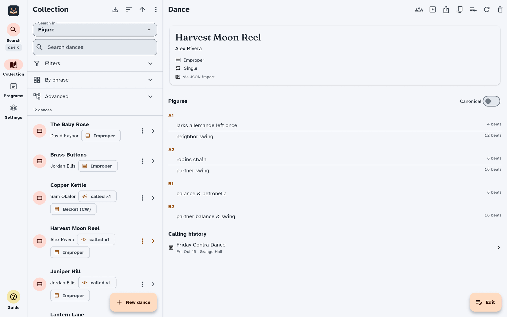

# Dialect: put the app in your own words

Every caller has their own words. This guide shows you how to make Caller's
Compendium speak yours — choosing the role names and phrasing you use, switching
them in a moment, and doing it all without ever changing the dances you have
saved.

A [dialect](./glossary.md#dialect) is your personal choice of role names and
wording — for example **Larks/Robins** or **Leads/Follows** — applied everywhere
the app shows text. It is *your words, your way*. Dialects are the heart of
Caller's Compendium, so it is worth a few minutes to set yours up the way you
like it.

If you are brand new here, start with the [getting-started guide](./getting-started.md)
first, then come back to make the app sound like you.

## Why callers need dialects

Contra has no single vocabulary. One community calls the roles **Larks** and
**Robins**; another says **Leads** and **Follows**; older cards and some regions
use other words again. The same is true of moves — one caller's "shoulder round"
is another's older term for the very same figure.

That variety is wonderful, but it makes a shared library of dances awkward: if a
[dance](./glossary.md#dance) is written down in one caller's words, everyone
else has to translate it in their head. Dialects solve this. You keep every dance
once, and the app shows it to *you* in *your* words — and to the next caller in
theirs — without anyone rewriting anything.

## The big idea: one library underneath, your words on top

This is the single most important thing to understand, and it makes everything
else safe to experiment with.

Under the hood, every dance in your [collection](./glossary.md#collection) is stored
in one shared, neutral form. Your dialect is a layer of wording laid *on top* of
that stored dance when the app draws it on screen. Choosing or switching a
dialect changes only what you see — it never rewrites the dance itself.

That leads to a distinction worth keeping clear:

- **Changing your dialect changes your *view*.** The role names and wording you
  read on the dance card, in a program, and while calling all update to match. No
  saved dance is touched.
- **Editing a dance changes the *dance*.** That happens only in the dance editor,
  when you deliberately change a [figure](./glossary.md#figure), the notes, or the
  title.

Because the stored form never changes when you switch dialects, three good things
follow on their own:

- **Search always works**, whatever words you prefer. If you search using your
  own role names, your own names for the built-in figures, or an older term, the
  app matches it against the shared form for you, so you find the dance either
  way. (Search finds a figure of your own by its own name; see
  [Your own figures](#your-own-figures).)
- **Your data stays portable.** A dance you saved in one dialect opens correctly
  for someone using another, and your [backups](./backup-portability.md) never bake in one set
  of words.
- **Nothing is ever lost in translation.** Switching between dialects — even
  repeatedly, even mid-evening — can't corrupt or reword your saved dances.



*The dance card in the active dialect, with the toggle that switches to shared
canonical wording without changing the saved dance.*

## The dialects that come built in

Caller's Compendium ships with three ready-to-use dialects. You choose one as
your active dialect, and you can add as many of your own as you like.

- **Larks/Robins** — the modern, role-neutral names, and the app's default. If
  you do nothing, this is what you see.
- **Leads/Follows** — another role-neutral choice, ready to pick.
- **Canonical** — the plain, shared wording the app stores underneath (see
  [canonical wording](./glossary.md#canonical-wording)). Handy when you want to
  see a dance in its neutral form (more on this below).

The built-in dialects are deliberately role-neutral. If your community uses other
role names — including traditional gendered ones — you are not stuck: you enter
whatever wording you want yourself, in a custom dialect. The next sections show
how.

## Choose your dialect

1. Open **Settings** and choose the **Dialect** section.
2. In the **Dialects** list, select the one you want to use. The app switches to
   it right away, everywhere.

The built-in dialects carry a **Preset** badge and are read-only, so you can't
change their wording by accident. Your own dialects appear in the same list and
can be edited freely.


*The Dialect section lists the built-in presets and your own dialects, with the
active one selected.*

## Make your own dialect

When none of the built-in dialects match your community, make your own. From
**Settings › Dialect**:

- Choose **New dialect** to start from a clean slate. The app asks for a name,
  then opens the dialect's editor.
- Choose **Duplicate from…** to copy an existing dialect (a preset or one of your
  own). The copy is named after the original with "(copy)" added; open its
  **Dialect actions** menu and choose **Edit terms** to change its wording, or
  **Rename** to give it a name of its own.
- To tweak a built-in dialect in one step, choose **Duplicate to customize** from
  its **Dialect actions** menu. This makes an editable copy, opens it in the
  editor, and leaves the original preset untouched.

The editor has a section for each of the following. The **Preview** section shows
sample figures reworded with your dialect and updates as you type, so you can see
the effect immediately. Choose **Save** when you are done.

### Role names

In the **Role terms** section, set the words for the two roles — for example
**Larks** and **Robins**, or your community's own terms. You can enter both the
singular and plural forms; leave the plural blank and the app works it out for
you. This is also where you would enter traditional or gendered role names if
that is what your dancers use.

### Reworded moves

In the **Move substitutions** section, give individual moves the wording you
say out loud. If you always call a move by a particular name, set it here and the
app uses your wording on every dance that contains that move. For moves that come
in left- and right-handed versions, type `%S` where the side belongs — for
example `%S shoulder round` — and the app fills in "left" or "right" for you, so
you don't have to write two versions. The Collection search bar understands your
names too: searching your name for a move finds every dance with that move.
A name with `%S` in it is the exception; search for the move by its usual
name instead.

### Move wording templates

To reword the whole sentence around a move, not just its name, add a
**Display template** in the **Move wording templates** section. Type your
sentence and put slots such as `{who}` and `{move}` where the app should fill in
the details; the editor lists the **Available slots** for each move and shows a
preview. A template can be up to 512 characters, and can word a move
differently in some cases (see
[Word it differently in some cases](#word-it-differently-in-some-cases)).

- If a template leaves out one of its available slots, the editor asks you to
  confirm before saving, because that detail won't appear on the dance.
- Some slots hide themselves when they add nothing. For example, a chain's
  `{hand}` is left out when the role already implies it (a robins chain is
  right-hand). Put a `!` in front of the slot, as in `{!hand}`, and it always
  shows. A `!` slot can't show a detail the figure doesn't have, and a few
  move-specific slots (such as `{subject}` or `{balance}`) ignore the `!`.
- If a template can't be read — a slot left unclosed, for example — the editor
  says so, and you need to fix it before you can save the dialect.

#### Word it differently in some cases

A template can choose its words from the figure's details. Put the choice in
square brackets that start with `if`:

```text
[if who is neighbors then neighbor swing else {who} swing]
```

reads "neighbor swing" when neighbors swing, and "partner swing" (or whoever
swings) otherwise. The parts are:

- `if` and a **condition**, then `then` and the wording to show when it holds.
- Any number of `else if` … `then` … for other cases, checked in order.
- At most one `else` and the wording for every other case. Leave it out and
  nothing shows when no condition holds:
  `[if prefix is balance then balance and ]{who} swing`.

A condition tests one of the things listed under **A condition can test**
below the field: the move's details, its other slots, and for your own figures
each opposite, such as `otherWho`. You can write:

| To test | Write |
| --- | --- |
| A switch is on, or a detail is filled in | `balance` |
| The opposite | `not balance` |
| A value | `who is robins` |
| Not a value | `who is not robins` |
| One of several values | `who is in (robins, larks)` |
| None of several values | `who is not in (ones, twos)` |
| No value | `hand is empty`, or `hand is not empty` |
| A number | `beats is more than 8`, `is less than`, `is at least`, `is at most` |

Join conditions with `and` or `or`. When one condition uses both, add
parentheses to say which goes first:
`(who is robins or who is larks) and beats is more than 8`.

Write values the way they read on your dances: your role names in this
dialect, dancer words such as "next neighbors", the labels of your own
figures' options, and numbers as digits (a turn can be `1.5`, `1½`, `once` or
`twice`). The app keeps what a condition means, not the words, so renaming a
role or an option later never changes what it tests, and the editor shows it
in the new words.

Only `is not` says "not": `isn't` isn't read. If the app can't read a
condition, the message under the field says what is wrong and how to fix it,
often with the words to write instead, and you need to fix it before you can
save. A few things it explains:

- `who isn't robins`: write `who is not robins`.
- `who is robbins`: there's no such value; did you mean `robins`? The message
  lists every value `who` can have.
- `who is one of robins, larks`: write `who is in (robins, larks)`.
- `who = robins`, `beats > 8`, `&&`: write the words, such as `is`,
  `is more than` and `and`.
- `style is rock and roll`, when a figure has the options "rock" and "rock and
  roll" and a switch called `roll`: it can be read two ways, and the message
  shows both so you can write the one you mean.

The word `else` ends the wording before it. To say "everyone else" inside a
condition's wording, put those words in their own square brackets:
`[if who is ones then [everyone else] swing]`. The editor warns you when it
looks like you meant that.

Square brackets that start with "if" always hold a condition. A template you
saved before conditions arrived, with brackets that start with "if" as
ordinary words, keeps reading as it did: the editor shows those brackets
starting with an empty `[]`, as in `[[]if needed, ]`, which keeps "if" as a
word. Leave the `[]` in place when you change the template. It shows nothing.

Older versions of the app can't read conditions: on a device that hasn't been
updated, a move with a conditional template keeps its normal wording, and one
of your own figures using one is marked **Needs repair** there.

A few moves are worded differently depending on how they are danced, so the
editor gives them a separate template for each version:

- **Form a long wave** has one template each for **In only**, **Out only**,
  **In and out**, and **Neither**.
- **Promenade** has one for **Ordinary** and one for **Single file**.

Fill in only the versions you want to reword; any you leave blank keep the
normal wording. A version you do fill in must use every slot the editor lists
for it before you can save, so a dancer's in or out instruction, or a
single-file promenade, never quietly disappears. A **circle** uses one template
for both forms, and the app adds "single file" for you when a circle is danced
that way.

If you made a long-wave or promenade template before the app split them into
versions, it still applies — but only to the ordinary version (**In only** for a
long wave, **Ordinary** for a promenade).

### Your own figures

While **Custom Figures** is on, both sections also offer your own
[new figures](./settings.md#glossary-and-custom-figures), listed by name after
the moves that come with the app. Give one a name of its own under **Move
substitutions**, or reword it under **Move wording templates**: a new template
starts from the figure's own wording, uses the figure's own parameters as its
slots, and previews with the figure's defaults; leave it as the figure's own
wording and it isn't kept, so a later change to the figure reaches this dialect
too. A name of your own can't fill a `%S`: a figure has no side for it. A
dialect's name for a figure counts as a name taken: none of your other figures
or terms can be given it, and one that already has it is marked **Rename
needed**.

Your dances store each figure in its own wording, and search finds it by its
own name, not by a dialect's name for it: a dialect only changes how the figure
reads. If
a template uses a slot the figure doesn't have, such as after you removed a
parameter, the editor says so and the figure reads with its own wording until
you fix the template. Deleting a figure removes its name and wording from every
dialect.

### Dancer wording

In the **Dancer substitutions** section, reword the way the app refers to *who*
is dancing — for example the words for "neighbors" or "the next couple" — to
match how you phrase things from the stage.

### Discouraged terms

Each dialect keeps a list of [discouraged terms](./glossary.md#discouraged-term)
— words you would rather not use. When you type one of these while writing a
dance, the editor flags it (it shows the word struck through) so you can
reconsider, but it never blocks you or changes your text. The list starts with
some common examples and is yours to edit, add to, or clear; **Restore defaults**
brings back the starting list.

Separately, the app updates a fixed set of common older terms whenever it shows
you a dance: "gypsy" and "gyre" read as "shoulder round", and older role words
such as "gents", "ladies", and "ravens" read as your dialect's role names. This
applies to dance details (including formation notes, tunes, and custom-field
values), shorthands, Perform mode, and text and PDF exports. Titles always show
exactly as written. Editing your discouraged-terms list doesn't change which
words are converted.

This conversion is on by default. To see the words exactly as they were saved,
turn off **Auto-convert all discouraged terms** in **Settings › Dialect › Dance
details & shorthands**. Either way, it only changes what you see: your saved
dances, notes, search, shared files, and backups are never altered.

Text you write in the [Glossary](settings.md#glossary-and-custom-figures) — your
own figures and your notes on built-in figures — is the exception: those older
terms are saved in today's wording as you save it, so "ladies chain" is kept as
your dialect's role, and a later dialect change shows it in the new one. A word
your own dialect uses as a role name, such as "ravens" in a Ravens and Crows
dialect, is kept as that role.

> **The app watches for clashes.** If two different things would end up with the
> exact same wording, the editor warns you right away, because that would make it
> impossible to tell them apart later. Adjust one of the words and the warning
> clears. You can't save a dialect with an unresolved clash.

## Switch dialect on the fly

You don't have to visit Settings every time. On the dance card and in
[Perform mode](./glossary.md#perform-mode) there is a **Switch dialect** control
— a group-of-people icon — that changes your active dialect instantly. On a
narrow screen the dance card lists your dialects in its **More actions** menu
instead.

Choose it, pick a dialect from the list, and the whole app switches to those
words at once. This is built for real evenings: guest-calling for a community that
uses different role names, or switching wording between gigs, takes a moment and
leaves every saved dance exactly as it was.

Remember the distinction: **Switch dialect** changes *how dances read for you*, not
the dances themselves. Switch as often as you like.

## Give a program its own dialect

If you already know tonight's hall uses a particular dialect, you can set it on
the program ahead of time instead of switching on the night. Open the program's
details and choose a dialect under **Perform dialect**; choose **Use app
dialect** to clear it again. The list only offers the dialects you have, so there
is nothing to type.

- The program's dialect applies only in that program's
  [Perform mode](./glossary.md#perform-mode). The program editor, the summary,
  and every export keep reading in your active dialect, and your active dialect
  itself never changes. Other programs are unaffected.
- You can still use **Switch dialect** in Perform. While the program has its own
  dialect, that switch affects the rest of this time in Perform only; the
  program's dialect is back the next time you open it.
- A program remembers the dialect by its **name**. If you rename that dialect,
  every program that uses it, including ones in Recently deleted, follows the
  new name. If you delete it, the program quietly goes back to using your active
  dialect in Perform, and the editor shows the old name as **unavailable** so you
  can see what happened. Pick a dialect again to reconnect it.

## Peek at the canonical wording

Sometimes you want to see a dance in the plain, shared wording — to compare notes
with another caller, or to double-check what a figure really is underneath your
own phrasing.

On the dance card, the **Canonical** switch (read out by screen readers as
**Show canonical terms**) flips the current view between your dialect and the
shared canonical wording. It appears only after you turn on **Canonical figure
text** in **Settings › Dialect › Dance details & shorthands**; while that setting
is off, dance details stay in your active dialect. The switch changes only what
is on screen right then — it doesn't change your active dialect or touch the
saved dance. When your active dialect is already **Canonical**, the switch isn't
shown, because there would be nothing to switch between.

In Perform mode, choose **Canonical** under **Switch dialect** instead. It
doesn't depend on the **Canonical figure text** setting, and you keep your place
in the dance or program. Unlike the dance card's switch, this does change your
active dialect, for the whole app, unless the program has its own dialect — so
switch back afterwards. See the [Perform mode guide](./perform.md) for the full
calling view.

## Set your defaults

These settings decide what you see before you touch anything:

- **Your active dialect** (in **Settings › Dialect**) is the wording every screen
  uses by default — except [Perform mode](./glossary.md#perform-mode) for a
  program that has its own dialect (see
  [Give a program its own dialect](#give-a-program-its-own-dialect)).

The rest are in **Settings › Dialect › Dance details & shorthands**:

- **Canonical figure text** controls whether dance details can show canonical
  wording at all. It is off by default.
- **Auto-convert all discouraged terms** controls whether common older terms are
  shown in current wording, as described under
  [Discouraged terms](#discouraged-terms). It is on by default.
- **Open dance details in canonical terms** decides whether a dance opens showing
  your dialect or the canonical wording. It takes effect only while **Canonical
  figure text** is on; while that is off, dances open in your active dialect and
  the app remembers this choice for later.

If an earlier version of the app was set to open dances in canonical terms, that
choice was reset to your active dialect when **Canonical figure text** arrived.
To get it back, turn on **Canonical figure text**, then **Open dance details in
canonical terms**.

For a full tour of everything under Settings, see the
[Settings guide](./settings.md).

## Practical scenarios

**Guest-calling for another community.** You usually call Larks/Robins, but
tonight's crowd says Leads/Follows. Before you start, open **Switch dialect** on the
dance card or in Perform and choose **Leads/Follows**. Every dance now reads in
that community's words. Afterwards, switch back — none of your dances changed.

**Your community's own words.** Your dancers use role names that aren't built in.
Make a custom dialect once (**Settings › Dialect › New dialect**), enter your role
names and any moves you say differently, and set it active. From then on the whole
app speaks your language.

**Bringing in dances written in older words.** When you [import](./imports.md)
dances, they may use terms that have since fallen out of use. The app
understands the common older words and matches them to the shared form, so those
dances still appear in your dialect and still turn up in search — no clean-up
required.

**Comparing a figure with another caller.** Mid-conversation, flip the
**Canonical** switch on the dance card to read the dance in neutral wording you
both recognise, then flip back to your own.

## Good to know

- **Printing and sharing.** Text you copy or share, and a PDF you print, are
  written in your **active** dialect, so what you hand someone matches how you
  speak. The on-screen **Canonical** switch changes only what you are looking at
  — it doesn't change what an export contains. To export in different words,
  switch your active dialect first. A share file you send to another Caller's
  Compendium user carries the dance itself, so it opens in *their* dialect. See
  [Share, print & export](./sharing.md#which-words-a-dance-export-uses).
- **Screen readers.** The app reads dances aloud in your dialect too — your own
  words are the clearest ones for you — so the spoken view and the visible view
  stay in step. See the [accessibility guide](./accessibility.md) for more.
- **It stays on your device.** Your dialects are stored on your device, and
  there is no account. If you turn on the experimental
  [Device Sync](./settings.md#device-sync), your own dialects and your choice of
  active dialect sync to your other connected devices along with your library.

## Where to go next

- [Getting started](./getting-started.md) — find your way around the app.
- [Perform mode](./perform.md) — call live, with the dialect switch (Canonical
  included) close at hand.
- [Settings](./settings.md) — where the dialect manager and display defaults live.
- [Collection & search](./collection.md) — searching works whatever dialect you
  use.
- [Imports & migration](./imports.md) — bring in dances written in other words.
- [Share, print & export](./sharing.md) — which words leave the app with a dance.
- [App terms](./glossary.md) — plain definitions of the terms used here.
