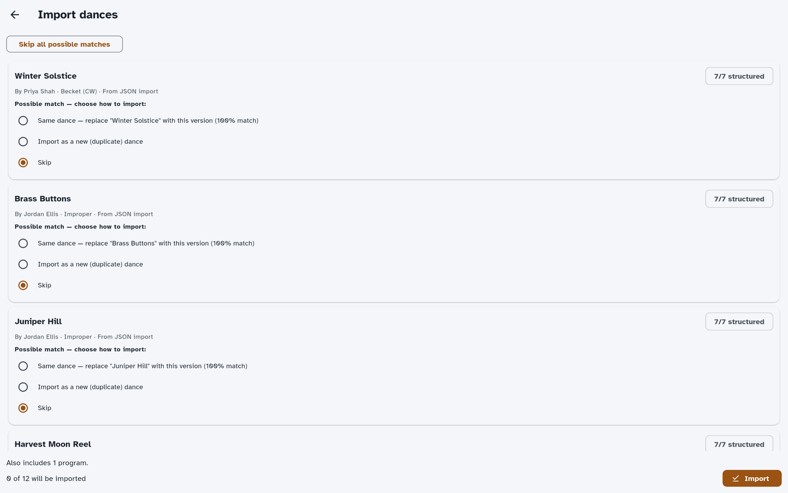

# Imports & migration

This guide is about getting dances *into* [Caller's Compendium](./glossary.md#callers-compendium)
and moving your whole library between devices. It covers bringing in single
dances from [The Caller's Box](./glossary.md#the-callers-box) and
[ContraDB](./glossary.md#contradb), bringing in your own spreadsheet or typed
notes, importing signed published collections and
Caller's Compendium files, moving a whole library across from Caller's Companion,
and backing up and restoring everything you own.

> **Finding your way around these words.** On-screen buttons and screens are
> written in **bold** — like **Settings**, **Import…**, and **Choose file…**. The
> first time a dance term appears it links to [App terms](./glossary.md), so
> you can get a plain-language definition without losing your place.

## Your data stays yours

Caller's Compendium is **local-first**. Your [collection](./glossary.md#collection)
lives on your own device, the app works fully offline, there is no account to
create, and nothing you do is sent anywhere for tracking. Importing and
exporting are the doors your dances walk through — the ways you bring
material in from the wider community and carry your own library from one machine
to the next. Nothing leaves your device unless you ask for it (an online search
or a single dance import reaches out once, when you tell it to), and nothing
changes your collection until you say so. Turning on an automatic option —
the [update check](./settings.md#updates), or the
[calendar import at startup](./settings.md#calendar) set to add drafts — is
saying so: it runs only once you switch it on.

## Nothing gets lost when a dance comes in

Every import follows one promise: **bringing a dance in never loses the dance.**

When the app reads a dance from another source, it recognizes the
[figures](./glossary.md#figure) it can and turns them into structured moves you
can search and rework. Anything it does not recognize — an unusual phrasing, a
complicated sequence, a note the choreographer tucked into a line — is kept
word-for-word as a plain-text figure instead of being dropped. A dance can
arrive entirely as plain text and still land safely in your collection, still be
searchable, and still be yours to tidy up later. You are never left wondering
what the app quietly threw away, because it throws nothing away.

The app also *shows* you where that happened. A figure kept word-for-word carries
a small warning glyph beside it — on a dance card, in the editor, and in Perform.
Hover it on a desktop, or select it on a touchscreen, and it explains itself:
**Couldn't recognize this call — kept exactly as written as an
unrecognized figure.** It is a shape, not just a color, and it is announced to screen
readers, so you can find the lines worth tidying up whichever way you read.

There is nothing wrong with leaving them as they are. A verbatim figure calls
perfectly well; the badge just tells you the app cannot search or count beats for
that line the way it can for a recognized move.
Once you rewrite such a figure's text yourself in the editor, it is your own
wording: the badge goes away, and **Re-check unrecognized figures** leaves it as
you wrote it.

## Bring in single dances from an online archive

Caller's Compendium can reach two community archives —
[The Caller's Box](./glossary.md#the-callers-box) and
[ContraDB](./glossary.md#contradb) — two ways: a live **online search**, and
importing a single dance **by its link or ID number**. Both need an internet
connection, and both bring in **one dance at a time** so you can look before you
keep.

### Search an archive online and import a dance

1. Open **Collection**.
2. Tap the **Online search** icon at the end of the row of search tools above
   the dance list. (Your local filters do not apply while online
   search is on — you are searching the archive, not your own library.)
3. Choose which archive to search — **The Caller's Box** or **ContraDB** — from
   the online source selector.
4. Choose **Title**, **Author**, or **Figure** in the **Search in** menu, then
   type in the search box. Results appear as you type. With The Caller's Box you
   can also narrow by the figures a dance contains, using the same **By phrase**
   panel as a local search. The
   [Collection & search guide](./collection.md#search-across-your-dances)
   explains how each option matches. Curly and straight apostrophes and quotes
   (`’` and `'`, `“”` and `"`) and the different dashes count as the same, so
   type them however your keyboard does. Accented letters must still be typed
   with their accents (`Déjà vu`, not `Deja vu`), but upper or lower case
   doesn't matter. With ContraDB you can instead (or as well) use the
   **Advanced** panel to find dances by the figures they contain; a dance
   must match both the Advanced query and any text you typed. See the
   [Collection & search guide](./collection.md#search-across-your-dances) for
   what ContraDB can and cannot run.
5. Select a result to open a **preview** of that dance. While the dance is
   loading you can choose **Cancel** (or press Back) to stop waiting and return
   to your results.
6. If it is the one you want, choose **Import** to add it to your collection.
   The message that confirms it offers **Undo** while it is showing. Undo takes
   the dance back out, or, if you chose **Same dance (update existing)** for a
   dance you already had, puts your own version back. In that case the message
   says **Updated** rather than **Imported**, because nothing new was added. A dance you have since
   added to a program, or changed, is kept as it is.

**Caller's Box results only include dances whose figures it will share.** Not
every dance in The Caller's Box has its choreographer's permission for the
figures to be shown — for some, the Box can search the figures but not display
them. Those dances would come in as a title and a formation with no figures at
all, so a Caller's Box search leaves them out. About three in ten of the dances
matching a typical search are affected, so if a dance you know is in the Box
does not appear, this is the likely reason. You can still bring such a dance in
deliberately by [importing it by link or ID](#import-a-dance-by-link-or-id) —
you will get its title, formation, and notes, and the review screen will tell
you the figures were not available. ContraDB has no such restriction, so nothing
is left out of a ContraDB search.

If the dance is already in your collection from an earlier import, the app tells
you so and does not add a second copy — see
[Avoiding duplicates](#avoiding-duplicates) below.

### Import a dance by link or ID

If you already have a dance's web address — or even its number — you can import
it directly:

1. Open **Settings**, choose **General**, and choose **Import…**.
2. In the source selector, choose **The Caller's Box** or **ContraDB**.
3. Paste the dance's **web address** — for The Caller's Box a `dance.php?id=…`
   link, for ContraDB a `…/dances/N` link — or enter its **ID number** (for
   example `1`) in the address field, then choose **Fetch**. Paste a recognized
   address and the app selects the matching source for you.
4. Review the dance and commit it, as described in
   [Review before anything changes](#review-before-anything-changes).

A few honest notes about these online imports:

- They bring in **one dance at a time** and need an internet connection.
- The app reads each archive's public dance page, so it depends on how that page
  is laid out; if a page changes or a dance has no figures listed, the dance
  still comes in with whatever the app could read (its title, formation, and
  notes), following the *nothing gets lost* promise above. This applies to the
  link-or-ID route described here — it is deliberately how you can still bring
  in a Caller's Box dance whose figures the Box will not share, even though
  online search leaves those out.
- Figures come in as recognized moves where the app can read them and as
  plain-text figures otherwise, the same as every other import.
- To have every dance you import on its own tagged automatically — a "no card"
  tag, say — choose the tags under **Settings ▸ Defaults ▸ Import defaults**.
  See [Settings](./settings.md#import-defaults).

### What the app will and won't fetch

Anything you paste is treated as untrusted, because a link can point anywhere.
When you give the app a web address to fetch:

- **It must be `https`.** A plain `http` address is refused rather than fetched
  over an unencrypted connection, and a redirect that tries to drop back to
  `http` is refused too.
- **It must be a real place on the internet.** Addresses that point back at your
  own machine or your local network are turned away with *That URL points to a
  network location that cannot be imported from.*
- **It must belong to the source you chose.** A Caller's Box import accepts links
  from `ibiblio.org` or `www.ibiblio.org`, under that site's
  `/contradance/thecallersbox/` path — an `ibiblio.org` link outside that archive
  is not a Caller's Box link. A ContraDB import accepts links from `contradb.com`
  or `www.contradb.com`. Paste a link from anywhere else and you get a plain
  message naming what does work — or you can skip the link entirely and type the
  dance's ID number. This holds for the *whole* fetch, not just the address you
  typed: if an archive forwards the app somewhere else, that new address has to
  belong to the same source too, or the import stops there. A forward that leaves
  the source is turned away with the same general message as any other address the
  app won't fetch from, rather than one naming hosts — by that point the address
  came from the archive rather than from you, so there is nothing for you to
  retype.
- **Redirects and size are capped**, so a link cannot bounce the app around
  indefinitely or hand it an endless download.

Refusals never echo the address back at you, so a link that happened to contain
something private does not end up on your screen or in a log.

A [calendar address](./programs.md#import-programs-from-your-calendar) follows
the same rules, except that it may be on any host — it is your calendar, not an
archive. A `webcal://` address is fetched as `https://`.

## Import a published collection

Published collections are curated dance collections delivered through the
trusted Compendium Analect catalog. They are signed and checked before the app
offers them for import, and the app records their source and version so you can
see where the dances came from.

1. Open **Collection** and choose **Import dances**, choose **Browse published
   collections** on the card that shows while the sample dance is your only
   dance, or open **Settings** ▸ **General** ▸ **Import…**.
2. Under the source selector, choose a published collection to review its
   title, version, dance count, and availability. You can also browse the same
   catalog from **Settings** ▸ **General** ▸ **Published collections**.
3. Select **Import collection** and review what it contains.
4. Confirm the import when you are ready. Nothing is added until you commit it,
   and the same review flow lets you skip items you do not want.

The catalog shows only the newest version of each collection, and a version
older than the one you already imported cannot be imported from the catalog.

Importing a newer version of a collection you already have offers
**Re-import onto** for its dances, which updates only their figures, formation
and progression (with the dance form, meter and key they need), as for any other source (see
[Re-import an archive dance to pick up a correction](#re-import-an-archive-dance-to-pick-up-a-correction)).
A corrected title or credit in the new version reaches a dance you already have
only if you tick **Also update title and credit** on its row; a corrected note
never does.

If the catalog or a collection cannot be loaded, the message tells you which of
four things happened: the catalog **could not be reached** (check your
connection), it **needs a newer app version** (update the app), it **could not
be verified** (its signature did not match a key this app trusts; if it keeps
happening, update the app, because the catalog may have moved to a newer
signing key), or it is **temporarily unavailable** (it failed another safety
check, so nothing was imported). Choose **Try again** to run it again without leaving
the screen (it is not offered when the catalog or collection is in a format
only a newer app can read). Failures are
recorded in **Settings** ▸ **Diagnostics**.

## Bring in a list of dance titles

If you have a list of titles written down — an evening's set list, a workshop
handout, dances a friend recommended — you can paste the whole list at once and
let the app find them, **without** building a program.

1. Open **Collection** and choose **Import dances**, or open **Settings** ▸
   **General** ▸ **Import…**.
2. In the source selector, choose **a list of titles**.
3. Paste your titles, **one per line**, and choose **Review import**.
4. The app checks each title against your own collection first, then searches
   The Caller's Box for anything you don't already have.
5. Review what it found and commit, as described in
   [Review before anything changes](#review-before-anything-changes).

**Every title you pasted is listed on the review screen**, grouped by what
happened to it:

- **To import** — the app found one dance with exactly that title. These get the
  usual review row, so you can look before you keep, change what each one does,
  or skip it.
- **Already in your collection** — you have it. There is nothing to import, so
  the app tells you which dance it matched and who wrote it, since two different
  dances can share a title.
- **Not found** — and it says which kind of "not found": the archive has no dance
  by that name, it only found near matches, several dances share that exact
  title so it can't tell which you meant, or it couldn't reach the archive just
  then. Those need different follow-up, so they are never lumped together.

A few honest notes:

- The app only takes a dance when **exactly one** result matches your title
  exactly. Near matches are never imported on a guess.
- The Caller's Box search it uses leaves out dances whose figures the Box will
  not share, so a title only held by one of those comes back as **not found**
  rather than arriving with no figures. You can still bring such a dance in
  deliberately by [importing it by link or ID](#import-a-dance-by-link-or-id).
- Nothing is written until you commit on the review screen, and an uncertain
  match is set to **Skip** by default, so a paste can never quietly duplicate
  something you already have.
- Blank lines are ignored, and a title repeated in your list is only looked up
  once.
- It works through the list one title at a time, showing its progress, and you
  can **Cancel** at any point — nothing has been added yet, so canceling costs
  you nothing.
- If the app can't reach The Caller's Box (you're offline, or the connection
  hangs), it **stops after the first failure** instead of trying every title, and
  says so once at the top of the review. The titles already in your collection
  are still listed; paste the rest again once you're online.
- There is a limit of **100 titles** per import. A longer list is refused
  outright rather than partly imported, so you are never left thinking a list
  came in whole when it didn't.
- Even if nothing turns out to be importable, you still get the answer to
  "which of these do I already have?" — that list is worth having on its own.

## Bring in your own spreadsheet

If you keep your dances in a spreadsheet — a title, an author, a formation, a
column of figures, some notes — you can bring them in without retyping them.

1. In Excel, Numbers, LibreOffice or Google Sheets, save the sheet as a
   [CSV file](./glossary.md#csv-file): choose **File ▸ Save As** (or
   **Download**) and pick **CSV UTF-8**.
2. Open **Settings**, choose **General**, choose **Import…**, and set the source
   to **Your own spreadsheet (CSV)**. Choosing a `.csv` file with **Import…**
   switches to it for you.
3. Choose the file with **Choose a CSV file…**, then **Continue**.
4. **Map the columns.** The app shows each column with a few of its values and
   asks what it holds:
   - Title (needed: **Continue** waits until one column is the title);
   - Authors, Type, Formation, Progression, Level, Status, Mixer, Tags, Tunes,
     Meter, Key, Hook, Calling notes or Walkthrough;
   - **Figures**, either one column with one figure per line (or several
     separated by `;`), or one column per phrase (**Figures, A1**, **Figures,
     A2** and so on);
   - one of your [custom fields](./glossary.md#custom-field), or a **new custom
     field** of the type you choose, named after the column;
   - **Ignore**, to leave the column out.

   A column whose first-row name matches a field, in the app's language or in
   English, is chosen for you; you can change any of them. The app also works
   out what separates the columns (a comma, or the semicolon Excel uses in
   Danish, German, French and Dutch) and whether the first row names the
   columns; change either if it guessed wrong.
5. Review and commit, as for any import (see
   [Review before anything changes](#review-before-anything-changes)).

How the values come in:

- **Figures** are read the way the app reads typed figures. A line it can't
  read comes in as an unrecognized figure with your words, never dropped.
- **Authors** are matched to the authors you already have, or added.
  Several in one cell can be separated by commas or "and". To keep a comma
  inside one author's name, write `\,` (the app's own export does) and a
  backslash `\\`; a backslash before anything else is read as it is. A name
  that itself holds "and", "with", `&`, `/`, `+` or `;` is still split there.
- **Tags** are separated by commas, matched to your tags by name, and added
  when new. Your **Import defaults** tags are added too. To keep a comma inside
  a tag, write `\,` (the app's own export does); a backslash is written `\\`,
  and a backslash before anything else is read as it is.
- **Tunes** are separated by commas, semicolons or line breaks, and read the
  same way: `\,` keeps a comma in a tune's name. There is no way to keep a
  semicolon or a line break inside one tune name.
- **Level** is matched to your difficulty levels by name.
- **Numbers** are read as you would type them, with one exception: in a sheet
  separated by semicolons (what Excel saves in Danish, German, French and Dutch)
  a comma is the decimal mark and a dot or a space groups thousands, so `3,5` is
  3.5 and `1.000` is one thousand. A number the app can't read either way, such
  as `1,234.5` in such a sheet, goes into the calling notes rather than being
  guessed. A number with a dot that doesn't fit that pattern, such as `1.5` or
  `0.500` (a leading 0 is never a thousands group), is read as a decimal.
- A choice field takes the option you already have whatever case, surrounding
  space or accent form the cell uses (`café` typed as `e` plus an accent still
  matches `café`). A cell with nothing visible in it adds no option.
- A value that doesn't fit its field — a formation or level the app doesn't
  know, or text in a number field — goes into the dance's **calling notes**,
  with a note on the review row, so nothing is lost.
- When two columns are set to the same field, the first value that fits fills
  it and the other goes into the calling notes. A new custom field counts as
  one of yours with the same name and type, and two new ones with the same
  name and type are one field. Two columns for the same phrase of **Figures**
  are both kept, one after the other.
- A dance from your own spreadsheet records **no source**, just like one you
  typed in. If you import the same file again, the dances you already have show
  up as possible matches by title and author, and default to **Skip**.

A spreadsheet the app exported (see
[Export dances as a spreadsheet](./sharing.md#export-dances-as-a-spreadsheet-csv))
comes back in with its columns already chosen.

If the file can't be read, the app says why and nothing is imported: it isn't
saved as UTF-8 (save it again as **CSV UTF-8**), it is too large, it has more
than 20,000 rows or more than 200 columns, a cell is longer than 65,536
characters, or a quoted cell never ends. A file with more than 500 rows is
fine, but the app mentions that reviewing it may take a while.

## Bring in dances you typed up

If you keep your dances as notes in a text file, or in Markdown, you can bring
them in without retyping them. Write each dance like this:

```
## Rory's Reel

by Pat Example
Formation: Improper
Music: Any reel

- A1 (8) Neighbor balance & swing
- (8) Long lines forward and back
- A2 (16) Partner swing

Watch the chain at the top.
```

1. Save the notes as a `.txt` or `.md` file, as UTF-8 text (most editors do
   this already).
2. Open **Settings**, choose **General**, choose **Import…**, and set the source
   to **Your own text or Markdown file**. Choosing a `.txt` or `.md` file with
   **Import…** switches to it for you.
3. Choose the file with **Choose a text or Markdown file…**, then **Continue**.
4. **Map labels.** If your file has headings, **Each dance starts at** shows
   where the app found each dance: at a heading level (**A # heading**,
   **A ## heading**, …) or at **A title after a blank line**. If the dances
   came out split or merged wrongly, choose another and the file is read again.
   Each label your file uses (`Formation`, `Music`, …) is shown
   with a few of its values, as a spreadsheet's columns are (see
   [Bring in your own spreadsheet](#bring-in-your-own-spreadsheet)). A label
   that names a field, in the app's language or in English, is chosen for you.
   Any other label is set to **Calling notes, with the label**, so `Music: Any
   reel` comes in as that line in the dance's calling notes. Choose **Ignore** to
   leave a label out.
5. Review and commit, as for any import (see
   [Review before anything changes](#review-before-anything-changes)).

How the file is read:

- **Where a dance starts.** The app guesses, and you can change its guess in
  **Each dance starts at** (step 4). Headings at the chosen level start dances
  and are their titles. A deeper heading (`## Figures`, `## Notes` under a `#`
  dance) is a part of the dance, and its lines come in with it. A shallower
  heading with no figures under it, such as `# My dances` at the top or
  `# Squares` above a group, is a title for the file and is left out; any
  details or text under it go into the calling notes of the dance after it.
- **A file without headings**, or with **A title after a blank line** chosen:
  the first line, and each line after a blank line, is a dance's title, unless
  it starts like a figure (`-`, `1.`, `A1`, `(8)`) or is a detail line before
  the dance's figures. A heading also starts a new dance, and a line of `---`
  (or `***`, `___`) counts as a blank line. So a note after a blank line
  starts a new dance; keep notes straight under the dance's lines. One
  exception: in a file with a single `#` heading whose dance has details or
  figures, a paragraph of prose after it (more than one line, or ending with
  `.`, `!` or `?`) with neither is that dance's note. A single `#` heading at
  the top with nothing but text under it is the file's title and is left out;
  its text goes into the notes of the dance after it.
- **Details** are `Label: value` lines, with a label of up to three words.
  `**Formation:** Improper` and a full-width colon (`：`) work too; a label
  needs a letter in it, so `10:30 start` is a note.
  `by Pat Example` and `Author: Pat Example` both fill **Authors**; a `by` line
  counts only above the dance's figures and notes. A web address is not a
  label.
- **Figures** are lines that start with a list marker (`-`, `*`, `1.`), a phrase
  (`A1`) or a count (`(8)`, or `8` within a dance), and any line straight after
  one, so a figure that wraps onto a second line stays one figure, even with a
  colon in it. A detail written as a list item (`- Formation: Improper`) is a
  figure line too, so write details without a list marker. They are read the way the app reads
  typed figures, phrase and count included. A line it can't read comes in as an
  unrecognized figure with your words, never dropped.
- **Anything else** goes into the dance's calling notes, as written.
- Markdown is read as plain text apart from headings and list markers, so
  `**bold**` and links come in as you typed them.
- A value that doesn't fit its field, such as a formation the app doesn't know,
  goes into the calling notes with its label, with a note on the review row. A
  formation is matched by its name in the app (**Improper**, **Becket (CW)**).
- As with a spreadsheet, a dance from your own file records **no source**, and
  importing the file again shows the dances you already have as possible
  matches, defaulting to **Skip**.

If the file can't be read, the app says why and nothing is imported: it isn't
saved as UTF-8 text, it is too large, it has more than 19,999 dances or more
than 197 different labels, or a line, or one dance's figures, notes or details,
is longer than 65,536 characters.

## Import a Caller's Compendium file

Dances shared as a **Caller's Compendium** file (the app's own `.json` or
`.ccshare` format) come in through the same review flow:

1. Open **Settings**, choose **General**, and choose **Import…**.
2. Set the source to **a Caller's Compendium JSON file**. If you choose a
   `.ccshare` file in the next step, the source switches to this one for you.
3. Choose the file with **Choose file…**, paste its contents, or enter a URL and
   choose **Fetch**.
4. Review and commit.

This is the format the app uses for sharing between callers and for the whole
library backup described next. Importing a file **adds to** your collection
through the review queue; it does not replace what you already have. To move an
entire library and replace what is on a device, use **Restore** instead — see
below.

A file made by a **newer version** of Caller's Compendium can still be reviewed
and imported, but this version only understands the details it already knows
about. The review then shows one warning, *"This was made by a newer version
of Caller's Compendium. Update the app before importing, or some details may be
left out."* Update the app first if you want everything that file carries.

If the app can't read the file you chose, it says why and nothing is imported:
either the file isn't a share file or text the app can read (another app
saved it as text in a different encoding: save it again as UTF-8), or the file
can't be opened
(another app is using it, or it is on a drive that isn't connected).

### Open a dance someone shows you as a code

Another caller can show you a dance as a QR code on their screen
(**Show code**, described in
[Share, print & export](./sharing.md#show-a-dance-as-a-code)). To add it to your
collection:

1. Point your phone's own camera app at the code: the iPhone **Camera**, or the
   Android camera or **Google Lens**.
2. Tap the link it offers. Caller's Compendium opens on the dance in the same
   review as a file someone sends you (see
   [Review before anything changes](#review-before-anything-changes)).
3. Review and commit. Nothing is added until you do, and **Undo** removes it
   afterwards.

Opening a code this way doesn't use Caller's Compendium's camera access, and it
needs no network.

On a phone or tablet you can also scan the code from inside the app: open
**Import…**, choose **Scan a dance code**, and photograph the code. On iPhone
and iPad the system asks, the first time, whether the app may use the camera;
on Android your phone's own camera app opens, and the app needs no camera
permission. The code is read on your device and opens the same review; the
photo is deleted as soon as the code has been read, or straight away if no code
is found, and the app never adds it to your photo library. On Android, some
phones' camera apps also keep their own copy in the gallery; the app can't stop
that, so delete it from the gallery, or look in the camera app's settings, if
you don't want it. If you said no to the
camera on iPhone or iPad, turn it on again in the Settings app, under
**Caller's Compendium**. If Android closes the app while the camera is open,
that photo isn't read; the app deletes it the next time you scan a code or
start the app. Scan the code again.

On any device, including a computer, **Dance code from a picture…** opens a
code from a picture you already have: a photo of it, or a screenshot someone
sent you. On iPhone, iPad and Android the copy the picker makes for the app is
deleted once read; your own picture is left as it is. On Android, if the app says
the picture couldn't be read and the picture is kept only in the cloud (in a
photo or file app that hasn't downloaded it yet), save it to your device
first, then choose it again.

Any QR code can be scanned or chosen, but only a dance code is opened: a code
holding a web address or anything else is refused, and nothing is fetched. If
no code is found, try again with the whole code in the picture and sharp.

If your camera app shows the link but won't open it, copy the link, open
**Import…**, and paste it into the URL field (then choose **Fetch**) or into the
text field (then choose **Review import**). That works on a computer too, if
someone sends you the link as text. The link is read on your device; nothing
is fetched.

If the app can't read a code, it says why and nothing is imported: a code made
by a **newer version** of Caller's Compendium asks you to update the app, and a
code that is damaged or was read only in part says so. So does a code that
isn't a dance code, or one with no dances or programs in it. Ask for the code
again, or for **Share dance file** instead. A code made by a newer version whose dance
this version can read still opens, with the same newer-version warning as a
file.

### Open a shared program someone sent you

If another caller shares a **program bundle** with you — the
**Share program and dances** file described in
[Share, print & export](./sharing.md#share-a-program-with-its-dances) — you can
often open the file directly:

- **Mac, iPhone, or iPad:** open the `.ccshare` file wherever it arrives, or
  send it by AirDrop.
- **Android:** open a `.ccshare` or `.json` file with **Open with**, or send it
  to the app from another app's **Share** menu. Android doesn't know the
  `.ccshare` type, so the app also appears for other files of unknown type;
  if you open something that isn't a share file, the app says so and imports
  nothing.
- **Windows:** if you installed the app with the installer, double-click the
  `.ccshare` file, or pick Caller's Compendium under **Open with**. The portable
  copy doesn't register the file type.
- **Linux:** open the `.ccshare` file with Caller's Compendium once the file
  type is set up (see [Installing on Linux](./installation.md#install-on-linux));
  you can also run the app with the file's path, for example
  `./CallersCompendium-*.AppImage "Contra Night.ccshare"`.
- On Windows and Linux, if the app is already open, the file opens in the
  window you have. If you open more files while one is in review, the app
  keeps only the last one and shows it when you close that review. Only a `.ccshare` file stored on this computer opens this
  way. For a file on a network share (a `\\server\folder` path), a
  symbolic link to a file or, on Windows, a file inside a folder that is a
  symbolic link or junction, the app says it couldn't read the shared file:
  copy the file itself to a local folder first.
- **Any device**: go to **Settings ▸ General** and choose **Import…**, then
  pick the file.
  On Android the file picker lists every file of unknown type as well as share
  files, so choose the one you saved.

Opened directly, the app launches and takes you straight to the same review
screen a manual import uses, already loaded with what the file contains — the
program, its dances, and its venue.

Nothing is added until you confirm. You review the bundle exactly as you would any
other import, decide what to bring in, and commit. The same summary as any
other import follows: what happened to each dance and to the program, anything
that could not be imported, and any note, such as a link to a related dance
that was left out. It offers **Undo** until you choose **Done**. The dances it
adds get your [default import tags](./settings.md#import-defaults), next to
the tags the sender gave them.

A full **backup** opened this way is not imported: the app says it is a
backup, and that **Settings ▸ General ▸ Restore from a backup** is where to
bring it in (see [below](#move-your-whole-library-backup-and-restore)).

This intake is deliberately safe. The file is treated as untrusted input: it is
size-checked *before* being read, validated against the expected format, and a
file that fails any check is turned away with a plain message and nothing is
written. It is also **identity-first** — dances you already have are matched rather
than duplicated, brand-new material is added, and nothing is ever deleted. A
program always arrives as a new one, as a **Draft** with no performed marks or
event date, even when you already have a copy: your own copy is never
overwritten (see
[Share a program with its dances](./sharing.md#share-a-program-with-its-dances)).

#### Figures in a shared file

A shared file also carries any of the sender's
[own new figures](./authoring.md#your-own-figures) its dances use. With
[Custom Figures](./settings.md#glossary-and-custom-figures) on, once you have
imported the dances the app shows **Figures in this file**, so you can choose
what to add to your Glossary:

- **New to you**: figures you don't have. Each is ticked; untick any you don't
  want.
- **Different from yours**: figures you have, which the sender's version
  changes. **Keep mine** is chosen, and the dances you imported then show the
  figure your way; **Use theirs** replaces yours with theirs, keeping your
  notes on it.
- **Added as a copy**: figures whose id this device has used before, for
  another entry or a figure you deleted. Each is added under a new id, and the
  dances you just imported use the copy.
- **Already in your Glossary**: figures you have, unchanged. Nothing to do.

A figure whose name is already taken here is added all the same, and your
Glossary marks it **Rename needed**. A dance whose new figure you don't add
shows the line it was shared with. **Skip** adds nothing. The **Undo** after the
import also takes back what you added or replaced here. With Custom Figures
off, nothing is offered, and the dances show each figure as the line it was
shared with.

## Bring your library across from Caller's Companion

Moving from **Caller's Companion**? Caller's Compendium can read its exported
`.USR` library file and bring your material across in one pass:

1. Open **Settings**, choose **General**, and choose **Import…**.
2. In the source selector, choose **a Caller's Companion .USR file**.
3. Choose your `.USR` file when the app asks for it. Files over **256 MiB** are
   refused; a typical Caller's Companion library is around 20 MB, far below that.
4. Review and commit, as described in
   [Review before anything changes](#review-before-anything-changes).

A `.USR` import brings across both your **dances** and your **program history**
(Caller's Companion "sets"), and — like every other import — it is reviewable
before it commits and undoable right after. Dances and programs you have imported
before are recognized and offered as updates rather than duplicated. A dance
you bring in early with **Import and edit** still takes its place in your
programs and related dances when you then import the rest of the file (one you
re-imported that way gets no new related-dance links, as with any re-import). The review
says how many programs the file includes, and they are imported even when you
leave every dance at **Skip** — so importing a fresher export just to pick up new
sets works when you already have all its dances.

Each program is named the way Caller's Companion names the set, by its date and
location: "2024/04/20 - NEFFA Contra Party". A set with no location is named by
its date alone, and one with no date, or a date the app cannot read, by its
location. With no location and a date the app cannot read, it is named
"Caller's Companion set" and the date as written; with neither, "Caller's
Companion set" and its number. Importing a set again renames its program the same way.

A slot keeps the name of the caller Caller's Companion recorded for it only
when the set's slots name more than one caller, when a slot names someone other
than the set's own caller, or when the set is called by several people
("Michael Smith & Lisa Greenleaf"). On a set you called yourself throughout,
with your name on the set first name first, the repeated name is left out.

Your **figures come across too**. Caller's Companion keeps the actual
choreography separately from the dance record, so earlier versions of the app
brought your dances over with their titles, authors and notes but an empty body.
The import now reads that choreography, so a migrated dance arrives with real
A1/A2/B1/B2 figures you can search and edit. A line that names several figures
separated by commas, such as "Slide Left, Circle Left 3/4", comes across as
those figures, sharing the line's beats. Anything the app cannot represent
faithfully is kept word-for-word as text rather than guessed at. A dance
whose Type is English comes across as an English country dance: its lines
are read as English figures, and a "Duple Proper" or "Duple Improper"
formation becomes a duple minor, proper or improper. A formation that doesn't
say Improper comes across proper.

Many Caller's Companion libraries of English dances type them all "Contra",
so before reading a `.USR` file the app asks once: **Are these English country
dances?** Choose **Yes, English dances** and every dance in the file comes
across as an English country dance. A dance typed Square, or with a Square
formation, becomes an English dance in a square set, as Newcastle is,
keeping what Caller's Companion said of its formation as the formation's
description and the repeat order its SubType names; a square in a big circle
stays a circle. A dance typed Circle Mixer becomes a circle marked as a mixer.
A dance typed English is read the same way whichever you answer, so one with a
Square formation is an English dance in a square set. Choose **No, read their
types** and each dance comes across by its Type, as above. Closing the question reads nothing, and choosing the file
again asks again. Re-importing a dance you first brought in with the other
answer takes the form along with the figures, so a contra dance re-imported
as English becomes English and takes the file's meter and key if it had none
(see
[Re-import an archive dance to pick up a correction](#re-import-an-archive-dance-to-pick-up-a-correction)).

An English dance takes its meter and key from the dance's Music field ("Key:
G, Meter: 3/2" gives the meter 3/2 and the key G). A line that starts with a
bar range, such as `1-4 Partners set and turn single`, `(5-8) circle left` or
`A1 1-8 lead up`, counts that many bars, and the dance's meter says how many
beats a bar holds: two in 2/2, 2/4, 6/8 or 6/4, three in 3/2, 3/4, 9/8 or
9/4, four in 4/4, 12/8 or 12/4. So `1-4` is 8 beats in 2/2 and 12 in 3/2.
When the Music field gives no meter the app counts two beats a bar and says so
in the review. The bars are the count: a line that also gives a count in beats,
such as `1-4 (6) circle left` or `(6) 1-4 circle left`, comes across as
written, with the bars' count. A line that names several figures, each with
its own count in brackets, such as `(4) First corners trade by right  (4)
Second corners trade by right` or `(5-8) circle left (9-12) circle right`,
comes across as one figure for each count, each read on its own, so a piece
the app cannot read is kept as text without holding back the others. An
opening count that is the total of the counts after it, as in `(16) 1-4
partners set (5-8) turn single`, counts the line rather than its first
figure. A count in brackets that ends a piece of the line, rather than
starting one, stays with it, and so does one followed by what it counts
(`circle (3) hands round`). A line counted in bars splits only at its further
bar ranges, so `1-4 (6) circle left` and a count in beats inside a ranged line
stay as written, and a section label (`A1 (1-4) circle left`) stays with the
figure after it.
A number after a word like Track, CD or Disc ("Track 3/4 of CD") isn't taken
for a meter unless a word like Meter names it, and "A 3/2 hornpipe" gives the
meter 3/2 but no key ("A 3/2 hornpipe in G" gives the key G).
When the dance's sections are labeled A, B and C (`A1 A2 B1`, `A1 B1 C1`)
and every line in them is counted, the dance comes across with those
phrases named, each with the bars its lines add up to: A1 and A2 of 4 bars
and a B1 of 8 become A played twice and B played once (see **Phrases** in
[Writing and editing dances](./authoring.md)). A section that counts no bars,
such as an A2 that only says "Repeat to places", names no phrases. Otherwise
an English dance whose meter gives other than two beats a bar, such as 3/2
or 4/4, gets four 8-bar phrases of that many beats, so its A and B labels
fall in the right places.

The app also reads Caller's Companion's abbreviations and wording. "Circle L",
"pass R shoulder" and "alle R 1.5" keep their direction, shoulder and hand;
"R&L" is a right and left through; "New Neighbor" and "Corner" mean your next
neighbors and first corners. "Ring balance, spin to the right", "Balance wave
and slide to the right", "Wave balance, circulate" and "Partner R-hand balance,
square through 2" read as a petronella, a Rory O'More, a box circulate and a
square through, each with its balance. In an English dance, "First corners
trade by right", "Pass P by L", "All Partner Set", "Ones Partner right-hand
turn 1.5", "Partner Set Right and Left advancing" and "Lines of three go
forward and back" are read as English figures too. A line that joins several
figures with a count, as "First corners trade by right (4) Second corners trade
by right" does, is still kept as written. The same wordings work in
[Free-text entry](./authoring.md#free-text-entry). For dances brought across
earlier, [Re-check unrecognized figures](./authoring.md#fix-figures-an-import-could-not-read)
can upgrade such lines, but it does not split a line at its commas: re-import
the dance for that.

The up to three **custom columns** you defined in Caller's Companion come
across as **custom fields**, one per column name, filled in on each dance, so
you can show, search and sort by them like any field you made yourself. If you
already have a text field whose key is the column name in lower case with
punctuation turned into underscores (a column called "Card color" matches a
field with the key `card_color` or `Card_Color`), it is reused;
if that key is taken by a field of another kind (a number, say), the column
arrives as a new field with `_2` on the end. A column with no name is called
"User field" and its number. New fields are shared like any other custom field, so if a
column holds private notes, turn off **Include in sharing** for that field in
the custom fields settings before you share. Dances you imported in an earlier version keep those
values as lines in their calling notes.

Re-importing a dance takes only its figures, formation and progression from
the file, with the dance form, meter and key they need (see
[Re-import an archive dance to pick up a correction](#re-import-an-archive-dance-to-pick-up-a-correction)),
so it never changes the dance's custom-field values. A column you changed or
emptied in Caller's Companion since is not applied; change it in the app.

Each dance's **formation** comes across as Caller's Companion recorded it: a
Becket keeps its direction (clockwise or counterclockwise), four facing four,
triplets, triple minors and longways keep their shape, squares come across as
squares, circle and scatter mixers are marked as mixers, and your own
description of the starting position ("Long Waves, R-hand to Neighbor") is kept
as the formation's detail. A square's repeat order comes across too, when
Caller's Companion gives it as "H H S S" or "H S H S".
Alternates in your sets come across as alternates.

A **title** that Caller's Companion filed with its article at the end, such as
"Baby Rose, The", comes across with the article back in front: "The Baby Rose".
The articles moved are The, A, An, La, Le, Les and L' ("Amour, L'" becomes
"L'Amour"), and a note in brackets stays at the end ("Baby Rose, The (var)"
becomes "The Baby Rose (var)"). A title that only looks library-style moves
too ("Thanks, Les" becomes "Les Thanks"), so check a dedication title and fix
it in the editor if it moved. A dance you imported before keeps the title it
has, unless you tick **Also update title and credit** on its row when you
import again (see
[Re-import an archive dance to pick up a correction](#re-import-an-archive-dance-to-pick-up-a-correction)).
When the app looks for a dance you already have, "Bastringue, La" and "La
Bastringue" count as the same title, whichever source either came from.

Some libraries pad a **date onto the end of the title**, such as "Jack's
Maggot   1702". When the date follows two or more spaces, the app takes it
off the title. A plain year becomes the dance's composed date, unless
Caller's Companion's own composed date says otherwise. Anything more, such as
"1703/2009", "Circa 1800", "2024?" or a year followed by the tune's key and
meter, is kept as a line in the calling notes ("From the title: 1703/2009"),
and an English dance whose Music gives no meter, or no key, takes the missing
one from that line. A number after a single space stays in the title, because
a title may end in one ("Trip to the Manors 2000"). A dance you imported
before keeps the title it has. If you re-import it with **Also update title
and credit**, it takes the title without the date, but a re-import changes
neither the composed date nor the notes, so the date is not kept anywhere:
note it down from the old title first if you want to keep it.

A dance Caller's Companion credits to a choreographer **"and others"** (such
as "Rick Mohr" and "And Others") is credited to the people it names, and the
credit is kept as a line in its calling notes: "Choreography: Rick Mohr and
others". No author called "Others" is made. "& others", "et al." and a
credit of just "Others" are read the same way, and a dance credited only to
others reads "Choreography: others, not named". A dance you imported before
keeps its credit; if you re-import it with **Also update title and credit**,
it is credited to the named people only, without the note, and an author
called "Others" from the earlier import stays in your list. Fix it in
**Settings ▸ Collection ▸ Dances ▸ Authors** (see
[Settings](./settings.md#dances)): delete it once no dance credits it, or merge
it into another author.

Your **notes and sources** come across with each dance. Your calling notes
come first, then the music, any progression detail, your other notes (under
"Other notes:"), an "and others" credit (under "Choreography:"), and where the
dance came from (under "Source:"). Source and
video web addresses become links on the dance, a dance with a Caller's Box
number gets a link to its page there, and a book reference becomes a published
source cited with its page, reusing a source you already have with the same
title. A dance's **level** comes across too. When you checked more than one
level, such as Easy and Intermediate, the dance gets a level of its own named
"Easy/Intermediate", placed between Beginner and Intermediate in your list of
levels; a level you already have with that name is used instead. In your programs, a dance you marked with a
break is followed by a **Break** slot, and a set that hid its alternates keeps
them hidden.

Your **venues** and **related-dance links** come across as well. Set locations
become real venue entries — matching one you already have when it is clearly the
same place, and creating a new one when it isn't (an ambiguous match always
creates a fresh venue rather than guessing). That happens when venue entities
are switched on; with them off, the location is kept as plain text exactly as
before. Dances that pointed at each other in Caller's Companion arrive linked as
**related dances**. A dance you re-import gets no related-dance links from the
file, and the review notes no link left out for it.

If the `.USR` file is an **incomplete copy** — cut short by an interrupted
download or copy — the review shows a warning above the list: *"This file looks
incomplete — only part of it could be read."* Dances after the cut are missing,
and the count of dances to import only reflects what could be read, so the
warning is the sign that something is absent. Copy the file again from the
original and import it again; dances you already imported are recognized and
offered as updates rather than duplicated. The same warning area
also tells you when figures, programs, glossary terms or related-dance links in
the file could not be read.

Your own **glossary terms** can come across too, if the
[Glossary](settings.md#glossary-and-custom-figures) is shown. See
[Bring your glossary terms across](#bring-your-glossary-terms-across).

### Dances tagged "ECD"

Some libraries mark English country dances with a tag called **ECD** rather
than with the dance's **Type** (see [Write & edit dances](./authoring.md)),
and a Caller's Companion library is often one of them. When the app opens and
finds a dance tagged **ECD** (in any capitalization) whose type is not already
**English (ECD)**, it asks once per launch:

> **Convert ECD dances?** — Would you like to convert all non-English dances in
> your collection with the tag "ECD" to English dances?

**Convert** sets each of those dances' type to **English (ECD)** and takes the
**ECD** tag off it; other tags stay. **Not now** changes nothing, and the
question comes back the next time you open the app. Check **Don't show this
again** before either answer to stop it asking.

After a conversion the app says how many dances it converted and offers
**Undo** for a few seconds. **Undo** gives each dance back its old type and its
**ECD** tag. A dance whose type or tags you have changed since the conversion
is left as it is, so that change is never overwritten, and an **ECD** tag you
have deleted in the meantime is not put back.

The question appears when the app opens, not straight after an import: a
dance you import tagged **ECD** is offered for conversion the next time you
open the app.

### Convert English dances to English figures

An English country dance imported before the app knew English figures, or
converted from the **ECD** tag above, still holds the contra moves it was
read with. Those still show correctly, but **Settings ▸ General ▸ Import ▸
Convert English dances** can turn them into English figures, so they read in your
English dialect and can be edited with English options.

The screen lists each English dance that would change and what would change
in it:

- **moves to convert**: contra moves that mean the same in English dancing,
  such as a circle, a star, an allemande (a hand turn) or a do si do (a back to
  back). Only what the dance already says is carried across: nothing it left
  unstated is filled in, except that a forward and back goes back, and goes a
  double unless the dance says otherwise. Each figure keeps the number of
  beats it had.
  A contra move with no English twin is read again from its words, as if you
  had typed them into the English dance, and converts when they read in full
  as English figures that keep every detail the move holds. Then what it
  shows, such as the hand or shoulder, is what it states from then on. A move
  whose words would lose or change a detail, such as a promenade's direction
  entered in the contra editor, stays as it is.
- **unrecognized figures now read**: lines the app kept as text because it
  could not read them, which the English reading now understands, as
  [Re-check unrecognized figures](./authoring.md#fix-figures-an-import-could-not-read)
  does. An unrecognized figure you chose to write as text is not changed.
- **English formation**: a duple proper or improper dance becomes a duple
  minor, proper or improper, and a triplet or quadruplet becomes a three- or
  four-couple longways set.

Every dance starts ticked. Untick the ones you want to leave alone, choose
**Convert**, and confirm. A move with no clear English meaning, such as a
contra hey, a poussette, a mad robin or a petronella, stays as it is. Tags, ratings, notes
and everything else on the dance are kept. A conversion can't be undone, so
you may want to [export a backup](./backup-portability.md) first.

### Bring your call buttons across as shorthands

If your Caller's Companion file has **call buttons**, the import offers to turn
them into [figure shorthands](./authoring.md#figure-shorthands) — short tokens you
type during free-text entry that expand into whole figures.

The **Seed figure shorthands** screen lists the buttons the app could read as
figures and what each one would expand to. Buttons whose text does not read as a
figure are left out, and a note at the top says how many. Every button listed starts ticked, so untick
the ones you do not want and choose the confirm button, which counts what you
kept (**Seed 3 shorthands**), or choose **Skip** to move on. Nothing is added
until you confirm.

Where a button offers two versions, you pick **Primary** or **Alternate**. And if
a shorthand of that name already exists, the button is listed under **Already
defined — skipped** and your existing one is left exactly as it is.

The app keeps up to 500 figure shorthands. When fewer than that many slots are
free, the screen says how many more it can take, and only the first ones you
leave ticked are added. The message afterwards says how many were seeded and how
many were not added; you can seed those after deleting some shorthands.

The message offers **Undo**, which takes back the shorthands this step added.
One you have already changed in the meantime is left as you made it.

### Bring your glossary terms across

If your Caller's Companion file has **terms** of your own, and the
[Glossary](./settings.md#glossary-and-custom-figures) is shown, the import then
offers them on **Terms in this file**, after the shorthands. Each comes across as
a term in your Glossary: a word with its explanation, and no figure. Its
**Source**, where Caller's Companion has one (such as a book and its author),
comes with it as it was written, and shows on the term's page. Its notes become
the term's notes.

Every Glossary entry needs a name and a definition. Caller's Companion has no
**More details**, so each term's starts as its definition. Choose **Edit** to
change either one, or the name, before you add it. More details left blank
there becomes the definition.

- A term with no definition starts unticked and says so. Give it one with
  **Edit**, and it is ticked.
- A term whose name is already a figure's, a shorthand's or one of your entries'
  (or an earlier term's in the same file) can't be added under that name. Leave
  it out, or rename it with **Edit**. Names are compared as your Glossary keeps
  them, so *Ladies wait* and *Robins wait* are the same name.
- A term longer than a Glossary entry can be says so, and can be added once
  **Edit** shortens it.
- A term already in your Glossary as the file has it, from an earlier import of
  the same file, isn't offered again. If every term is, the step doesn't
  appear. A term of your own with the same name is a taken name, as above.

The confirm button counts what is ticked (**Add 2 terms**). Afterwards, **Undo**
on the message takes the terms back out. A term that doesn't fit because your
Glossary is full is left out, and the same message says how many. Choose
**Skip** to add none.

## Move your whole library: backup and restore

A single Caller's Compendium file can hold **everything** — your dances,
[programs](./glossary.md#program), custom fields,
[dialects](./glossary.md#dialect), themes, and settings. This is how you keep a
safety copy and how you move your whole library from an old machine to a new
one. Because a backup you export can be restored (or imported) again exactly,
moving between devices is a clean round trip: what you save is what you get back.

For step-by-step backup and restore, see
[Backup & portability](./backup-portability.md). In short:

- **Export a backup** — open **Settings ▸ General**, find **Export a backup**,
  and choose **Export**. The app writes one `.json` file containing your entire
  collection, programs, custom fields, dialects, themes, and settings. Keep it
  somewhere safe or copy it to another device.
- **Restore from a backup** — in the same section, choose **Restore** and pick a
  backup file. Restoring **replaces everything** currently in the app with the
  contents of the backup, so use it when you are setting up a device or
  recovering, not to merge two libraries. This cannot be undone, so the app asks
  you to confirm first.
- **Backup reminder** — set a reminder cadence of **Off**, **Weekly**, or
  **Monthly**, and see when you last backed up, so a safety copy never drifts too
  far out of date.

## Review before anything changes

Importing from a file or a URL opens the **import review** screen, and nothing
touches your collection until you commit there — except **Import and edit**,
which imports that one dance right away (and, if the row is a Re-import or
Link, updates the matched dance as that choice would; you are asked first). It works the same whichever
source you pick:

1. **Choose a source and give it something to read** — pick the source, then add
   a file, paste text, or enter a URL or ID. (Paste a recognized web address and
   the app selects the matching source for you.) For your own spreadsheet you
   then **map the columns**, saying what each one holds (see
   [Bring in your own spreadsheet](#bring-in-your-own-spreadsheet)).
2. **See the plan** — the app reads the material without changing anything and
   lists every dance it found, with a sense of how much of each dance it could
   turn into structured figures versus keep as plain text, plus any notes about
   a particular dance.
3. **Decide dance by dance** — each dance can be brought in as **new**, updated
   as a **re-import** of one you imported before (which refreshes only its
   figures, formation and progression, with the dance form, meter and key they need), **linked** to an existing dance, kept as a separate **duplicate**, or **skipped**. Anything the app is
   unsure about defaults to **skip**, so it never guesses its way into your
   library.
   If something is wrong with the **whole file** — an incomplete `.USR`, or a
   file from a newer version of the app — a warning at the top of the list says
   so, and what to do about it.
   If you go back or close the screen while you are still deciding, the app asks
   whether to **Discard** the import or **Keep reviewing**, because leaving
   throws away the list and your choices on it. Dances you already brought in
   with **Import and edit** stay in your collection.
4. **Commit** — only now are the dances you accepted written to your collection.
5. **Undo** — right after committing, the summary offers **Undo**, which removes
   everything the **Import** button added; dances brought in with **Import and
   edit** are not undone by it. This is the review-and-undo queue for
   bringing in more than one dance at a time.

*The import review screen lists each dance and the action available for its
current result, so you can inspect the batch before committing it.*



## Avoiding duplicates

Re-importing the same dances should not clutter your collection, so the app
watches for matches:

- **Same dance, same source.** If you import a dance you have imported before
  from the same source, the app recognizes it and offers to **update** the
  choreography of the one you already have rather than adding a copy (see
  [Re-import an archive dance to pick up a correction](#re-import-an-archive-dance-to-pick-up-a-correction)). (This is how the Caller's Box
  online import can tell you a dance *"is already in your collection."*)
- **Same dance, from another source or typed in.** If a dance matches one
  already in your collection by title, author, and figures — the same moves in
  the same order, even if the timing or notes differ — and yours came from a
  different archive, or is one you typed in yourself, the app prompts rather
  than adding a second copy. You can choose **Same
  dance (update existing)** to link the import to your existing copy — this
  replaces your version of the dance with the online record's, including its
  title, figures, notes, and tags; your rating (unless the online record carries
  one), custom fields, its place in your
  programs and its calling history are kept — **Import a second copy** to add it alongside
  your existing dance and keep both source records, or **Cancel** to leave your
  collection unchanged. This applies to single-dance online imports only; the
  batch review screen still marks the row for you to decide.
- **Looks like something you already have.** If a dance closely matches one
  already in your collection by title and author but did not come from the same
  source, the review shows **Possible match — choose how to import:** and asks you
  to choose: **Same dance — replace**, keep both as a **duplicate**, or **skip** the new
  one. **Same dance — replace** keeps the existing dance's identity (its id,
  created date and history) but replaces its content with the imported version,
  including its title, calling notes, tags, hook, walkthrough, status, links
  and source citations. Custom fields the import carries replace yours; the rest
  of your custom fields are kept. Your star rating is kept whenever the
  incoming file carries none, as share files and The Caller's Box never do; a
  rating the file does carry replaces yours. The same goes for who
  interpreted the dance and when, its other titles and its Barnes reference
  (which stays only when the imported dance is an English dance), and a
  square's kind, repeat order, new partner, singing call and free-form
  setting. The review warns
  how many existing dances will be overwritten before you commit.
- **Same dance, written another way.** Archives spell and annotate titles
  differently: The Caller's Box has `A-1 Reel {variant}` where your collection
  might have `A1 Reel (Imp Var)`. When a dance's title matches one you already
  have once punctuation and a trailing note in brackets are set aside, **and**
  the two share an author, the review offers a **Same dance under another
  title — replace** choice for each such dance. Nothing is chosen for you. When
  these are a row's only matches, the row is headed **Possibly a dance you
  already have, under another title**, still defaults to **New dance**, and is
  left alone by **Skip all possible matches**. When the row also has an ordinary
  possible match, the choices are added to that row, which defaults to **Skip**
  as before. A single-dance online import asks the same question in a dialog
  (**Is this a dance you already have?**), where you pick the dance to replace
  or **Import as a new dance**; replacing it keeps your rating, custom fields, its
  place in your programs and its calling history, but takes the incoming title,
  figures, notes and tags. (A rating the incoming record carries would replace
  yours.) A title like `New Dance (Velvet)`, whose
  bracket is the dance's real name, is not treated this way, and nor is a
  bracket holding only a part number, as in `Rickett's Hornpipe {#2}`.
- **Same name, different choreography.** When the title and author match
  confidently but the *figures* differ, the app shows a **Variation of "…"?** block with
  an inline diff of exactly which lines changed, and offers **Import as a
  variation** — which keeps it as its own dance, optionally linked back to the
  original as a related dance — or **Same dance — replace**. Two dances that
  differ only in timing or in which figure carries the progression count as the
  same dance and never raise the prompt.

  For a **single-dance online import** (the Import button in the online preview),
  this same confirmation appears as a dialog rather than a review-screen block.
  The choices are identical: **Import as a variation**, **Same dance (update
  existing)**, or **Cancel**. "Same dance" overwrites the existing dance with the
  incoming version — your edits and tags for the existing dance will be
  replaced, and so will its rating if the incoming record carries one — but
  your calling history is preserved.
- **A record with no figures.** Some sources send a dance without its figures —
  The Caller's Box does when the choreographer has not allowed them to be
  shared. Replacing one of your dances with such a record would erase its
  figures, so no **Same dance** or **Same dance under another title** choice is
  offered for it, in the review or in a single-dance online import. The record
  can still be imported as a new dance (or, where the figures differ from a
  matching dance, as a variation), and a note says so.

### Re-import an archive dance to pick up a correction

When the review screen recognizes a dance you already imported, it offers
**Re-import onto** that dance, naming the dance it would update, so there is no
doubt which one it will touch. Choose it and the incoming version's **figures,
formation, and progression** replace those of the dance you already have instead
of adding a second copy, which is how you pick up a correction an archive has
made since you first imported.

The figures bring their dance form with them: figures from a contra source make
the dance a contra dance, and English figures make it English. When the dance
has no meter or key yet, the incoming ones fill them, since English figures are
counted in bars of the meter; a meter or key you already set stays.

Everything else on the dance is yours and stays as it is: its title, authors,
calling notes, walkthrough, status, rating, tags, links, tunes, custom fields and
source citations. Your own ratings, tags and notes are never overwritten by a
re-import, whatever the source: a share file or other Caller's Compendium file,
a published collection, a Caller's Companion `.USR` file, ContraDB or The
Caller's Box. Only the dance's record of where it came from is updated, to the
version you re-imported. If the incoming version has no figures the app can
read, your figures are kept.

To pick up a corrected **title or credit** as well, tick **Also update title
and credit** under that row's **Re-import onto** choice. It is off on every row
each time you import, and applies only to the row you tick it on. The dance
then also takes the incoming title and authors; if the incoming version names
no author, yours are kept. Its rating, tags, notes, links and status still
never change.

Before you commit, a note above the **Import** button says how many existing
dances a re-import will update, and how many of those will also take the
file's title and credit.

A shared file carries the tags, custom fields and published sources its dances
use. Those that only a re-imported or skipped dance needed are not added to
your collection, and one you had deleted stays deleted.

Dances already in your collection show **Re-import** and **Skip** choices in the
review list, and **Skip** is the default, so choose **Re-import** on the ones you
want updated. When many dances match, use **Set all matched dances to:
Re-import** or **Skip** at the top of the list to change every one in a single tap
(you can still change individual rows afterwards), and **Skip all possible
matches** to skip every row marked **Possible match** (not a row whose only
matches are under another title). The commit summary counts re-imports separately — **Re-imported: 4**
— so you can see at a glance how much of an import was new material and how much
was an update. The **Imported** badge appears only on a row you brought in with **Import and
edit** during review.

**Skip** leaves your copy of a dance exactly as it is, but programs in the same
file still point at it. When a `.USR` file or a shared program uses a dance the
review recognized as one you already have and you left it at **Skip**, or one you
brought in with **Import and edit**, its place in the program links to the dance
in your collection. In a shared program, a dance that is not brought in and
was not recognized — including a **Possible match** you skip — still becomes a
*Dance not imported* note in the program. From a `.USR` file, such a dance's
place in the program shows its title instead, so the program still reads as
you planned it, and you can make the dance from that slot later. If the app
could not write the dance, the slot shows its title and a *Dance not imported*
line, and the import says so; if it could not read the dance from the file at
all, just the *Dance not imported* line. A slot for a dance you deleted in Caller's
Companion is left out of the program, as Caller's Companion has nothing left to
show for it; the import result notes it. Its first alternate, if it had one,
moves up to take its place, as when you remove a dance in the program editor,
and the same happens to an empty slot's alternate.

Re-importing replaces that dance's figures, formation, and progression with the
incoming version's, with the dance form they need (and its title and credit, if
you ticked the box), so if you
have edited them in your copy, look before you commit. The **Undo** on the summary reverses the
whole batch import if it was not what you wanted (but not a dance you brought in
with **Import and edit**).

### Refresh choreography on one saved dance

From any saved dance detail view — including Collection, a Program Summary,
global search, a post-import result, or a saved Program Editor preview — choose
**Re-import choreography**. Select Caller's Box,
ContraDB, **Link or ID**, or a Caller's Compendium JSON file. Online searches use
the saved dance title and always show their results for you to choose from; the
app never selects an online match automatically. JSON must contain exactly one
dance and cannot contain a program.

If the source spells the title differently from your copy — `A-1 Reel` on The
Caller's Box against your `A1 Reel` — the title search finds nothing. Choose
**Link or ID** instead and paste the dance's Caller's Box or ContraDB address,
or enter its ID number, as for
[importing a dance by link or ID](#import-a-dance-by-link-or-id). A pasted
address selects its own source. A bare ID number is looked up in the source
selected above the field, which starts on the one your dance was imported from
(The Caller's Box when it has none), so check it before you fetch. An address the app does not recognize is reported before anything
is fetched, and a dance that does not exist, or a source that cannot be reached,
says so in its own words.

If the source does not provide the dance's figures — The Caller's Box shares
them for only some dances — the app tells you so and leaves your dance
unchanged, rather than replacing your figures with an empty list.

Review the preview, then import to replace only the dance's **figures,
formation, and progression**, with the dance form they are written in, and the
meter and key if the dance has none. The Caller's Box and ContraDB hold contra
dances, so refreshing an English dance from them makes it a contra dance. This keeps your title, notes, rating, tags,
links, custom fields, authors, citations, and other saved metadata. The import
review's **Re-import onto** does the same. Its **Same dance — replace** choices
are different: they replace the dance's content (see
[Avoiding duplicates](#avoiding-duplicates)).

## Importing whole programs

Everything above brings in **dances**. You can also import a **whole program**
— a night's set list — in one go, and Caller's Compendium matches each dance to
your collection (or imports it for you) as it reads the list:

- **From a plain-text list of dance titles** you already have written down, and
- **From a ContraDB event**, by pasting its link or searching for it by name.

Both live in the **Import program** menu on the **Programs** screen rather than
the **Import…** flow here, because they build a program, not just add dances. For
step-by-step instructions, see
[Programs & matrix ▸ Import a program from ContraDB](./programs.md#import-a-program-from-contradb)
and [Build from a list of titles](./programs.md#build-from-a-list-of-titles).

If you want the dances but **not** a program, use
[Bring in a list of dance titles](#bring-in-a-list-of-dance-titles) above
instead.

## Where to go next

- New to the app? Start with [Getting started](./getting-started.md).
- Keeping your library safe and moving it between devices:
  [Backup & portability](./backup-portability.md).
- Want imported dances to read in your own words and role names? See
  [Dialect](./dialects.md).
- Tidying up a dance after it lands: [Write & edit dances](./authoring.md).
- Unsure about a term used here? [App terms](./glossary.md) has plain
  definitions.
