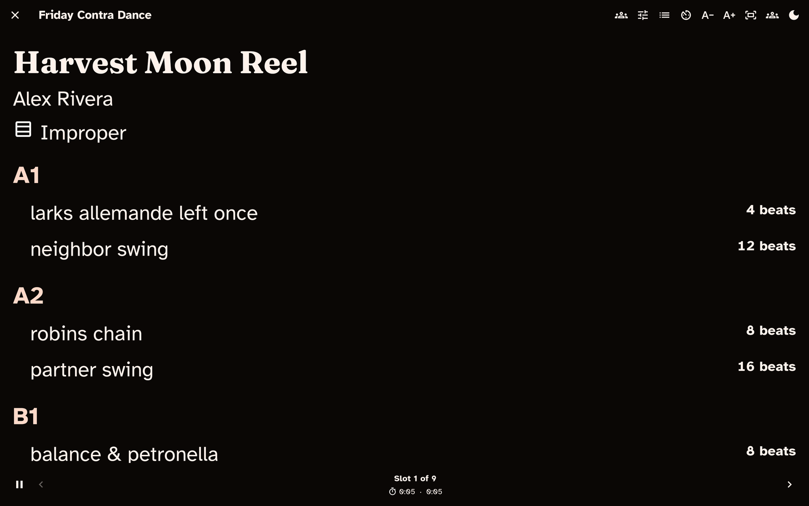

# Perform mode

[Perform mode](./glossary.md#perform-mode) is the app's stage-ready calling view. This
guide covers calling a single [dance](./glossary.md#dance) or a whole
[program](./glossary.md#program), sizing the text so it is readable from a distance,
moving through your evening, keeping time, and making changes on the fly without
losing your place.

> **Finding your way around these words.** On-screen buttons and screens are
> written in **bold** — like **Perform this dance** and **Perform this program**.
> The first time a dance term appears it links to
> [App terms](./glossary.md), so you can get a plain-language definition
> without losing your place.

New to the app? Start with the [Getting started guide](./getting-started.md).

## Enter Perform mode

Perform mode is not a navigation tab — you step into it when it is time to call,
and step back out deliberately when you are done. On a phone or tablet it
fills the whole screen: the status bar, and on Android the navigation bar, hide
while you perform and come back when you exit. On Android, swipe in from the
edge to see them for a moment. On a computer, Perform opens in the app window, and **Full screen**
takes it over the whole display (see [Set the stage](#set-the-stage)).

- To call a **single dance**, open it from your
  [collection](./collection.md#what-you-can-do-with-a-dance) and choose
  **Perform this dance**.
- To call a **whole evening**, choose **Perform this program** in the program
  editor or on the program's summary.

When you exit, the app takes you back to wherever you came from.

*Perform mode in the dark-stage theme, with large type and controls for moving
through the program.*

## Read the card

Perform mode shows one dance at a time in very large type, with the
[figures](./glossary.md#figure) grouped by section (A1, A2, B1, B2) and set in a
typeface built to be read from a distance.

Above the figures, the card shows the dance's title, author, formation,
and level; below them come the dance's calling notes. The figure where the
progression happens is marked with an icon labelled *Progression*. Break and
note slots in a program get a card of their own, with the text in the same
large type.

Your [dialect](./dialects.md) is applied — or the program's own dialect, if you
gave it one (see [Programs](./programs.md)) — so the card speaks in your words.
To see the shared wording, choose **Canonical** under **Switch dialect** below
(that section says how long the change lasts). Figure
detail you recorded shows here too: when a swing ends facing somewhere other
than the usual "in"/across — up or down the hall, or out of the set — the card
notes that ending so you can cue it.

## Set the stage

A row of controls along the top shapes the calling view itself. On a tablet or a
desktop they all sit there as buttons. On a phone, only **Switch dialect** and
the **Stage theme** toggle stay out — the rest tuck into a **More actions** menu
so the toolbar can't crowd a narrow screen. Wherever a control lives it does the
same thing, and every toggle says which state it is in rather than relying on
how it looks.

**Switch dialect.** Changes your active dialect for the whole app — handy when
tonight's hall uses different role names. The change stays after you leave
Perform: later screens, PDFs and shared text use that dialect too, and it syncs to
your other devices. **Canonical** is one of the choices, for when a dancer or
another caller asks what a figure is in the shared wording; switch back the same
way when you are done. If the program has its own dialect, the switch changes
the wording for this time in Perform only: your active dialect stays as it was,
and the program's dialect is back the next time you open Perform. See
[Dialect](./dialects.md#switch-dialect-on-the-fly).

**Stage theme.** Perform opens on a **high-contrast dark-stage theme** by default,
built for strong legibility (a contrast ratio of at least 7 to 1) under stage
lighting. Toggle it off to fall back to your usual app theme. Its tooltip reads
*Stage theme on — tap to use app theme* or *Stage theme off — tap for dark stage*,
so there is no guessing, and it stays where you put it — next time too.

**Auto-size text to screen.** Out of the box this is on: the card scales so the
current dance's full text fits the screen without scrolling, recomputing whenever
you move to a new dance or slot, rotate the device, or resize the window. So the
text is always as large as it can be while still fitting. It starts however you
set **Auto-size Perform cards** in
[Settings › Program › Performance](./settings.md#performance), and the in-view
toggle flips it until you leave Perform.

**A− and A+.** The **Decrease text size** and **Increase text size** controls step
the size down and up, starting large with no upper limit. Using either one
switches auto-size off, because you have told the app what size you want. The
size you pick is remembered for next time; auto-size goes back to your Settings
choice the next time you open Perform.

**Tap tempo** opens a silent, visual metronome: tap out the beat on the large
target to see the tempo in beats per minute and a pulse you can follow or show
the band. **Show walkthrough** — which appears when the dance has a
walkthrough written — lays it over the card until you close it.

**Full screen.** On a computer, this takes the window over the whole display,
covering the taskbar or Dock, and back again. The keyboard does the same:
**F11** on Windows and Linux, **Ctrl-Cmd-F** on macOS. **Esc** also leaves full
screen. It never leaves Perform, which always asks first. When you exit Perform,
the window goes back to how it was when you came in. If you close the app while
it is full screen, it opens in its usual window next time. Phones and tablets
have no button for this, because Perform is always full screen there.

**Caller notes.** When you perform a program, a slot's caller note appears above
the dance title, labelled *Caller note*. To hide these, turn off **Show caller
notes in program Perform** in
[Settings › Program › Performance](./settings.md#performance). The note is for
your eyes only: it does not change the dance's own calling notes, search, or
exports.

## The screen stays awake

While you are in Perform mode, the app keeps the screen awake, so a propped-up
tablet will not dim or sleep partway through a dance. The moment you exit, the
screen is free to sleep as normal again.

## Move through a program

When you are performing a program, step through your slots with whichever
control suits you and your setup:

- the **Previous slot** and **Next slot** buttons at the bottom of the screen;
- the **giant edge hit zones** — tap the left edge to go back, the right edge
  to go forward — easy to hit without looking; or
- the **arrow keys** or **Page Up** / **Page Down** on a keyboard, or a
  page-turner pedal that sends them.

When a card is too long to fit, **down** and **Page Down** scroll it first, and
move to the next slot only once you can see the end of the card. **Up** and
**Page Up** scroll back to the top before they go back a slot. Each press moves
most of a screen, so a pedal reads through a long card in a few presses. The
**left** and **right** keys always change slot straight away. A new slot always
opens at its top. A card that fits needs no scrolling, so every key changes slot
at once.

While the walkthrough overlay is open, none of these change your slot: taps on
the card are absorbed, the **up**, **down**, **Page Up** and **Page Down** keys
scroll the walkthrough itself, and **Esc** closes it — so reading ahead can't
move you off the dance you are calling.

Between the two buttons, **Slot N of M** shows where you are. A dance and its
alternates count as one slot, so stepping forward skips past the alternates.

**Jump to slot** lists the whole program so you can go anywhere at once — useful
if plans change mid-evening. When the current slot has an
[alt](./glossary.md#alt), **Show alternate** switches the card to it (and on
through any others, then back to the primary). This only changes what you are
looking at; the program itself stays as it is.

If a dance in your program has been deleted, its slot still shows the figures
as long as the dance is in Recently deleted, and both the card title and
**Jump to slot** mark it "(deleted dance)". A dance that no longer exists at all shows "Dance
unavailable" instead; your note for that slot, if you have notes turned on,
appears underneath.

## Keep time through the evening

Perform mode shows timing in a status area so you can pace yourself. For a
single dance, it shows:

- an **elapsed timer** for the dance; and
- a **pause/resume** control for interruptions.

For a program, the status area additionally shows:

- a **running program clock** for the whole evening;
- a **per-slot elapsed timer** that resets each time you move to a new slot;
- the slot's planned length, when you have set one, shown as **planned N min
  (W:D)** — where W is the walkthrough minutes and D is the dance minutes;
- once the slot's walkthrough minutes have passed, the words **walkthrough
  complete**, with a running-figure icon;
- once the walkthrough and dance minutes together have passed, the word
  **over**, with a timer icon; and
- a **Pause timers** button (**Resume timers** while paused) that freezes both
  clocks for interruptions; and
- when the slot has a walkthrough length, a round **dance-start** button (a
  music note) at the end of the readout.

### Mark when the walkthrough really ended

Walkthroughs rarely run to the clock. When a slot has a walkthrough length, tap
the dance-start button the moment the dancers actually start dancing. Its tooltip
reads "Walkthrough done — start the dance"; once marked it becomes a filled
circle and reads "Dance started — tap to undo". Tap it again to undo a
mis-tap. You can press it early or late, while paused, or after **over** is
already showing.

While a slot is marked:

- **walkthrough complete** follows your mark instead of the clock;
- **over** is counted from your mark plus the dance minutes, not from the start
  of the slot; and
- the readout adds how long the walkthrough actually took against its plan, for
  example **walkthrough 4:10 (+1:10)** (ran over), **(−0:50)** (finished early)
  or **(on plan)**.

If you never tap the button, nothing changes: the cues follow the clock exactly
as described above. The mark belongs to the slot you are on, so it clears when
you move to another slot, swap in an alternate or jump to a slot (the same
moments the per-slot timer restarts), and it survives reordering or inserting
slots around the one you are reading. It is session-only: it is kept when you
leave and re-enter Perform within the same session, but it is never saved to
your program or your dances.

While Perform is open, the timers keep counting when you switch to another
app, such as your music player, or when the device sleeps: coming back shows
the full time that passed. Only **Pause timers** stops them.

Timing is display-only — it helps you keep an eye on the clock but never changes
your program or your dances. The single-dance timer is on by default; to hide
it, turn off **Show timer for individual Perform** in
[Settings › Program › Performance](./settings.md#performance).

## Adjust on the fly

Plans change mid-gig. When you are calling a program, **Adjust program** opens a
sheet that lets you make changes without disturbing the card you are reading.
From it you can:

- **reorder the remaining slots** (with a drag handle or move up / move down
  buttons);
- **insert a dance** with **Insert dance from search**;
- **add an ad-hoc note or break**; and
- **mark the current slot performed** (choose it again to clear the mark).

An inserted dance and an ad-hoc note both land right after the current slot, so
"play this next" is one action away. Every change offers **Undo**, and a change
to a saved program is saved right away. Only the change you made in Perform is
saved: if you opened Perform from the builder with unsaved edits, those edits
stay unsaved in the builder, for you to save or discard when you return (unless
**Auto-save program changes** is on, which saves them as it always does). The
Undo is still offered for a moment after you leave Perform (for as long as you
need with a screen reader), but only while the program is as the change left
it. So if the program has been changed since, for example edited in the
builder, Undo does nothing except tell you it can no longer undo, and the later
change is kept.

Perform shows the program as it was when you opened it. If the program changes
somewhere else while Perform is open — most often when
[Device Sync](./settings.md#device-sync) brings in an edit from another device
— your next change is saved on top of that edit rather than replacing it.
Perform then switches to the newer program and says so: *This program had
changed elsewhere since Perform opened. Perform now shows the latest version,
with your change.* Undo still takes back only your own change. If you have set calling history to count
only slots marked performed, this is where you mark them — see
[Programs & matrix](./programs.md#track-what-you-have-called).

This sheet belongs to program Perform. Performing a single dance has nothing to
reorder, so it has no adjust sheet.

## Screen readers and verbose figures

For screen-reader users, Perform mode always announces each figure in an
expanded, spoken-friendly form — clearer to hear than the terse text shown on the
card. You don't need to turn anything on for that; it is how Perform always
behaves.

The **Always show verbose figure text** setting is a different thing: it puts that
fuller wording on screen in the *dance view*, not in Perform. The
[Accessibility guide](./accessibility.md) covers this and the app's other
accessibility options.

## Leaving Perform

Choose **Exit Perform mode** and the app checks first:

> **Exit Perform?** — Leave Perform mode? Your place and the running clock
> are kept, so you can resume where you left off.

**Keep performing** returns you to the card; **Exit** leaves. When you are
calling a program, your place and the clock are kept for as long as that
program stays open, so you can step out to check something and choose **Perform
this program** again to pick up where you left off. That holds when a tablet is
rotated while you perform, too, even though the Programs screen switches
between its one- and two-pane layouts: if it shows the list when you leave,
open the program again. Closing the program — choosing another one, or going
back from it to the list — or performing a single dance starts the next session
fresh. For that reason the
exit check on a single dance says so instead of promising a resume: *Performing
a single dance doesn't keep your place, so the next time starts fresh.*

## Print or share a single dance

You do not have to be on stage to hand someone a dance. From a dance's detail
view you can export or print a single dance card as a PDF or as shareable text,
and the export follows your active dialect. See
[Share, print & export](./sharing.md#share-a-dance).

## Where to go next

- **Build the program you will call:** [Programs & matrix](./programs.md)
- **Find and prepare dances:** [Collection & search](./collection.md)
- **Call in your own words:** [Dialect](./dialects.md)
- **Hand a dance or set list to someone:**
  [Share, print & export](./sharing.md)
- **Large text, high contrast, screen readers, keyboard:** the
  [Accessibility guide](./accessibility.md) and
  [Settings](./settings.md)

Not sure what a word means? [App terms](./glossary.md) has plain
definitions for every term used across these guides.
