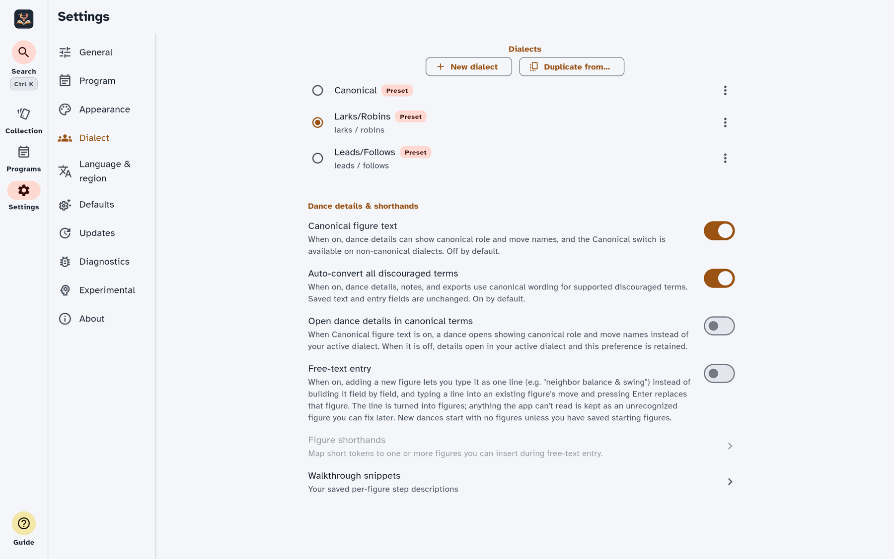

# Settings

**Settings** is where you tune Caller's Compendium to fit the way you work — how
your library sorts, how [dances](./glossary.md#dance) look on stage, which
[dialect](./glossary.md#dialect) names appear, and how the app protects your data.
Most of what you'll find here has a dedicated guide of its own, so think of this
page as a tour: it shows you where each control lives and points you to the
details.

> **Finding your way around these words.** On-screen buttons and screens are
> written in **bold** — like **Settings**, **Appearance**, and **Defaults**. The
> first time a dance term appears it links to [App terms](./glossary.md), so
> you can get a plain-language definition without losing your place.

*The Settings screen with the section list beside the controls for the Dialect
section.*


## Finding Settings

**Settings** is a top-level destination, marked with a gear icon and labeled
**Settings**. On a phone held upright it's a tab in the bottom navigation; on most
phones turned on their side, a tablet or a desktop it's in the side navigation
rail. On a computer you can also press **Ctrl-,** (**Cmd-,** on a Mac), or
choose **Settings…** in the **Caller's Compendium** menu on a Mac (see
[Using the keyboard](./accessibility.md#using-the-keyboard)).

Inside, on a wide screen (a desktop, or a tablet in landscape), a list of
sections sits beside the controls for the section you've chosen, starting with
**General**. On a narrower screen (a phone, or a tablet in portrait) you pick a
section and it opens as its own page, then you step back to switch sections. There are eleven sections, always in this order:

1. **General**
2. **Collection**
3. **Program**
4. **Appearance**
5. **Dialect**
6. **Language & region**
7. **Defaults**
8. **Updates**
9. **Diagnostics**
10. **Experimental**
11. **About**

## General

The **General** section gathers everyday behavior into small groups.

### Accessibility

- **Reduce motion** — trims animations and movement. Follows your device's system
  *Reduce Motion* setting by default; turn this switch on to
  switch off the app's animations and the fade between themes even when your
  device allows motion — screens, dialogs, date pickers and bottom sheets
  appear at once, and expanding sections open without animating. Turning it
  off stops the app removing its own animations, but cannot restore animations
  your device's setting has already shortened. This setting belongs to this
  device: it is not synced to your other devices, but a backup includes it.
- **Always show verbose figure text** — shows the full spoken-style
  [figure](./glossary.md#figure) wording on screen in the dance view, not only to
  screen readers. Turn it off for the terse notation. This affects the dance view;
  [Perform mode](./perform.md) has its own text-size controls.
- **Show turns as decimals** — shows turn and rotation amounts as decimals (0.75)
  instead of fractions (¾). Screen-reader wording is unaffected, and so are
  printed and exported cards: PDFs, shared text and set-list cards always write
  turns as fractions.
- **Confirm before delete** — adds a prompt before any delete you can undo: a
  dance or program from its **⋮** menu, from the dance or program screen, or
  from Collection's selection mode, and a venue, custom field, tag, author,
  source, shorthand, dialect, custom theme, walkthrough snippet or matrix
  column. The one exception is swiping a row in the Collection or Programs
  list: that reveals a **Delete** button, and tapping it deletes with no
  prompt, because the swipe plus the tap is already a deliberate two-step
  action. These deletes offer **Undo** either way. When you delete a program,
  the prompt also says how many dances lose it from their calling history. A
  dance already permanently deleted is not counted. A delete that can't be
  undone always asks first, whether this is on or off.
- **Undo prompt** — how long the **Undo** message stays on screen after you
  delete or change something: **2**, **5**, **10** or **15 seconds**, or
  **Until I close it** (default **10 seconds**). It also stays while you point
  at it or move to it with the keyboard, and its time starts again when you
  move away. With a screen reader running it always stays until you act on it
  or close it.

These are the highlights; the [Accessibility guide](./accessibility.md) gives you
the full picture.

### Recently deleted

- **Keep recently deleted items for** — choose **30 days**, **90 days**, or **Never**
  (default is **30 days**). Deleted dances and deleted programs are held for
  this long and then purged. If you use [Device Sync](#device-sync), the
  setting syncs and applies on all your devices: when a shared item's time is
  up, its content is erased everywhere, as if you had deleted it permanently,
  and only a small deletion record is kept (with the dance's title, while a
  program or another dance still includes it). Choosing
  **Permanently delete** on one item in **Recently deleted** removes only that
  item. For how soft-delete and restore
  work, see [Collection & search](./collection.md).

### Import

- **Import dances** — the entry point for bringing dances in from other sources.
  See [Imports & migration](./imports.md).
- **Published collections** — browse signed collections from the trusted catalog
  and send one through the review flow. See
  [Imports & migration](./imports.md#import-a-published-collection).
- **Convert ECD dances?** is a question the app asks when it opens, not a
  setting here. Choosing **Don't show this again** in it stops the question;
  answering **Not now** without it asks again next time. A conversion can be
  undone straight after. See
  [Imports & migration](./imports.md#dances-tagged-ecd).
- **Re-check unrecognized figures** — re-reads imported dances whose figures were kept
  as plain text only because the app couldn't recognize them at the time.
  You preview and confirm before anything changes, and your tags, ratings, and
  notes are preserved. See
  [Write & edit dances](./authoring.md#fix-figures-an-import-could-not-read).
- **Convert English dances** — turns the contra moves, unrecognized imported
  lines and contra formation of English country dances stored before the app
  knew English figures into their English counterparts. You pick the dances and
  confirm first. See
  [Imports & migration](./imports.md#convert-english-dances-to-english-figures).

### Backup & restore

- **Export a backup** and **Restore from a backup** — save a copy of everything or
  bring a copy back.
- **Backup reminder** — set to **Off**, **Weekly**, or **Monthly**, with a "last
  backup" date so you know where you stand.
- **Export dances as a spreadsheet** — every dance in your collection as a CSV
  file for Excel, Numbers or Google Sheets. It follows the sharing rules, plus
  your star ratings, and it is not a backup: the app can't restore from it. See
  [Export dances as a spreadsheet](./sharing.md#export-dances-as-a-spreadsheet-csv).

For the whole workflow, see [Backup & portability](./backup-portability.md).

## Collection

The **Collection** section holds the settings for your dances and your saved
searches.

### Dances

- **Ignore leading articles when sorting** (on by default) — alphabetizes titles
  by their first meaningful word. With this on, "The Nice Combination" files under
  **N**, not **T**. It applies to the Collection, the program dance picker, the
  Programs list, and the order of [quick search](./collection.md#jump-straight-to-a-dance-or-program)
  results.
- **Capitalize figures** (off by default) — starts each
  [figure](./glossary.md#figure) in the dance view, [Perform mode](./perform.md) and
  the figure editor with a capital letter. Off, figures are shown as written
  (built-in figures start in lower case, as in ContraDB). Only the look in those
  places changes; exports, search, sync comparisons and screen-reader wording are
  unaffected.
- **Tags** — opens the Tags manager, where you rename, merge, color and delete
  your tags. **Show dances** in a tag's menu closes Settings and adds that tag to
  your collection's filter; your search text, other filters and any tags
  already chosen stay (with two or more tags, the collection shows dances that
  have all of them unless you pick **Any tag**). See [Group by category](./collection.md#group-by-category-a-dances-vibe)
  for what each action does.
- **Authors** and **Sources** — open the Authors and Sources managers. They
  work like the Tags manager: search, a **Not used** filter, sort by name or by
  number of dances, and a ⋮ on each row (or tap the row) for its actions.
  Each row shows how many dances use it; a dance in
  [Recently deleted](#recently-deleted) doesn't count. A source's row also shows
  its author and year, so two sources with the same title can be told apart.
  - **Rename** changes the name everywhere it is credited. Renaming an author
    to a name another author already has offers to **merge** the two instead.
  - **Merge into…** combines two entries into the one you pick: every dance that
    credited either now credits that one. Any detail the kept entry leaves
    empty is filled from the other — an email, say, typed only on a misspelled
    copy. Where both hold different values, the kept entry's value stays and the
    other is dropped; the app lists what it will drop and asks before it merges.
    An author marked deceased on either copy stays marked. For a source, a dance
    that cited both keeps one citation, with the page and number it had for the
    source you merged into; an empty one is filled from the other citation. A
    page or number the two citations disagree on isn't listed: the one for the
    source you merged into is kept.
  - **Edit details…** opens the same details you edit from the dance editor.
  - **Delete** appears only for an entry no dance uses. One still in use can
    only be merged, so no dance loses its author or source.

  Rename, merge and delete happen at once (a delete asks first only when
  **Confirm before delete** is on) and show an **Undo** in the message at
  the bottom of the screen; once that message goes, the change stays. A merge's
  dropped details come back with Undo, and are gone after it.

  Merging two authors loses something on your other devices, as merging two
  authors in [Sync decisions](#sync-decisions) does: an email address,
  location, and deceased marker are kept only on your own device and are never
  sent to your other devices, so the ones another device holds for the author
  that is not kept cannot be recovered there.

### Saved searches

Every search you have saved from the Collection (see [Save a search and use it
again](./collection.md#save-a-search-and-use-it-again)) is listed here by name.

- **Rename** (the pencil) changes a saved search's name. What it searches for
  stays as it was saved; to change that, load it in the Collection, change the
  search and choose **Update** in the ⋮ menu.
- **Delete** (the bin) deletes it at once (it asks first only when **Confirm
  before delete** is on) and shows an **Undo** in the message at the bottom of
  the screen. A saved search that a [program template's slot
  rule](#program-defaults) uses can't be deleted; the message names the rule
  and its template, so you can change or remove the rule first.
- A saved search that this version of the app can't read (saved by a newer
  version, or damaged) is listed last, under **Needs attention**. It is never
  used. Tap it to read what that means and to delete it; you can undo that.
- A saved search that one of your [event rules](#event-rules) uses can't be
  deleted. The app says **Can't delete "…"** and lists the rules that use it;
  change those rules to another search, or delete them, and then delete the
  saved search. A rule you deleted doesn't count. **Manage rules** in the
  message opens your rules there and then, so you can change them now. It is
  there even while **Check programs against your rules** (under
  [Event rules](#event-rules)) is off, when Settings doesn't show Manage
  rules; the message then also says that to check programs against your
  rules again, you turn that switch on under Settings ▸ Experimental ▸
  Event rules.

## Program

The **Program** section gathers the settings that shape how you build, check, and
perform your [programs](./glossary.md#program) — venues, the programming matrix,
sharing, Perform mode, calling history, and your calendar.

### Venues

- **Use reusable venue records** (off by default) — turns a program's
  [venue](./glossary.md#venue) into a reusable record with address, contacts, and
  schedule that many programs can share and you edit in one place. When off, a
  program's venue is a simple free-text field. Switching is **lossless and
  reversible**: your typed venue text and any linked record are both kept, so
  flipping the toggle never discards either. When you turn it on, and whenever
  you add a venue record, the app also offers to **link earlier programs**: any
  program whose typed venue matches a record's name (ignoring capitals and extra
  spaces) can be linked to it in one step. Until a program is linked, calling
  history counts a typed "Grange" and a saved "Grange" as two venues. Linking
  keeps the typed text, only programs in your list are linked (a program in
  **Recently deleted** keeps its typed venue), and choosing **Not now** just
  skips it; the offer comes back the next time you turn the setting on or add
  a matching venue.
- **Manage venues** — browse, edit, and delete your saved venue records. You can
  also add a venue on the fly while editing a program (when reusable venue records
  are on). Deleting a venue offers **Undo**; it doesn't go to Recently deleted,
  so once the message has gone you can't restore it on its own. To keep you
  from stranding a program, a venue can't be deleted while any program is still linked to it; change or remove the venue on
  those programs first, then delete it. A program in **Recently deleted**
  doesn't count, so it won't stop you deleting the venue, and restoring that
  program brings the venue back.

Whether the toggle is on or off, a program that's linked to a saved venue always
shows and exports that venue's full details (the linked record wins over free
text). See [Programs](./programs.md) for how the venue field behaves in each mode,
and [Share, print & export](./sharing.md#what-stays-private) for how venue contact
details are handled when you export.

### Programs

- **Flag exact beat overlap only** (on by default) — controls how the
  [programming matrix](./programs.md#check-your-evening-with-the-matrix)'s alert
  marker decides that a move repeating in two back-to-back dances is worth a
  second look. On (the default), only a move whose beats actually **overlap**
  between the two dances is flagged. Off, any move that merely lands in the same
  **named phrase** (A1, A2, B1, B2…) is flagged, even if its beats don't overlap
  at all. The screen legend and the printed PDF legend always agree with
  whichever mode is on.

- **Auto-save program changes** (off by default) — when on, valid changes are
  saved as you work, so leaving the program editor never asks whether to
  discard them. Leave it off to save programs yourself.

- **Show pay** (on by default) — shows each program's
  [Pay](./programs.md#event-details) field under **More details** in the
  program editor, and its pay line on the program's summary. Turn it off if you
  don't track pay, and both are hidden. Hiding never clears anything: pay
  already entered is kept, saving a program while pay is hidden keeps its amount
  and currency as they are, and turning **Show pay** back on shows them again.
  If you had changed a pay amount just before hiding it, that change is still
  saved; an amount that isn't a valid number stays visible so you can fix it.
  A sync conflict still compares pay, so two versions that differ only in pay
  don't look the same. While pay is hidden, the
  [programs spreadsheet](./sharing.md#export-programs-as-a-spreadsheet-csv) leaves
  pay out too, and its export dialog says so.

- **Matrix columns** — opens a dedicated editor for the columns of the
  [programming matrix](./programs.md#check-your-evening-with-the-matrix). These
  changes are saved and apply to **every** program, both on screen and in the
  printed PDF — distinct from the per-session eye icon in a matrix's own header,
  which only hides a column until you reopen that program. In the editor you can:
  - **Reorder** columns by dragging the handle on the left of each row, or with
    the **Move up** and **Move down** buttons under its name.
  - **Rename** a column with a name that suits your callers; leave the field
    empty to fall back to the built-in name (shown as a hint).
  - **Remove** a column you never use, or **restore** one you removed earlier —
    removed columns stay listed here (struck through) so you can always bring
    them back.
  - While [Custom Figures](#glossary-and-custom-figures) is on, each of your
    new figures is listed as a column, so you can arrange it before any program
    uses it. A new one is listed after the built-in moves and before **Custom**,
    or, once you have moved columns, after the ones you placed. Columns you
    placed keep their place while Custom Figures is off.
  - **Restore removed columns** brings back everything you removed and returns the
    built-in columns to their original order, while keeping your renames and any
    custom columns.
  - **Restore all defaults** clears every customization and returns the matrix to
    how it ships. Because it discards your renames and custom columns, it asks
    you to confirm first.

- **Manage rules** — shown only while [Event rules](#event-rules) is on in
  Experimental. It opens the same rule manager as the link there. The switch
  that turns event rules on and off is only in Experimental.

### Sharing

These three switches choose what the set list you **share** or **copy** as text
includes. All three are on, so the set list carries everything unless you turn
one off.

- **Include program title when sharing a set list** (on) — the program's title,
  which is also the subject line of the share.
- **Include caller and band when sharing a set list** (on) — the **Band** and
  **Caller** lines.
- **Include date, times and venue when sharing a set list** (on) — the line
  with the date, the dance's start and end times and the venue, and the
  beginner lesson's time. **Arrive by** is never in a shared set list.

They don't change what is shared when you share the whole program as a
`.ccshare` or JSON file: that file always carries the full program.

### Perform mode

- **Auto-size Perform cards** (on) — scales each card so it fits the screen in
  [Perform mode](./glossary.md#perform-mode), but never below your usual text
  size; a card too long for that scrolls. Turn it off when you'd rather size
  the text yourself using the **A−** and **A+** buttons while performing. See
  [Perform mode](./perform.md) for more. Like the stage theme and the text size
  you pick in Perform, this setting belongs to this device: it is not synced to
  your other devices, but a backup includes it.
- **Show timer when performing one dance** (on) — shows an elapsed timer and
  pause/resume control while performing a single dance. Turn it off when you
  want Perform mode for a single dance to stay timer-free.
- **Show caller notes when performing a program** (on) — shows each non-empty
  per-slot caller note above the dance title while performing a program. Turn it
  off when you want the program card to show only the dance's own details.
- **Confirm before leaving Perform mode** (on) — makes the close button and Back ask
  *Exit Perform?* before taking you out of Perform mode, so a stray tap can't drop
  you out mid-dance. Turn it off to leave in one tap; a program's place and
  clock are kept either way. See [Leaving Perform](./perform.md#leaving-perform).
- **Swap a dance** — which **Keep** choices are on when you
  [swap a dance](./perform.md#swap-a-dance) in Perform: **Same formation**,
  **This level or easier**, **Same type** (offered only in a program that mixes
  types) and **Not already in tonight's program**. All four start on. Figures to
  keep always start off. A backup includes this setting, and it syncs to your
  other devices once every device in the store has a version of the app that
  knows it. If a newer version of the app saved these choices, this screen can't
  read them: it shows the choices the app starts with, all on, and can't change
  them until you update (your saved choices are kept). If the choices can't be
  read at all, it says so and changes nothing.

### Calling history

Two settings below decide **what counts** as called. They override the four
under [Recency and history order](#recency-and-history-order), which only date
and order what already counts.

- **Require "mark performed" for calling history** (off) — when on, a dance's
  calling history lists only the [programs](./glossary.md#program) whose
  [slot](./glossary.md#slot) was actually marked performed, rather than every
  program the dance appears in. Either way, an
  [alternate](./glossary.md#alt) counts only once you mark that slot performed;
  **Mark all performed** and the **Performed** status skip alternates, so mark
  the ones you used yourself.
- **Show mark-performed toggles** (on) — adds a circle to the end of each dance
  row on a saved program's summary, alternates included, so you can mark that
  dance performed (or clear the mark) without opening the editor. Marking or
  clearing offers an **Undo**. Turn it off and rows only show a check on dances
  already marked performed. The change applies straight away.
- **Mark all performed sets the status** (on) — **Mark all performed**, in the
  program editor or on a program's summary, also sets the program's status to
  **Performed**, and its **Undo** puts the marks and the status back together.
  Turn it off to keep the status separate: Mark all performed then only marks
  the dances. Either way, saving a change to **Performed** yourself marks every
  unmarked dance except alternates, and changing the status back keeps the
  marks.
- **Require an event date for calling history** (off) — when on, a program with
  no event date counts nowhere calling history is read (the "called ×N" count,
  the **Calling history** filter, a dance's history list, the **Last called** sort, and
  the repeated-venues and half summaries) until you give it a date. Duplicated
  programs and programs another caller sends you arrive without a date. When
  off, a program counts whether or not it has a date. It applies on top of the
  other calling-history settings (all must pass).

- **Track calling history for all callers** (off) — when off *and* you've set a
  [default caller for new programs](#program-defaults), a dance's calling history
  and "called ×N" counts include only programs led by that caller (plus any
  programs with no caller recorded, which are treated as your own). Turn it on —
  or leave the default caller blank — to track every program that contains the
  dance. Matching ignores surrounding spaces and letter case, and applies on top
  of the *Require "mark performed"* setting (both must pass). Collection's
  counts and **Last called** sort follow a change to the default caller straight
  away.
- **Repeated venues in calling history** (3) — shows the top venues where a
  dance was called more than once. Choose **Don't show** to hide the summary, or
  choose up to 10 venues.

#### Recency and history order

These four settings never change what counts as called, so they never change
"called ×N", whether the **Called** filter matches a dance, or the venue and half
summaries. The two settings above decide that, and a slot they leave out is left
out here too. These only change how calls are dated and ordered.

- **Recency only counts dated programs** (on) — the **Called** filter's
  **Within** windows (and so "not called within 3 months") skip a program with no
  event date. Its dances still count as called, they just fall in no window. Turn
  it off and an undated program is dated by when you marked the slot performed,
  or else by when the program was last changed, so it shows up as recent after an
  edit, even if you never marked it. Before this setting existed, a slot marked
  performed in an undated program was dated by that mark, and one never marked
  was in no window; no combination of these settings brings back exactly that.
- **Recency only counts slots marked performed** (follows *Require "mark
  performed"*) — the **Within** windows skip a slot you have not marked
  performed. Until you set it yourself it follows the *Require "mark performed"*
  setting; once you switch it either way, your choice stays. With both recency
  settings on, a slot must pass both.
- **History order and Last called ignore undated programs** (off) — in a dance's
  history list and the **Last called** sort, a program with no event date gets no
  date. It is listed after the dated ones and gives no *last called* date, so a
  dance whose only calls are undated sorts with the dances you have never called.
  It still shows "called ×N". Off, such a program is ordered by when its slot was
  marked performed, else by when it was last changed.
- **History order and Last called ignore slots not marked performed** (off) — the
  same for a slot you have not marked performed. With both on, only a dated slot
  you marked performed gives a date.

### Calendar

For [importing gigs from your online calendar](./programs.md#import-programs-from-your-calendar)
as draft programs.

- **Calendar address** — your calendar's iCal address (`https://…` or
  `webcal://…`). One address per device. The setting shows only **Set** or
  **Not set**, and the address itself appears only when you edit it, because a
  private calendar's address contains a secret: it is never
  synced to your other devices, never put in a [backup](./backup-portability.md)
  (enter it again after a restore), and removed from
  [diagnostics](#diagnostics).
- **Which events** — how far ahead to look: 3, 6 (the default) or 12 months.
  Repeating events are read only 30 days ahead, whatever you choose.
- **Only events whose title contains** — for a calendar that also holds things
  other than gigs. Leave it empty for every event. It ignores capitals.
- **Import calendar when the app starts** (off) — reads your calendar once each
  time the app starts, and never at any other time: not in the background, not
  on a timer, not when you come back to the app. Like the automatic
  [update check](#updates), it is off until you turn it on. With
  [Device Sync](#device-sync) on, it first waits up to 30 seconds for the sync
  the app runs when it starts, so events another of your devices has already
  imported and synced aren't added again here. Both can still add a draft for
  the same event if that device hasn't synced them yet, or if this one can't
  sync when it starts (offline, or on mobile data with **Sync only on WiFi**)
  or takes longer than that.
- **At startup** — what that run does with events not imported before:
  - **Report new events** (the default) — adds nothing. If there are new events,
    a message says how many, with **Review**, which opens the import review with
    what was found; nothing is added until you choose **Import** there.
  - **Add them as drafts** — adds a draft program for each new event, with the
    same rules as an import you start, and says so, with **Undo** and **Show**.
    **Undo** moves the drafts you haven't touched to Recently deleted, so the
    next start doesn't add them again: the import skips events whose
    programs are there, until they leave it for good (after the time set in
    [Recently deleted](#recently-deleted), 30 days unless you change it). A
    draft you have started filling in is kept.

  Either way it never changes a program you already have. If an event you
  imported has changed or been canceled, the message only counts it ("1 change
  needs you") and **Review** shows it.
- If the run can't reach the calendar, nothing tells you at the time. A line
  here says what the last run did ("Checked at startup 22 Nov: 2 new events",
  or that it couldn't reach the calendar), and after it has failed 3 times in a
  row, a notice here says so, with a hint to check the address. A successful
  run, or changing the address, clears it. A run that reached the calendar but
  couldn't read it, such as a Wi-Fi sign-in page, says so on that line, and
  neither counts toward the notice nor clears it.
- **Pull now** — opens the calendar import.

**Which events** and the title filter travel with your other preferences; the
address does not. The startup switch and **At startup** stay on this device,
like the update check's, but a backup keeps them.

## Appearance

The **Appearance** section controls how the app looks.

### Theme

The **Theme** row shows the theme you're using under its title; tap it to open
the **Theme** screen. There the built-in themes are grouped under **System** (follows your
device), **Default** (Light, Dark, Soft dark, then High contrast), **Light** and
**Dark** — named color palettes, including editor-inspired schemes — with your
saved custom themes under **Custom themes** after them. On a phone the built-in
theme cards sit in two columns (one at larger text sizes). Selecting a theme
previews and applies it right away.
There's a **High contrast** theme for maximum legibility — see the
[Accessibility guide](./accessibility.md) for when it helps.

Type in **Search themes…** to find a theme by its name, or by a color or
character word such as *purple*, *green*, *warm*, *pastel*, *muted* or *retro*.
On a computer the box is ready to type in as soon as the screen opens; on a
phone, tap it first. The headings give way to just the matching themes, with a
count of them above, which a screen reader reads out as you type. Every word you
type has to match, so *dark purple* finds the dark themes that are purple, and
accents are optional: *frappe* finds *Catppuccin Frappé*.

### Custom themes

- **+ Custom theme** — the floating button on the Theme screen opens an editor
  seeded from your current theme, so you start from something familiar. You can
  tune any color in it. When you save, the new theme becomes your theme and the
  screen scrolls to its card.
- Saved custom themes are listed under **Custom themes** on the Theme screen,
  and can be selected, edited, duplicated, or deleted at any time.
  Deleting one offers **Undo**, which also makes it your theme again if it was.
  They sync to your other devices along with your other settings when sync is on, and deleting a theme deletes it on those devices too.

### Easter eggs

- **Color-named dances tint the theme** (off by default) — a playful surprise:
  open a dance whose title names a color, like *Baby Rose* or *Blue Boy*, and its
  view is tinted that color. It steps aside when a high-contrast theme is active,
  so readability always wins.

### Set lists

- **Color-code set-list rows** — tints each dance row in a program's set list
  (both the read-only summary and the builder) by its
  [formation](./glossary.md#formation) family — contras, triplets, mixers,
  circles, and squares each get their own accent, so you can read the *shape* of a program at a
  glance. Dances marked as [mixers](./glossary.md#mixer) always get the mixer
  accent regardless of their formation, so a mixer-flagged Improper reads as
  a mixer rather than a contra, even if you have given that formation its own
  color (see [Formation colors](#formation-colors) below). The formation (and "Mixer" when applicable) is
  always shown as text on the row too, so rows stay fully readable without relying
  on color, and the family tints switch to a brighter set on dark themes and
  High contrast. On by default;
  turn it off to hide the tints (your own formation colors are hidden with them).

### Formation colors

- **Formation label colors** — highlight individual formations in your own
  colors (for example Becket clockwise in yellow and Becket counter-clockwise in
  pink). Your choices show on dance cards, in dance detail, in the Perform
  header, and on set-list rows in a program's summary and builder. On a set-list
  row your color replaces the built-in tint for that formation's family; a
  formation you haven't colored keeps its family tint, and a dance marked as a
  mixer keeps the mixer accent. Your color is used as you chose it in every
  theme, High contrast included, because on a row it only paints the edge of the
  row, never text. With **Color-code set-list rows** off, set-list rows show no
  color at all.

### Tag colors

- **Tag colors** — give a tag its own color so it stands out wherever it
  appears, on dance cards and in dance detail. Only the tags you color change;
  every other tag looks exactly as it does now. The tag's name is always shown
  beside the color, so tags stay readable without relying on color, and the
  app picks a black or white label automatically so your color stays legible in
  every theme. This opens the Tags manager (also under **Collection ▸ Dances ▸
  Tags**): choose **Color…** in a tag's menu to pick one, or **Remove color**.

## Dialect

The **Dialect** section is your library of [dialects](./glossary.md#dialect) — the
role names and wording the app uses when it describes dances.

- Each type of dance (**Contra**, **English (ECD)**, **Square**) has its own
  dialects. Choose the type at the top of the section; the list below shows that
  type's dialects, and each dance reads in the active dialect of its own type.
- **New dialect** starts a dialect of your own, and **Duplicate from…** copies
  an existing one as a starting point.
- Preset dialects are read-only, but you can **Duplicate to customize** to make
  your own version.
- Custom dialects can be edited (**Edit terms**), renamed, or deleted. Deleting
  one offers **Undo**, which also makes it active again if it was.
- One dialect is active at a time for each type; select a dialect in the list
  to make it active for that type.
- Dialect names and role names can't use gendered words such as "gents" or
  "ladies".

### Dance details & shorthands

- **Canonical figure text** (off by default) — allow dance details to show
  canonical role and move names. When it is off, dance details open in your
  active dialect and do not show the in-detail **Canonical** switch.
- **Auto-convert all discouraged terms** (on by default) — show supported
  discouraged terms in canonical wording across read-only dance details,
  shorthands, notes, Perform mode, and exports. Saved text and entry fields are
  unchanged.
- **Open dance details in canonical terms** — when this and **Canonical figure
  text** are both on, dance details open in canonical wording. While
  **Canonical figure text** is off, this preference is kept but has no effect.
- **Free-text entry** (off by default) — when on, adding a figure lets you type
  a whole line (for example "neighbor balance & swing") instead of building it
  field by field. A figure already in the dance still opens in the full editor,
  but a line typed into its move and entered replaces it with what the line
  reads as, and a new dance starts with no figures unless you have saved
  starting figures. See [Free-text entry](./authoring.md#free-text-entry).
- **Figure shorthands** — map short tokens to one or more figures you can insert
  during free-text entry. This row is grayed out until **Free-text entry** is on. See
  [Figure shorthands](./authoring.md#figure-shorthands).
- **Walkthrough snippets** — manage your personal, per-figure walkthrough
  wording. These settings are independent of canonical figure text. Deleting a
  snippet offers **Undo**.

This is the entry point — see [Dialect](./dialects.md) for the full story on
choosing and customizing wording.

## Language & region

The **Language & region** section sets the app's language, then how dates
are shown.

### Language

- **App language** — choose **System default** or one of the bundled languages
  (currently English, German, French, Japanese, Danish, and Dutch). Changing it
  re-renders the app immediately and is remembered next time you open the app.
  With **System default**, the app follows your device's language when it is one
  of those bundled languages and otherwise uses English. The language belongs to
  this device: it is not synced to your other devices, so each one can use its
  own, but a backup includes it.
  Your dance content — figure and call wording — is governed by your chosen
  [dialect](./dialects.md), independent of the interface language.

### Formats

- **Date format** — choose **System default**, **Year-month-day**,
  **Day/month/year**, **Month/day/year**, or **Custom…**. A live example shows the
  result, and your choice controls how program event dates appear: in the
  Programs list and editor, in a dance's calling history, and in printed and
  emailed set lists and PDFs. **System default** always includes the year and
  follows your **device's region** (not the app language): on a phone in
  Denmark, an English-language app shows `15.7.2026`, whether the phone itself
  is set to Danish or English. It uses all-numbers dates, so a date never mixes
  two languages' month names. A few multilingual regions (Belgium, say) have no
  single order and use your device language's default. Pick a fixed format or
  **Custom…** if you want one layout everywhere.

  The same choice formats the dates the app stamps itself, such as when an
  unsaved draft was saved, when Device Sync last ran and when a version on a
  sync conflict was changed. The time of day after the date stays in the app
  language.

  A custom pattern is built from these tokens:

  | Token | Meaning |
  |---|---|
  | `yyyy` or `yy` | Year |
  | `MM` | Month as digits |
  | `MMM` | Month as a short name |
  | `MMMM` | Month as a full name |
  | `d` or `dd` | Day |

  Separate them with a hyphen, slash, dot, comma, or space. If a pattern isn't
  recognized the app says so and falls back to the system default until you
  correct it.

- **First day of week** — choose **System default**, **Sunday**, **Monday**, or
  **Saturday**. This sets which day starts the week in the date views the app
  draws for itself — today that is the "this week" strip at the top of the
  Programs list, which reorders the moment you change the setting. Date *entry*
  still uses the system picker, which follows the app's active language.

## Defaults

The **Defaults** section sets starting points: how lists open, what dance rows
show, and what new programs and dances begin with. Every default here can still
be changed on each item later — they save you repetitive setup.

### Display defaults

- **Collection sort order** and **Programs sort order** — the order your
  library and your Programs list use when you open them. Choose a fixed order,
  or **Last used** to open with the sort and direction you last used while
  browsing. You can still change the sort while browsing. The program dance
  picker also opens in the Collection sort order; a sort you choose in the
  picker is not remembered as the last used.
- **Ascending / Descending** — shown under a fixed sort order. It sets which
  way that list opens, so you can have Programs always open newest event first.
  Each order starts in its natural direction (Title and Event date ascending,
  Recently updated descending), and choosing a different sort order puts the
  direction back to that sort's natural one. It is hidden under **Last used**,
  which remembers the direction itself.

### Collection card fields

Choose which details appear on each dance row in your collection and in the
program dance picker: **Authors**, **Times called**, **Formation**, **Status**,
**Level**, **Rating**, **Tags**, and **Custom fields**. All of them are shown by
default.

### Shared dance fields

Choose which details appear when you share, copy, or export a program or dance:
**Authors**, **Formation**, **Level**, **Mixer**, **Status**, **Phrase**,
**Calling notes**, **Walkthrough**, **Tunes**, **Hook**, **Sources**, and
**Meter, key and Barnes**. Everything except tunes, the hook and sources is
shown by default; those three are hidden until you turn them on. If you had
changed this list before **Meter, key and Barnes** was added, it starts off.
See
[Choose which dance fields appear](./sharing.md#choose-which-dance-fields-appear).

### Collection filters

Choose which filters appear in the **Filters** panel on the Collection screen and
when you pick dances for a program. Every filter is shown until you untick it,
and each of your searchable custom fields has its own checkbox. Hiding a filter
only removes it from the panel: it does not delete anything, and the Advanced
search can still use the same properties. This differs from a custom field's own
**Searchable** setting, which also keeps the field's values out of the search
bar (see [Make your own fields](./collection.md#make-your-own-fields)). If you hide a filter that is currently
narrowing the list, its selection is cleared. A filter that is narrowing the
list when you open a dance's tag from its detail page stays visible until you
clear it.

### Program defaults

Select **Program defaults** to open this group.

- **Default caller** and **Default band** — prefilled into each new program, and
  editable per program.
- **Program templates** — opens the list of your templates. A template is a
  named, ordered list of dances, caller notes, breaks and free-text entries
  that a new program starts with: one for a family dance, one for a regular
  Saturday contra, and so on. Use **New template** to add one, select a
  template to edit its name and slots, and use its ⋮ menu to **Rename**,
  **Duplicate** or **Delete** it (Delete offers Undo). Drag a template, or use
  its move up and move down buttons, to change the order **New program** lists
  them in. Dances that are no longer in your collection are skipped when a
  program is made from a template.
- **Slot rules** (optional) — in a template, **Add slot rule** adds a slot
  that names a kind of dance instead of one dance: a label, such as "Easy
  family opener", and one of your [saved
  searches](./collection.md#save-a-search-and-use-it-again), such as "Family
  dances". Below its label, the rule shows the saved search it uses. A program
  made from the template gets a **placeholder** in that slot, showing the label,
  and you choose the dance later with **Fill** (see [Build a
  program](./programs.md#fill-a-placeholder)). A template without a slot rule
  makes exactly the slots it always did. A rule's **Edit** button (the pencil)
  changes its label or saved search; its label can't be "Break", which marks a
  break. While a template has a rule that uses a saved search, that search
  can't be deleted; the message names the template and the rule. If the
  saved search you choose for a rule is deleted before the rule is saved, the
  template says so and keeps its slots as they were. If the saved search is
  gone anyway (deleted on another device, say), or can't be opened, the rule's
  row says so, and the placeholder still offers Fill.
- **Rules** (optional, *Experimental*) — while [Event rules](#event-rules) is
  on, a template has a **Rules** row under its name, listing the template's
  rules: each by its nickname with its sentence beneath, or by its sentence if
  it has no nickname. A rule whose saved search was deleted or can't be read,
  or that a newer version of the app made, is marked **Needs attention**, as
  in Manage rules, and a program doesn't check it. Select it to open the same
  rule picker a program has, with **New rule…** at the top: tick the rules a
  program made from this template should start with, and untick one to take it
  off. They are added to each new program made from the template (see [Rules
  that come with a
  template](./programs.md#check-your-program-against-your-rules)); changing
  them later changes no program already made. A rule you delete stays on the
  template, shown as **Removed**, and isn't added to new programs; **Undo** of
  the delete brings it back on the template too. A template can carry up to 64
  rules; once it does, only the rules you deleted are let go to make room for
  another.
- **Default template** — the template a new program starts from when you are
  not asked to choose, or **Blank program**. The first template you add
  becomes the default unless you have chosen Blank program. With two or more
  templates,
  **New program** asks which to start from, listing the default first; with
  one template or none it uses the default without asking. The Default
  template also fills the drafts a
  [calendar import](./programs.md#import-programs-from-your-calendar) creates.
  Otherwise templates apply only to programs you start with **New program**:
  other imports, duplicates, programs someone shared with you, and **Create a
  new program with this dance** keep their own slots.

If you had set up a **Starting program** before templates arrived, it became
your first template, named "Starting program", and your Default template, so
**New program** works as it did. Each template syncs to your other devices as
its own setting, so editing two different templates on two devices keeps both
edits; templates wait to sync until every device in the store has a version
of the app that knows them, and a template that carries rules waits until
every device knows event rules too.

### Import defaults

Select **Import defaults** to open this group.

- **Tags for imported dances** — tick the tags you want added to each new dance
  you import on its own: from the import screen (including a pasted list of
  titles), from an online search (including the one in the program editor's
  dance picker), or from a shared dance link. It applies only
  to dances the import creates, including those from a file someone shared with
  you, alongside the tags the sender gave them. A dance an import updates in
  place, and a dance created for a program slot while importing a program (from
  a file, from a title list, or from ContraDB), keep whatever tags they already
  have. A program in a Caller's Companion file, a shared file, or a published
  collection is still imported, but only its dances receive the tags. You can choose up to 50 tags. The choice is remembered by tag name, so it
  survives a sync or a merge restore. Renaming or merging a tag in the
  [Tags manager](#dances) updates the choice to the new name, and deleting one
  there removes it from the choice, on every device you sync. A tag deleted
  some other way, such as on a device running an older version of the app,
  stays in the choice until you change it, and imports simply skip it. Dances you create in the editor are not tagged either.
  Choosing tags here does not change dances already in your collection, and
  **Undo** on an import removes the dances it created along with their tags
  (the tags themselves stay).

### Dance-authoring defaults

These help if you write your own dances. Select **Dance-authoring defaults** to
open this group. You can override any of them per dance, and
[Write & edit dances](./authoring.md) covers them in context.

- **Level** — open this to manage the difficulty levels used by dance editors,
  collection filters, and batch actions. Add a level, rename it, or move it to
  a different position by dragging it or with its **Move up** and **Move down**
  buttons; renaming keeps existing dances attached to that level.
  A level can't be removed while any dance uses it. A dance in **Recently
  deleted** doesn't count, so it won't stop you removing a level, and restoring
  that dance brings the level back. Until then, that dance is backed up without
  a level, and shared without one unless the level was one that ships with the
  app. Once no dance
  uses it, you can remove any level, including the ones that ship with the app. Removing a level asks nothing first and shows
  **Undo** for a few seconds, which puts the level back in its place.
- **Type**, **Formation**, and **Progression** — the starting choices for a new
  dance. **Type** can also be **Last used**, so a new dance starts as the type of
  the last new dance you saved. Until you save one, it starts as contra.
- **Default phrase structure** — leave blank for the standard 4×16 A1 A2 B1 B2, or
  set your own, as rows of phrases, bars per phrase and beats per bar or by
  writing it in the field under them. English phrase names
  (`A:2*8*2 + B:1*8*2`) go in the field; the rows don't show for a default
  that has them, and are dimmed if you type them.
- **Starting figures** — the figures a new dance begins with; defaults to eight
  stand stills of eight beats each, or to none while **Free-text entry** is on.
  Clear it for a blank new dance.
- **Meanwhile defaults** — the ordinary side figures used when you choose **Add
  meanwhile** while authoring a dance. Leave this list empty to start with two
  blank sides, or configure up to six ordinary sides. If only one side is
  configured, the app adds a blank second side so the container can be completed.
  Invalid or unavailable saved defaults use two stand-still sides.
- **Modifier defaults** — the core and modifier figures used when you choose
  **Add modifier** while authoring a dance. Leave this list empty to start with
  two blank figures, or configure up to six figures. If only one figure is
  configured, the app adds a blank second one. Invalid or unavailable saved
  defaults use two stand-still figures.
- While [Custom Figures](#glossary-and-custom-figures) is on, each of these three
  lists also offers your own new figures for the **Type** set above, as the
  dance editor offers them for a dance's form. A list keeps a figure it
  already holds when you change the form.
- **Move defaults** — preferred parameter values applied automatically when you
  insert a [move](./glossary.md#move) while writing, whether you pick it or type
  it with **Free-text entry**. These override that move's built-in defaults, but
  not a value you type in the line (`half hey`), and you can still change any
  parameter afterwards. While
  Custom Figures is on, **Custom Figures defaults** lists each of your
  figures that can be used (not one marked **Needs repair**): a figure keeps its own defaults, the values it starts with and its
  beats, so choosing one opens it to change them.
- **Aggressively recompute figure beats** (off by default) — when on, changing a
  figure's move or a parameter that affects timing recalculates its beat count
  immediately, even overwriting a beat count you typed in by hand. When off, a
  beat count you've edited is only changed automatically when you switch a
  balance option on or off, which adds or removes 4 beats.

## Updates

The **Updates** section lets the app tell you when a newer version is out — and,
on desktop, help you install it. Nothing here happens behind your back: the app
never updates itself automatically, and no update is ever downloaded or installed
without you choosing to.

- **Check for updates** — check right now, any time. It shows the version you're
  on (including a beta suffix, if yours has one) and whether a newer one is available. If it can't check, for example because
  you're offline, it says so in the same line rather than reporting that nothing
  was found; it never interrupts you with an error dialog. If the update service
  has a release in a form this version can't read, the line says a newer version
  is available from the Releases page.
- **Beta channel** (off by default) — turn this on to be offered pre-release beta
  versions. Left off, you're only offered stable releases. While Caller's
  Compendium is in beta, every release is a beta release, so turn this on if you
  want the app to tell you about new versions.
- **Check automatically** (off by default) — when on, the app quietly checks for a
  newer version as it starts up. If that check can't complete, it stays quiet.
  Left off, checking only happens when you ask.

When an update is available, a dismissible banner points you to the release so you
can read what's new before deciding.

How you installed the app decides what Updates offers:

- **Installed from an app store** (iOS, or Android through Google Play): the
  store updates the app. Updates shows a note saying so, with no **Check for
  updates** button or **Beta channel** switch, and the app never offers an
  update. With **Check automatically** on, it still looks for an end-of-support date; the notice
  appears here and as a banner, and **Get update** opens the store (TestFlight on
  iOS, Google Play on Android).
- **Portable copy** (the Windows .zip or the Linux .tar.gz): the app checks as
  usual, but instead of **Download & install update** it tells you to download
  the new archive from the release. Choose the row (or **View release** on the
  banner) to open the release page. Replace this copy with the new archive
  yourself; the app doesn't unpack it for you.
- **Everything else** (the Windows installer, the Linux AppImage, macOS, and the
  Android APK from the Releases page) works as described below.

Occasionally a version of the app reaches the end of its support, for example
when a later release changes something older versions can't keep up with. If an
update check finds that your version has an end-of-support date, a banner tells
you the date you need to update by. On that date and afterward it says that
support has ended. **Get update** opens the newer release. **Dismiss** hides the banner until you
next open the app. It comes back after that, because you can't skip an end of
support the way you can skip one update. The notice is also shown at the top of
the **Updates** section. The app remembers it, so it still appears when you're
offline. Once you've updated, the notice goes away. Versions up to and including
0.6.0-beta were released before these notices existed and can't show them.

On **desktop** (a portable copy excepted), once an update is found you can **Download & install update**: the
app downloads it, verifies it hasn't been tampered with, then hands it to your
system's installer to finish — it never replaces itself in place. On **macOS**,
you first choose where to save the disk image. If you pick an existing file and
confirm **Replace**, the new download replaces it; if a folder or a symbolic link
already has that name, the app asks you to choose another name or folder. After
it is verified, choose **Update now** to open the image and close the app; you
can then replace the app in **Applications**. Choose **Not now** to keep working and use **Update and
restart** from the banner or Updates section later. On **Windows**, clicking
**Download & install update** authorizes the verified installer to run; it handles
closing and replacing the existing installation. On **Linux**, the verified
download is shown in your file manager for you to run yourself; the app never
runs it for you. On Windows and Linux, the downloaded file stays in your
system's temporary folder after a successful download, and the next time the
app starts it deletes update downloads there that are a week old. It never
deletes the folder of the copy you are running, but on Linux, if you want to
keep the AppImage, move it out of the temporary folder to somewhere permanent
(your home folder, say) before then. On phones and tablets, the
banner's link takes you to the release to download it the usual way for your
platform.

If the download fails, the message says why: your connection, an error from the
update server, a full disk, or a folder the app cannot write to. Free some space
(on macOS, you can also choose another location), then try again. **View release** is always there as
a manual fallback. A failure during the transfer or while saving the file is also recorded in
**Settings** ▸ **Diagnostics**, without file paths.

Your privacy is built in: an update check downloads a small version file over a
secure connection and nothing else. No information about you, your device, or how
you use the app is ever sent.

## Diagnostics

When something goes wrong, the app writes a short technical note to a log on your
own device — not just outright crashes, but also errors you see reported on
screen (like a failed import). **It is never sent anywhere — there is no
telemetry.** The **Diagnostics** section is where you read that log, hand a
copy to a bug report, or wipe it.

### Recent entries

A list of the most recent entries, newest first, so you can see whether anything
was captured around the time the trouble happened. If nothing has ever gone wrong
you'll see **No errors recorded**. If the log can't be read, the app says so and
still lets you try to export or clear it.

### Export

- **Include full detail (may contain your content)** — **off by default**. Left
  off, the export removes the text of error messages, your content, file paths,
  email addresses, and phone numbers. The one exception is the short, fixed
  description the app itself writes for a failed update download, online import
  or published-collection download (such as a timeout or an HTTP status
  code), which has no content or path in it and stays, so a report can tell a
  timeout from a 404. Turn it on only when you mean to share the full,
  unredacted log.
- **Export / share log** — hands the log to your system's share or save dialog.
  The row tells you which kind you're about to send: a scrubbed copy safe to
  attach to a bug report, or the full unredacted log. If the app can't prepare a
  safe scrubbed copy it saves nothing and tells you, rather than sending more than
  you asked for.

If Device Sync is on or has done anything since the app opened, the export
ends with a short **Device Sync** part: how the last sync went (the same short
code **Copy details** gives, plus the step and HTTP status), how full the store
is if the app knows, and which kinds of notice are showing with how many of
each and for which kinds of record. It never includes your sync phrase, the
server's address, titles, or anything that identifies a device or a record, so
it's in the scrubbed copy too. This part is always in English, like the rest
of the export.

If there is nothing in the log and Device Sync has nothing to report, the app
says **No diagnostics to export** instead of producing an empty file.

### Clear log

- **Clear log** — deletes the local crash log from this device. The app asks first
  and is blunt about it: this cannot be undone. If the log can't be cleared (for
  example, another program has the file open), the app says so and the entries
  stay listed.

Filing a bug? A scrubbed log attached to a
[GitHub issue](https://github.com/ibanner56/CallersCompendium/issues) is the most
useful thing you can send.

## Experimental

The **Experimental** section holds features that are still in development —
today, that's the **Glossary**, **Repertoire**, **Suggestions**, **Event rules**, **Weekends and series**, **Calling cards**, **Device Sync** and **Developer options**. Anything here can change
before it becomes a regular setting. Each feature sits in its own section: select its heading to
open or close it.

### Glossary and Custom Figures

**Show glossary** adds a **Glossary** destination to the navigation, between
**Programs** and **Settings**. It is **off by default**, and the section starts
closed while both Show glossary and Custom Figures are off.

The Glossary is a reference to the figures built into the app. Search it by a
figure's name, an older name for it, or a word from its definition. Select a
figure to see:

- a one-line definition and a short description of how it's danced
- an **Example** of how the figure is written
- its **Parameters**, the details you can set on it in the dance editor
- other names it is **Also known as**, with discouraged terms struck through
- **Your notes** on it: choose **Add notes** or **Edit notes** to write your
  own, such as how you call it or what to watch for. Clear the text to remove
  them.

Choose **Contra**, **English (ECD)** or **Square** at the top of the
Glossary to see that type's figures. Each time you go to the Glossary, it shows the type a
new dance starts as (the **Type** default for new dances, which can be
**Last used**), until you choose one yourself. English figures and square
calls don't have definitions yet. Your own figures and terms are listed under
the type they were made for. One you add is made for the type shown. Copying an English
figure as one of your own makes it an English figure, and it offers English's
groups of dancers, such as the ends or the top.

Versions of the app from before English figures offered English's groups of
dancers can't read an English figure of yours whose default, or a condition in
whose wording, names a group only English has, such as the ends or the top. On
a device that hasn't been updated, that figure is marked **Needs repair**,
though it is kept as it is, and a dance that uses it shows the wording the line
last had. Repairing it there drops that default or condition, and the change
then syncs to your other devices, so update the device instead.

Names, definitions and examples of the built-in figures follow your active
[dialect](dialects.md) for the type shown, so role words read the way you call
them. Your own figures, combinations and terms read in the dialect of the type
they were made for, and a shorthand reads in the dialect of the type of the
figure it stands for; a shorthand whose figure is gone reads in your contra
dialect. The built-in
figures come with the app, and turning the Glossary off only removes it from
the navigation; your notes are kept, and come back when you turn it on again.
The built-in definitions and descriptions are in English whatever language the
app is set to; only the Glossary's labels and buttons are translated.

While [Device Sync](#device-sync) is on and a store is connected, a **Sync now**
button sits beside **+** in the Glossary toolbar, the same as on Collection and
Programs, so your terms and notes can be pulled from another device.

**Your terms** are words you define yourself, with no figure: a name and a
definition (both required), **More details** (optional), other names they can be found by,
notes, and the **Dance form** they're for. They are listed in the Glossary
alongside the built-in figures, marked **Custom**, and found the same way.
Choose **+** in the Glossary to add one (with Custom Figures on, choose
**Term** under **What it is**); select one to **Edit** or **Delete** it. Terms
need only Show glossary, not Custom Figures. A name already taken can't be
saved, as for your figures below; one of your own figures keeps its name even
while Custom Figures is off and it isn't shown, and saving says so. Terms can
also come from a Caller's Companion file (see [Bring your glossary terms
across](./imports.md#bring-your-glossary-terms-across)); such a term's page shows
its **Source** as the file had it.

**Custom Figures** lets you make your own figures and use them in dances. It
is **off by default**, and it doesn't need Show glossary: with the Glossary
hidden you can still turn it on, and use your figures everywhere. If you turned
it on in version 0.8.0-beta or before and later turned the Glossary off, it was
grayed out but kept its setting. It now takes effect, and your figures
show again everywhere Custom Figures shows them. Turn Custom Figures off here
to hide them. While it is on, the **Custom Figures** row under the switch opens them: see your figures,
choose **Add your figure** to add one (once you have a figure, the same button
sits at the bottom of the screen), or select one to **Edit** or
**Delete** it. The row
is grayed out while Custom Figures is off.
The Glossary lists them too, when it is shown. While it is on:

- Choose **Add your figure** on that screen, or **+** in the Glossary, to add a figure: a name and a
  definition (both required), **More details** (optional), other names it can be found by,
  notes, and the **Dance form** it's for.
- Under **What it is**, choose a **Combination**, which becomes figures that
  come with the app when you save a dance, a **New figure**, which stays
  one figure with your own wording, or, when you add from the Glossary, a
  **Term**. An entry keeps the kind it
  was saved with, except that a term can be given a figure: select it and
  choose **Make it a figure** to give it wording and parameters as a new
  figure. It keeps its name and other fields, and can't be turned back into a
  term.
- To start from a figure that comes with the app, open it in the Glossary and
  choose **Copy to Custom Figures**. The editor opens on a new figure named
  after it with **(copy)** (numbered if you already have one), with its
  definition and More details, its beats, its wording, and the parameters that
  wording uses, with their defaults (a variant, such as *pull by neighbors*,
  starts from its own). The wording is the figure's plain one where the app
  words it in a way of its own, so read it through before you save. Its
  `{move}` is the copy's name, so rename it to what a dance should say.
  Nothing is added until you save. The copy is yours alone: the built-in
  figure doesn't change, and later changes to the app's figure don't reach
  the copy. Its page says what it was copied from.
- Build a combination from figures that come with the app, in order, the same
  way as in the dance editor. Unrecognized figures and meanwhile, modifier and
  sequence groups can't be used as parts.
- Give a new figure its **Wording**, how it reads in a dance: put a parameter
  in braces, such as `{who}`, use `{move}` for the figure's name and `{beats}`
  for its beats, and put a part in square brackets to leave it out when its
  parameters are empty. To word it differently in some cases, start the
  square brackets with `if`, such as `[if who is robins then … else …]` (see
  [Word it differently in some cases](./dialects.md#word-it-differently-in-some-cases)).
  A parameter whose kind has an opposite, such as a hand, also offers it, such
  as `{otherHand}`. **Reads as** shows the wording
  with each parameter's **Default**. A parameter can be an **option** you name
  the choices of, and an on/off parameter has its own **Wording when on**. Set
  its **Default beats**; a dance can change them each time.
- Add **Parameters** for what can differ from one use to the next, such as
  *who* and *which hand*. In a combination, under **Filled in by parameters**,
  choose which of each figure's settings come from them. A setting can also take the **opposite** of
  a parameter — the other hand, the other role, partners for neighbors and
  neighbors for partners, or, in a combination made for English, the top for the
  bottom, the ends for the middles, the left file for the right file and the
  first diagonals for the second — where that has one. A choice
  that can't be used, because the kinds differ or no value would fit every
  setting it fills, is shown grayed out with the reason.
- If a parameter fills nothing, or a new figure's wording leaves it out, saving
  asks whether to go **Back to editor** or **Save anyway**; a parameter a
  condition tests counts as used. Wording that uses something the figure
  doesn't have can't be saved.
- A parameter can't be named `if`, `then`, `else`, `not`, `and`, `or` or `is`:
  conditions are written with those words. A figure saved with one before
  conditions arrived is marked **Needs repair** until you rename it.
- A name already taken can't be saved: a built-in figure's name or one of its
  other names, a figure's name in one of your dialects, one of your
  shorthands, or another of your figures or terms.
- In the dance editor, your figures for the dance's form are offered when you
  choose a figure's move. A combination becomes the figures it stands for when
  you save the dance; a new figure stays one figure that reads with your
  wording (see [Your own figures](./authoring.md#your-own-figures)). You can
  also give either kind a [shorthand](./authoring.md#figure-shorthands) with
  set values.
- In the Collection's **Advanced** search, a **Has figure** row offers your new
  figures, to find the dances that use one (see
  [Search by the moves a dance contains](./collection.md#search-by-the-moves-a-dance-contains)).
  In a program's [matrix](./programs.md#check-your-evening-with-the-matrix),
  each new figure a dance uses gets a column of its own, which **Matrix
  columns** lists so you can move, rename or remove it.
- Your figures are marked **Custom** in the list. Select one to see what a
  combination **Expands to** (folded until you open it), or a new figure's
  **Wording** and an **Example** with its defaults, and to **Edit** or
  **Delete** it. Deleting a new figure says how many dances use it; each keeps
  the wording it shows now, as plain text. It also says how many dances in
  Recently deleted use it, which keep the line each last stored, and whether your default
  figures use it; they keep its current wording as plain text, like the
  dances. Each dialect's name and wording for it, and its column's place, name
  and hiding in **Matrix columns**, are removed too. Deleting a combination or
  a new figure also says how many of your shorthands are for it: they stay,
  and once the figure is gone, typing one is read as an ordinary line (see
  [Figure shorthands](./authoring.md#figure-shorthands)). A figure that can no longer be used
  is marked **Needs repair**; one whose name is also another figure's is
  marked **Rename needed**. A figure's name is checked against the app's
  figures for its own dance form: an English figure of yours named *Siding*
  needs a new name, a contra one doesn't.
- If a later version of the app comes with a figure that has the name of one
  of your new figures, your figure's page says so, with two choices. (When the
  app has an English figure of that name, such as *Swing* or *Circle* for an
  English figure of yours, yours is marked **Rename needed** instead, even if
  the app has a contra figure of that name too.)
  **Rename mine** opens it to give it another name. **Switch to the app's figure**
  opens a page where you choose which of the app's figure's parameters each of
  yours becomes, and which of its values each of your options becomes; where a
  name matches, it is chosen for you. An option can become any parameter that
  takes words, such as a hand or who; any other parameter, one of the same
  kind that takes all its values. A group of dancers is measured against the
  app's figure's groups, which are contra's, whatever type your figure is made
  for. A places parameter can also become a plain
  number, which takes every count places can; the count then reads without
  the word "places". Two of yours can't become the same one.
  Every one must be chosen, so a parameter the app's figure has nothing for
  stops the switch: remove it from your figure first, or rename yours.
  **Switch** then says how many dances use your figure, as deleting does, and
  once you confirm, each of them uses the app's figure instead, with the same
  beats, and your figure is removed. Your default figures switch the same way,
  and your shorthands for it insert the app's figure (but one whose values
  your figure no longer has, or whose name another shorthand also has, stays
  as it is). A line whose wording was edited in an older version of the app,
  or that holds a value your figure no longer has, keeps its wording as plain
  text, and so does a line of an English figure that holds a group of dancers
  only English has, such as the ends or the top; the confirmation says so.
  Dances in Recently deleted keep the line each last stored. As with
  deleting, each dialect's name and wording for your figure, and its column in
  **Matrix columns**, are removed: the app's figure has its own.

Turning Custom Figures off hides your figures; it doesn't delete them. They are
kept in your backups.

With [Device Sync](#device-sync) on, your own figures and terms, your notes on
built-in figures, the Custom Figures setting and your shorthands for your own
figures sync to your other devices too, once every device connected to your
store has this version of the app or a later one. Until then changes to them
aren't sent to your other devices, and Device Sync shows a note naming the
device that is holding them back (see [New kinds of data wait for every
device](#new-kinds-of-data-wait-for-every-device)). One exception, while the app
is in beta: a figure or term saved with **More details** left blank, or an edit
that clears it, isn't picked up by a device on an older version of the app,
which keeps what it had until it is updated.

Your figures and your notes on built-in figures share a size limit, which
keeps what you add from growing too large to back up. It is far more than most
callers will use (thousands of short figures). If you reach it, saving says that
your Glossary has reached its size limit: delete or shorten some figures or
notes to make room, then try again. Shortening or deleting is always allowed.
Figures and notes that arrive from another device with Device Sync, or from a
backup you restore, are always kept, even if they take you past the limit; you
can then edit them down but not add more.

### Repertoire

**Repertoire** adds a **Repertoire** item to the **More actions** (⋮) menu in
the Collection toolbar. It is **off by default**. It opens a read-only page of
your most and least called dances, what you have never called, figure
frequency, the authors you call, your formation mix, and dances
repeated at a venue; see
[See your repertoire at a glance](./collection.md#see-your-repertoire-at-a-glance).
It adds nothing to the navigation, and it stores nothing: the numbers are
worked out each time you open the page, under the
[Calling history](#calling-history) settings.

### Suggestions

**Suggest the next dance** adds **Suggested** to the **Sort** menu of the
collection picker in the program builder. It is **off by default**, and the
section starts closed while it is off. Suggested orders the dances for where
the new one will go in the program you are building (the end, a place you are
adding before or after a slot, or the slot you are replacing), and each dance
says why it is where it is.
See [Let the app suggest the next dance](./programs.md#let-the-app-suggest-the-next-dance).
Turning it off takes Suggested out of the menu, and a picker that is open goes
back to its plain order.

**Use in Perform's Swap this dance** shows under it while Suggest the next
dance is on. It is **off by default**, so turning on suggestions for the
builder doesn't change Perform. With both on, Perform's
[swap sheet](./perform.md#swap-a-dance) lists its dances after **Your
alternates** in the Suggested order for the place of the dance you are
swapping, with a reason under each. Nothing is left out: the same dances are
listed, only in another order. With either off, the swap sheet keeps its usual
order.

**What suggestions look for** opens a screen with one row for each thing
suggestions weigh up. Each has **Off**, **A little** or **A lot**: Off leaves it
out entirely. There are no numbers to tune.

- **Variety on the matrix** — favors dances with moves the program hasn't
  used yet, and keeps away from a move on the same beats as the dance before
  or after (or in the same phrase, if
  [Flag exact beat overlap only](#programs) is off, and the reason says
  which), the same thing the
  [programming matrix](./programs.md#check-your-evening-with-the-matrix) flags.
  A break between two dances means they are not next to each other.
- **Formation balance** — keeps away from the formation of the dance before
  or after, and from formations the program already has many of.
- **Difficulty curve** — fits the difficulty of the evening to a **Shape**:
  **Build up, then ease off** (easy at the start, building to your hardest
  dances about two-thirds of the way through a dozen-dance evening, then easing
  back to the middle), **Even** (dances near the program's usual level), or
  **Off**. It uses each dance's **Difficulty**; a dance with none set
  is not moved by it.
- **Recent calls at this venue** — keeps away from dances called recently at
  the program's venue, **Within** 1, 3 or 6 months, and favors ones not called
  there for a while. A call counts the same way as in the Collection's
  [calling history filter](./collection.md#filter-by-calling-history), with your
  [Recency and history order](#recency-and-history-order) settings, and the
  program you are building never counts as its own history. A program with no
  venue skips this, and says so.

The shipped defaults are: Variety on the matrix **A lot**, Formation balance
**A little**, Difficulty curve **A little** with **Build up, then ease off**, and
Recent calls at this venue **A lot** within **3 months**. **Reset to defaults**
puts every choice back to these, and is grayed out while they are already the
defaults.

All three settings are in your [backup](#backup--restore), and sync with
[Device Sync](#device-sync) once every device connected to your store has a
version of the app that knows them (see
[New kinds of data wait for every device](#new-kinds-of-data-wait-for-every-device)).
If a newer version of the app saved these choices in a way this version can't
read, the screen shows the defaults with a note, and can't be changed until you
update, so nothing this version doesn't understand is overwritten. Suggestions
use the defaults meanwhile.

With [Event rules](#event-rules) on too, Suggested also marks the dances that
would break one of the program's rules where the dance will go and lists them
last in the program builder's picker (see [With your event rules](./programs.md#let-the-app-suggest-the-next-dance)).
There is no separate setting for this.

### Event rules

**Check programs against your rules** is **off by default**, and the section
starts closed while it is off. An event rule is a sentence about a program,
such as *At most 1 dance matching "Becket" in any two neighboring dances*,
and the program builder warns you when a program you added it to breaks it.
See [Check your program against your rules](./programs.md#check-your-program-against-your-rules).

Turning it on shows **Check Perform's Swap this dance**, which is **on by
default**: when you swap a dance in Perform, the swap sheet marks each dance
that would break one of the program's rules if it took that dance's place,
and lists it last. Nothing is left out, and you can still swap a marked dance
in. Turn it off and the swap sheet lists its dances as usual, without
checking them. See [Swap a dance](./perform.md#swap-a-dance).

It also shows **Manage rules**, which lists your rules as sentences, or by
their nicknames with the sentence under each. Use **New rule…** to add one,
select a rule to edit it, and the bin to delete it, with **Undo** in the
message at the bottom of the screen. To change the order of your rules, drag a
rule by its handle, or use the **Move up** and **Move down** buttons beside it.
A rule has:

- **Which dances** — one of your
  [saved searches](./collection.md#save-a-search-and-use-it-again). Save a
  search in the Collection first. If you choose a search and it is deleted
  before you save (in the Collection, or on another device), **Save** says so
  and doesn't save the rule, and you choose another.
- **How many** — **At most** or **At least** a number of dances from 1 to 99,
  or **None**. For **Any two neighboring dances**, which holds two dances,
  it is **At most** 1 or **At least** 1 or 2: a larger number could never
  break, or would always break. Changing to that scope lowers a larger
  number to the most it allows. A rule saved with a larger number before
  keeps it until you change its number, **How many** or **Where**: you can
  still rename it and save it as it is.
- **Where** — **The whole program**, **Before the first break**, **After the
  first break**, or **Any two neighboring dances**, which checks each pair of
  dances next to each other.
- **Nickname (optional)** — a short name of your own, such as *family* or
  *one petronella*, shown in place of the sentence with the sentence under
  it, here, in a template's [Rules](#program-defaults) row and in a program's
  rule picker, where you can
  [search for it](./programs.md#check-your-program-against-your-rules). Clear
  it to show the sentence alone again.

Also shown while it is on, **Rule order** chooses how a program's rule picker
lists your rules:

- **My order** (the default) — the order in **Manage rules**.
- **Most used** — the rules your programs use most come first, with rules
  used equally often in alphabetical order. A rule's use is the number of
  programs it is added to, counted when you open the picker; an archived
  program counts, and one in **Recently deleted** doesn't.

While it is on, [Settings ▸ Program ▸ Programs](#programs) has a **Manage
rules** link to the same list, and each [program template](#program-defaults)
has a **Rules** row whose rules are added to the programs made from it. With
[Suggestions](#suggestions) on too, the builder's picker, in its **Suggested**
order, marks the dances that would break a rule the program uses and lists
them last. Turning it off hides the builder's **Rules** button, its warnings
and its markers, the swap sheet's markers, and the templates' **Rules** rows,
nothing is checked, and new programs get no rules from a template; your rules,
the rules each program uses and the rules each template carries are kept for
when you turn it on again.

Your rules are in your [backup](#backup--restore), with the rules each program
uses and **Check Perform's Swap this dance**, and sync with [Device Sync](#device-sync) once every device connected to
your store has a version of the app that knows them (see
[New kinds of data wait for every device](#new-kinds-of-data-wait-for-every-device)).
They are never in a program you share, print or export. A rule made by a newer
version of the app, or whose saved search is gone, is marked **Needs
attention** and is never checked. A rule from a newer version can't be edited
here, but you can delete it.

### Weekends and series

**Check several programs together** is **off by default**, and the section
starts closed while it is off. Turning it on adds **Select programs** to the
**Programs** list's **More actions** (⋮) menu, so you can select two or more
programs, such as a weekend's dances, and open their **Combined view**: one
matrix across them and the dances they repeat. See
[Check a weekend or series](./programs.md#check-a-weekend-or-series).

Nothing new is saved: the programs you select and the combined view are
forgotten when you leave them. The switch itself is in your
[backup](#backup--restore), and syncs with [Device Sync](#device-sync) once
every device connected to your store has a version of the app that knows it
(see
[New kinds of data wait for every device](#new-kinds-of-data-wait-for-every-device)).
Turning it off ends a selection in progress.

### Calling cards

A calling card is one dance on a small card — a 3 × 5 index card unless you
choose otherwise — to hold while you call: the title, with the formation
beside it and the authors under it, then the figures phrase by phrase (A1, A2, B1, B2) with
their beats (bars for an English dance, each counted from where its figure
starts, unless one of its figures is not a whole number of half bars, when the
whole card stays in beats), then your calling
notes. The design comes from
[Contra Card](https://github.com/Yona-Appletree/contra-card), a tool by
caller Yona Appletree.

**Print calling cards** is **off by default**, and the section starts closed
while it is off: select **Calling cards** to open it. Turn it on and a dance's
**Export** menu gains **Print calling card**, and a program's gains **Print
calling cards** — see [Print calling cards](./sharing.md#print-calling-cards).

- **Card size** — an index card (3 × 5, 4 × 6 or 5 × 8 inches), A6 or A7, or
  **Custom size**, where you type a width and height in inches or millimeters.
  Each side can be from 1 to 14 inches (26 to 355 mm); a size outside that
  isn't kept, and the field says so.
- **Several cards to a page** (off by default) — print on ordinary paper
  instead of card stock: as many cards as fit on each page of the paper you
  choose in the print dialog, side by side, with short marks to cut along.
  Cards are turned a quarter turn on the page when that fits more of them
  (3 × 5 cards fit four to a Letter page that way, not three), and sizes made
  to divide a sheet fill it — four A6 or eight A7 to an A4 page. There the
  paper's own edges are the outer cuts, and the marks for the cuts between
  cards run a little way in from the edge your printer can reach, along the
  line between two cards. Cards bigger than the paper print one to a page,
  shrunk to fit (turned, if that prints them larger), and printing says so.
- **Landscape** (on by default) — print with the long side across the top.
  Turn it off for a card that stands upright.
- **Card layout** — opens the layout editor, described below.

#### The layout editor

The layout is a few lines of text: each line is one row of the card, from top to
bottom. A line starts with the name of a **block** — the thing it prints — and
can add **options** after it. Put `|` between blocks to place them side by side,
and start a line with `#` for a note to yourself. The layout every card starts
with is:

```text
title size=16 bold width=3 | formation size=8 right width=2
authors size=8 | level size=8 right
music size=8
rule color=#b64545 thickness=1.5
figures size=10 highlight
space 4
notes size=8 lines=4
```

That reads: the title, large and bold, with the formation to its right; the
authors, with the level to their right; the tune's meter, key and Barnes
reference, for a dance that has them; a red line; the figures, with the
move in bold dark red, the dancers in bold and amounts such as ½ or 3 places in
blue-gray; a small gap; then up to four lines of calling notes.

Beside the text, the editor shows:

- **Preview** — a sample dance laid out on a card of your size, redrawn a moment
  after you stop typing. Under it, the editor says when the text had to shrink
  to fit, and when a card is cut off (see below).
- **Lines that couldn't be read** — each line with a mistake, by number, and
  what's wrong, such as `Line 2: "titel" isn't a block.` Only the mistake is
  left out — a block that isn't one, or an option a block can't use, which then
  keeps its usual setting — and the rest prints. A quotation mark that is never
  closed skips its whole line.
- **How to write a layout** — every block and option, with what it does. Tap a
  block's name to add it on a line of its own where your cursor is, or an
  option's name to add it after your cursor. Under **Examples** are four
  ready-made layouts — **Classic** (the one above), **Big print**, **Program
  night** and **Teaching card** — and **Use this layout** puts one in place of
  yours, with **Undo** if you change your mind.

Changes are saved as you type. **Reset to default** (after asking) puts the
layout above back.

The blocks are `title`, `authors` (with the year the dance was composed, and
who interpreted it and when), `formation`, `level`, `meta` (formation, level,
mixer, status and phrase on one line), `music` (the meter and key, and the
Barnes reference, on one line), `figures`, `notes` (calling
notes), `walkthrough`, `hook`, `tunes`, `sources`, `program` and `number` (a
program's title, and the dance's number in its set list, or **Alternate**), `text`
(your own words in quotes, like `text "Called by me"`), `rule` (a line across),
and `space 8` (a gap of 8 points; there are 72 points to an inch). A `card
margin=18` line on its own sets the space around the card's edge.

The options are `size=12` (text size in points), `bold`, `italic`, `left`,
`center`, `right`, `color=#b64545`, `lines=3` (at most three lines of a long
block), `label="Notes: "` (words in front; `label=""` for none) and `width=2`
(in a row, twice the room of a `width=1` block). `figures` also takes
`beats=off`, `notes=off` (the figures' own notes), `phrases=off`,
`dividers=off` (the lines between phrases) and `highlight` (the move, the
dancers and the amounts set apart as above, in your dialect's words), and
`rule` takes `thickness=2`. With `highlight`, the move is marked wherever a
figure's line names it — a few moves, such as zig zag, are worded without
their name — and its red and the amounts' blue-gray take the place of a
`color=` on that line. A figure whose line holds your own words prints plain:
one written as free text (your own figures among them), one whose wording
you have changed, and a combination with either inside it, or with a note on
one of its parts. A layout you have written yourself keeps its figures
as they were until you add `highlight`.

A block prints only what the dance has, and only the fields turned on under
**Defaults** ▸ [**Shared dance fields**](./sharing.md#choose-which-dance-fields-appear)
— turning a field off there keeps it off your cards too. A row with nothing to
print takes no space, so a dance with no level simply has no level.

**When a card is too full**, everything on it shrinks evenly until it fits, down
to half size. A dance that still doesn't fit is cut off at the bottom, and a
small grey triangle at the bottom-right corner of the printed area (inside the
margin) marks it. The preview says
so, and printing tells you how many cards were cut off. Add `lines=` to a long
block, take a block out, or choose a bigger card.

Block and option names are always written in English, whatever language the
app is set to; the help, the preview and the cards themselves follow your
language and your [dialect](./dialects.md).

### Device Sync

**Device Sync** keeps your library in step across your own devices. It is **off
until you turn it on** with **Turn on Device Sync**, and while it is off the app
sends nothing anywhere. Turning it on does not send anything by itself; nothing
is exchanged until you connect a store. The section starts closed while Device
Sync is off and open while it is on.

- **Sync only on Wi-Fi** is on by default. On a mobile-data connection automatic
  sync waits, and pressing **Sync now** tells you why. In this section it points
  at this setting; from the sync icon on **Collection** or **Programs** it tells
  you to turn the setting off here in Settings.
  A pass that was skipped runs the next time sync is triggered — when you
  change something, open the app, or come back to it — and you do not need
  to do anything.
- **Closing the app during a sync.** The app says **Closing…**, saves any
  open editor's draft first, and then gives a sync that is still running up to
  ten seconds to finish before it closes anyway. Your changes are already saved
  on this device; a sync cut short this way runs again the next time you open
  the app.
- **Skip unused imported dances** is off by default. If you have a large
  imported collection, turning it on cuts what this device uploads — but a
  dance that's actually used in one of your programs, or linked from another
  dance, is always included, so nothing that's still in use loses anything.
  Turning it on removes nothing already on your other devices; this device
  stops advertising the rest. Turning it back off republishes them.
- **Status** opens with **Your sync phrase** — the phrase this device is
  connected with — so you can add another device later even if you didn't write
  it down when you first connected. It stays hidden behind bullets until you
  choose the eye button, and **Copy** puts it on the clipboard without showing it,
  which is all you need to type or paste it into the other device. Keep it to
  yourself: the phrase is where your shared library lives, so anyone who has it
  can open that library — read everything you sync, change or delete any of it
  on every connected device, and delete the whole store from the server.
  Changing the phrase means moving every device to a new one.
- **Status** names the server this device is syncing with, written out in full
  as an address. That's the Caller's Compendium server unless you set your own
  when you connected; a server that isn't the default one is flagged, because
  whoever runs it can read and change everything you sync.
- **Status** also tells you when a first connection merged duplicate dances —
  "Found and merged 3 duplicate dances", say. Connecting a device that already
  holds some of the same dances joins them up silently, and this is what tells
  you it happened. It shows after any first connection to a store: when you
  pair, when you reconnect a store that went missing, and when this device
  rejoins a store that was replaced. It stays put for the rest of the time the
  app is open, rather than flashing past while you're not looking, but it is
  **not** kept once you close the app — so if the number matters to you, write
  it down. The dances are already merged either way; the count is a report, not
  something waiting to be dealt with.
- **Status** also shows when this device last synced. **Sync is not a backup:**
  a store that goes unused for 30 days is removed, so keep making file backups.
  From three weeks of disuse the status also warns that the store is close to
  expiring.
- **When a sync can't finish for a reason that sorts itself out** — the sync
  server couldn't be reached or took too long, the server had a problem of its
  own, or it asked this device to slow down — the status calmly says **Waiting
  to sync. Your changes are saved here.** Nothing is wrong with your library,
  and you don't need to do anything: the app tries again by itself, waiting a
  little longer each time (from a minute up to half an hour, and never sooner
  than the server asked), and also tries when you come back to the app. The
  server limits how quickly one device can send and fetch. The app fetches
  records from your other devices and sends its own in batches, so connecting
  a device to a large library usually finishes in one try, or a few for a very
  large one. With a self-hosted server that hasn't been updated for batches,
  fetching or sending goes one record at a time and can take several of these
  tries: roughly a minute for every few hundred records, or for every sixty
  against an older server still. Each try keeps what it got through, so while it is
  still getting further the app tries again every minute rather than waiting
  longer, and nothing it hasn't fetched yet is reported as skipped. If the
  server has a problem sending another device's latest list, changes to
  records your devices already share wait until it can, so the status says
  **Waiting to sync** even though anything new still arrived. A small
  **Details** line still names the step that stopped and the HTTP status, if
  you're curious. If this goes on for weeks, the expiry warning below is what
  tells you.
- **When a sync fails for a reason you need to deal with**, the status shows a
  warning and says why: the sync server can't store more right now (for
  example, your store is over the space it allows), something was too large to
  upload, the server refused what was sent or didn't accept the sync phrase, it
  sent a reply the app couldn't use, another device's latest list was missing
  or unreadable during a first connection (a problem on the server's side
  while fetching it is the calm kind above), or something went wrong inside
  the app. Each
  comes with what you can do about it, and — where it's known — a **Details**
  line naming the step that stopped and the HTTP status the server answered
  with. If the server refused what was sent, the advice depends on the server:
  on the Caller's Compendium server it means this version of the app is newer
  than the server, your changes are saved here, and they'll sync once the
  server is updated; on a server you run yourself, it asks you to update that
  server. These are not retried by themselves: waiting alone usually won't
  fix them, and when the sync server is full it is up to you to try again
  later. The **Sync now** button on the Collection, Programs and Glossary pages reports a
  failed sync the same way — calmly or with the reason — so you don't need to
  come here to find out.
- **Copy details** sits beside every warning. It puts a short code on the
  clipboard — something like `SYNC-STORE-FULL upload 507` — that you can paste
  into a message to whoever helps you. The code names the problem and nothing
  else: no phrase, no titles, nothing about your devices. Nothing is sent
  anywhere; you choose where to paste it.
- **When your store is almost full** — 80% or more of the space or the number
  of items the server allows — the status warns **Your sync store is almost
  full.** If **Skip unused imported dances** is still off, the warning offers
  a **Skip unused imported dances** button that turns it on, since imported
  dances are usually most of what a store holds.
- **Notices** appear under that last-synced line when a sync had something to
  report. A sync can finish successfully and still leave one of these standing,
  which is the point of them: the conditions they name are ones the app will
  not guess its way out of. You'll see a notice when the same record was
  changed on two devices in the same moment and isn't something you can pick
  a version of here (if it's listed under **Sync decisions**, choose there;
  otherwise edit either one to settle it); when something created here was kept rather
  than removed by a device that had never seen it; when something on *this*
  device has a date the app can't trust, so it isn't being sent anywhere
  (check this device's clock); when some dances here have saved figures or
  tunes the app can't read, so they aren't being sent (nothing is deleted —
  enter those figures or tunes again to send them); when another device is
  using a newer version of the app, so this device can't read some of what it
  shared — in a newer format, with details this version can't keep, such as
  new details inside a dance's figures (those dances are marked as having
  figures only a newer version can read), or as a kind of data this version
  doesn't have yet, in which case everything else from that device still
  arrives. That one is a warning, says
  how many of each kind of record are waiting when it can tell (for example "2
  programs, 1 setting"), lists only those records, and is fixed by updating the
  app on this device. Until you do, avoid editing those records here: this
  device still has its older copy, and an edit makes that the newer one, so for
  most records it replaces the other device's changes everywhere. The notice
  says so too. There is also a notice when records here carry other details a
  newer version of the app added, which this version keeps and shares back unchanged so they
  aren't lost when you edit the record here — that one is information only, the
  records still sync, and updating the app shows the details; when records from
  another device couldn't be used and were skipped; when another device's clock
  looks far off; when an
  update arrived while you were editing the same record, so it waits for the
  next sync; when another device is syncing but isn't taking changes from
  this one; and when this device is holding back a new kind of data because
  another device runs a version of the app that couldn't read it yet. That one
  names the device by its tag from **Other devices**, is information only —
  the data is safe here — and goes away once that device is updated or removed
  from **Other devices**, when the data starts syncing. Choose **See other devices**
  on it to open that list. Each notice lists the records it is
  about, the first few individually and the rest as a count, so you know
  which ones to look at. Dances, programs, authors, tags and venues are
  named by the title or name this device has for them, and one this device
  doesn't have is listed as not on this device; other kinds of record —
  settings, custom fields, difficulty levels, published sources, your own
  figures and your notes on figures — are listed by kind only. A notice about records
  from other devices also says how many devices they came from. A notice is
  only ever a message — it
  never blocks an edit, never holds up a sync, and there is nothing to dismiss.
  It stays until a sync no longer finds the condition, then goes away on its
  own. One kind is deliberately stickier: a record refused from another device
  is only mentioned once per run of the app, so its notice stays for the rest
  of that run rather than disappearing at the next sync and leaving you with
  nothing. Notices are not kept when you close the app; anything still true is
  reported again by the next sync.
- **"Needs you"** marks the notices that ask you to do something, and each
  has **Copy details** beside it. One is the newer-version notice above, which
  you fix by updating the app on this device. The other is a device that is
  syncing — it has shared its own changes at least twice since this device
  shared some — but still hasn't taken them. It names that device
  by its tag from **Other devices**, says how many changes it isn't taking,
  and has a button to open that list. Your changes are safe on this device
  either way. The usual causes are that the other device needs an app update,
  or that this device's date and time are wrong, so the other device refuses
  its changes as coming from the future. A device that simply hasn't been
  opened since doesn't raise this notice: it just shows changes waiting for it
  under **Other devices**. Like every notice, it never blocks anything and goes
  away on its own once the other device catches up.

  This notice can also point the wrong way for a while after an update. A
  device still on an older version of the app may say an *updated* device
  isn't taking some of its changes, and that the updated device may need an
  app update. This happens when the older device has set **App language**,
  **Reduce motion**, **Auto-size Perform cards** or Perform's stage theme. Those
  settings now stay on each device, so the updated device leaves them alone. To
  clear the notice, update the app on the older device.

  A dance in one of the English country dance formations (such as duple minor
  or a three-couple longways set) reaches a device on an older version as a
  record that couldn't be used, not as one waiting for an update. That device
  skips the dance, and any program or related-dance link that names it, until
  you update it there; nothing is lost on the device that sent it. A dance's
  meter, key or improper mark doesn't hold it back: an older device keeps
  those and passes them on unchanged.
- These settings belong to this device. They are not synced to your other
  devices, and they are not included in a backup, so restoring a backup never
  turns sync on.
- A few other settings depend on the screen they are used on, so they stay on
  each device too: **App language**, **Reduce motion**, **Auto-size Perform
  cards**, and Perform's stage theme and text size. Unlike the sync settings
  above, a backup includes them. Your theme and custom themes do sync. A
  device still on an older version of the app keeps syncing the language,
  **Reduce motion**, **Auto-size Perform cards** and stage theme settings with
  other older devices (text size never synced), but this device ignores what it
  sends. Until you update it,
  that older device may wrongly say this one isn't taking its changes; see
  **"Needs you"** above. A choice that was waiting under **Choose which
  version to keep** for one of those four settings from before you updated is
  dropped, since there is nothing left to choose.

**Connecting.** Once Device Sync is on, choose **Connect**, then either:

- **Create a new store** — you get a phrase to read aloud or share with your
  other device. You can replace it with one of your own: four words separated
  by hyphens. If you type your own, the screen asks you to keep personal
  information out of it — no names, addresses or birthdays — because the phrase
  goes to the server with every request and gets read out or typed on each
  device you connect. If your phrase also looks easy to guess, the screen says
  so. Neither warning stops you using it.
- **Connect to an existing store** — enter the phrase shown on the device you
  already set up.

The screen tells you which you're doing; it never guesses.

If you press **Back** after typing a phrase to connect with, changing the phrase
you were offered, or changing the server address, the screen asks **Discard
changes?** first. Pressing **Back** while the screen is connecting leaves
without asking.

The **Server** field is pre-filled with the Caller's Compendium sync server,
`https://athenaeum.callerscompendium.com/`; leave it alone unless you run your
own. If you change it, the screen warns you that whoever runs that server can
read, change, and delete everything you sync. Whichever server you end up on,
the status shows its address once you're connected. The address must start with
`https://` (plain `http://` is accepted only for `localhost` or `127.0.0.1`,
for testing a server on the same machine).

Along the way the screen explains three things worth knowing before you commit
to sharing a phrase. A second device using the same phrase can edit the same
records, and if both of you touch the same dance or program at once, one
edit silently wins — there is no merge and no warning. The phrase is where your
shared library lives rather than a password in front of it — there's nothing to
sign in to — so anyone you give it to, and anyone who simply comes by it, can
open that library: read everything you sync, change or delete any of it on
every device you've connected, and delete the whole store off the server. There
is no version of a phrase that does less. And nothing anywhere else records it:
lose it and the library stays where it is with no way back to it, and telling
someone the phrase can't be untold. Moving every device to a new phrase just
starts a second library elsewhere; the first one is still there for anyone who
kept the old phrase — see **Deleting the store** below.

Before connecting, you're offered an optional one-time backup of your library — accepting or
skipping it doesn't change what connecting does.

When connecting finishes, the app says so and tells you what actually happened
to the first sync: that it has finished, that it didn't finish and will try
again (with the reason, as on the status), or that it's waiting — for Wi-Fi if **Sync only on Wi-Fi** is on and
you're on mobile data, or for a connection if you're offline. It never claims a
sync is running while you read it. It repeats there that sync is not a backup,
and reports any duplicate dances the first connection merged.

**Disconnecting.** To stop syncing on this device without turning Device Sync
off, choose **Disconnect this device** and confirm. The device forgets its phrase
and the server it was using, and stops syncing: your library here stays as it
is, and your other devices carry on syncing with everything they have.
Disconnecting removes this device from the sync store if your other devices
already have everything from it. If they don't, it stays listed under **Other
devices** until you remove it there. That removal is one quick try made just
after the phrase is forgotten, and only on a connection that **Sync only on
Wi-Fi** would allow; it never holds up disconnecting, and if it can't be made it
isn't tried again. To reconnect — to the
same store or a different one — choose **Connect** again; you'll need the phrase,
so keep it somewhere safe, along with the server address if you changed it.
Each time this device connects, it makes up a new identifier for itself
rather than reusing the one from its last connection, so if an entry from an
earlier connection was left under **Other devices**, it stays there until you
remove it.
Disconnecting really does forget the phrase, so copy it from **Your sync phrase**
first if it isn't written down anywhere else. Turning **Device Sync** off and on again, by contrast, keeps this device
connected.

**Your other devices.** **Other devices** lists everything else connected to
this store, and lets you remove one you no longer use — a phone you've replaced,
or one that's been lost. Removing a device frees the place it was taking up
straight away; a store holds 32 devices, so a run of replaced phones can
eventually leave no room for a new one. The store also drops that device's list
of what it shared, though the shared items themselves are cleared up later, in
the server's own time, so the space they use doesn't come back immediately.
Nothing is deleted from the removed device, and nothing is deleted from yours.

Removing is for a device that's genuinely gone. It doesn't disconnect anything
and it isn't a ban: a device that's still running will publish its list again
the next time it syncs and reappear in this list, and any device can connect to
this store again with the phrase. To stop a device syncing you have to
disconnect it on that device.

Each device makes up its own random identifier, and a new one every time it
connects, so the list shows each device as a short tag from that identifier —
"Device 7c02Lm", say — never a name. This device isn't in the list, but its own
tag is shown above it ("This device: k7mQ2x"), so you can look it up in the list
on your other devices. Under each device you'll see when it last shared changes
— today, a number of days ago, or roughly how many weeks — rounded to the day,
never a time; and, if some changes from this device haven't reached it yet, how
many are waiting for it. Those lines come from this device's last sync, so a
device that sync couldn't see, or one that connected since, shows its tag only
until the next one.

A device that disconnected and connected again can appear twice: once for its
earlier connection, which no longer changes and so never shares anything new,
and once for its current one. If you can't tell which is which, it's safe to
leave them, but an extra entry isn't free. It takes one of the 32 places, and
the store keeps the items it shared until it's removed. Because it still has
everything this device had shared before it disconnected, its "waiting" line
counts only what changed since. Removing an entry you know is an old connection
avoids all of that.

**Deleting the store.** **Disconnect all devices and delete the store** removes
everything the store holds from the server, for every device at once, and it
can't be undone. Your library stays on this device and on each of your other
devices, but anything that had only ever reached another device through syncing
won't arrive here. This device disconnects and forgets its phrase; your other
devices find the store gone the next time they sync and ask what to do next,
the same question as any store that's no longer there (see below).

If the store is deleted but this device can't disconnect from it, a message says
so: the store is gone and can't be brought back, and this device still holds its
phrase. Choose **Disconnect this device** to finish.

This is what to use when you want to stop using this store's address. The
phrase is that address, and it can't be changed or taken back, so there are two
steps, and neither does the whole job on its own. Deleting the store is the only thing that removes what
the store holds straight away — moving your devices to a new phrase on its own
leaves the old store where it is, for anyone with the old phrase. And to keep
syncing, set up a new phrase on each device — reconnecting with the old phrase
puts a new store back at the same address. Deleting is not the answer to
running out of room, though: remove a device you don't use instead.

If a store this device used to sync with is no longer there, the app asks what
to do: it may have gone unused past its 30-day limit, or it may have been
removed — the app can't tell which. You have three choices:

- **Set up with a new phrase** — this device disconnects from the old phrase
  and opens **Connect**, where you create a new store or connect to one you've
  already set up on another device. This is the way to stop using the old
  store's address: do it on each of your devices. If you back out of
  **Connect**, this device stays disconnected, as after **Disconnect this
  device**.
- **Reconnect** — creates a new store at the same address, with the same
  phrase, and sends your whole library to it. If another device that has the
  phrase got there first, this device joins that store instead.
- **Not now** — see below.

Reconnecting re-sends your whole library, so it follows **Sync only on Wi-Fi**
like everything else: on mobile data with that setting on, nothing is sent and
the app points you at the setting, with the question still waiting once you're
back on Wi-Fi. If a reconnection doesn't go through, the question comes back
and says so, and you can try again or leave it. Declining makes no network
request and leaves the choice for later. Sync then **pauses**: the status says
so and keeps saying so, and automatic syncs stop running rather
than asking again every time. Nothing is lost while it is paused. When you
want to decide, choose **Sync now** in this section — that reopens the same
question, and the paused line goes once a sync completes.

**Venues sync partially.** A venue's name, website, schedule, and notes sync
like everything else, but its address and both contact blocks stay on each
device — there's no channel for them to travel through. While Device Sync is
on, the [venue](./glossary.md#venue) editor shows a note on a venue whose
address and contact fields are blank, naming exactly those fields. (Notes
does sync — if you've put contact information there, it travels with the
note.)

#### New kinds of data wait for every device

Some things this version syncs can't be read by earlier versions of the app:
your [own figures and terms, and your notes on built-in
figures](#glossary-and-custom-figures), the Custom Figures setting, your
shorthands for your own figures, and your [saved
searches](./collection.md#save-a-search-and-use-it-again), your [event
rules](#event-rules), and the [Weekends and series](#weekends-and-series)
switch. They start syncing only once every device
connected to your store has an up-to-date app. Until then changes to them
aren't sent to your other devices, and nothing already on a device is removed;
you can keep using and editing them on each device.

While something is held back, Device Sync shows a note naming the device that
is holding it back, by its tag in **Other devices**. Update the app on that
device, or remove it from **Other devices** if you no longer use it, and they
sync on the next pass. Nothing is lost or deleted while they wait. Holding
data back never stops this device receiving what other devices send.

Because of this, the screen for connecting a device says **Every device needs
an up-to-date app**: update each device before you connect it, since one on an
earlier version may not be able to connect.

#### Choosing which version to keep

When the same item is changed on two of your devices before they've synced,
the newer change wins: the whole item, on every device, without asking — the
other device's change to it is gone. That's the rule for dances, programs,
venues and almost everything else, and it's why sharing a phrase isn't the same
as working together on a library.

The app asks you instead in two cases, where it can't tell which change you
meant to keep:

- **Both changes have the same time** — the same setting changed in the same
  second on two devices, say. Neither is newer, so both versions stay as they
  are until you choose.
- **A whole set kept in one setting** — your dialects, custom themes,
  walkthrough snippets, or one of your sets of shorthands, changed on both a
  laptop and a phone. Taking the newer
  one would throw away the other device's whole set, so the app asks however
  far apart the two changes were (see below).

It only asks when the versions differ in something you can see. When they look
exactly the same — the same author added on two devices before they
synced, say — the app keeps one of them for you, the same one on every device,
and doesn't ask.

- On the **Collection**, **Programs** and **Glossary** pages, the **Sync now**
  button shows a number badge while anything is waiting for your choice. When a
  sync you started finds something new to choose, the choice opens straight
  away.
- In **Device Sync**, **Choose which version to keep** lists everything that's
  waiting.

For each item you see **This device** and **Another device**, with a short
description of each version and, when they were changed at different times,
when each was last changed. Under them, a line sums up what differs — for
example "1 only on this device · 1 only on the other device" for a list such
as your shorthands, or "Differs in: Figures, Calling notes" for a dance.

To see exactly what's different, look at the comparison. With one item it's
shown straight away; with several, choose **Show differences** on an item. The
comparison shows:

- for a list such as dialects, themes, shorthands or walkthrough snippets: what
  is only on this device, what is only on the other device, and what both have
  but differently — with the two versions side by side. For a dialect, that
  means the terms that differ in each section; for a theme, whether it's light
  or dark and each color that differs;
- for a dance: each detail that differs, with both versions. Figures are
  compared line by line under the part of the dance they start in (A1, A2, B1,
  B2), and figures that match aren't repeated; when a figure reads the same in
  both, its note, its own walkthrough or wording, or its beats show what
  differs. Links show where they go, what kind they are and whether they join
  the related-dance group; published sources show their page and number; and
  **Origin** shows where the dance came from and its license;
- for a program: each detail that differs, then the dances only one version
  has (a dance is matched by which dance it is, not its title, and repeats are
  counted), whether the dances they share are in a different order, and
  whether their timings, alternates or other details differ;
- for a tag, venue or author: each detail that differs, such as a tag's
  color or a venue's sponsor, schedule or price.

Nothing is selected for you. Pick the version you want for each item, then
choose **Keep selected**; with several items, **Keep all
from this device** or **Keep all from the other device** fills in every choice
at once, and you still confirm. **Cancel** closes the list and changes
nothing.

The version you keep becomes the newest edit, so your other devices take it
the next time they sync and stop asking — with one exception for the sets
described next. If you choose on two devices before
either has synced, the later choice wins — unless you made different choices
in the same second, in which case you're asked again.

Your dialects, custom themes, figure shorthands and walkthrough snippets are
each one whole set. Your shorthands for combinations are one more, with its own
limit. If both devices changed one, you can keep either device's set, or choose
**Combine both** to keep everything from both. If both devices have the same
item — the same dialect, say — but changed it differently, the app asks you
which version of that item to keep before it saves. **Combine both** isn't
offered when the combined list would be longer than the app keeps (128
dialects, 500 in any one shorthand set, or 2,000 snippets); it says so instead.

Once you choose for one of these sets, the device where you chose stops asking
about it, even if the other device hasn't synced yet. The other device, if it
also changed that set, asks you once more the next time it syncs, because it
can't tell your choice apart from an ordinary change. That doesn't happen if you
kept that device's set. When it asks:

- keep the version you chose on the first device, and neither device asks
  again;
- keep that device's own set, and it saves that set as a new version, which
  your first device hasn't chosen against, so the first device asks you again.

**Changing your mind.** After you save your choices, a message offers **Undo**
for a few seconds. It reopens the items you just decided with the versions you
chose between, and nothing changes until you choose again and save — closing it
leaves your earlier choice in place. If something newer has arrived from
another device in the meantime, Undo tells you so and leaves things as they
are.

#### Sync decisions

- **Sync decisions**, under **Device Sync** while a store is connected — review
  conflicts that Device Sync couldn't settle on its own, and choose how each one is resolved. Three kinds of
  conflict offer a decision:
  - **A device deleted something another device still has.** One of your
    devices deleted an author, tag, custom field, or difficulty level
    that this device had already created on its own under the same name,
    before either device had seen the other's copy. **Merge** accepts the
    deletion, so this device's copy goes too. **Keep both** gives this
    device's record a new, distinct name so it survives alongside the
    deletion. Dances never enter this decision; they use the dance one below.
  - **Another device renamed a record onto a name this device already uses.**
    Both records already exist here — they may well be two different people or
    two different tags — so nothing is merged behind your back. **Merge** keeps
    one record and points everything that referred to the other at it.
    **Keep both** asks you for a new name for the record that currently holds
    the name, and then applies the other device's rename. Until you choose, the
    other device's change is not applied.

    You aren't asked when the tag or author holding the name has been
    deleted: a deleted one gives the name up, and the rename goes ahead. Nor
    are you asked while the record holding the name is already on its way to
    another name; the rename waits until it has moved, then applies. If the
    clash goes away before you choose, for example because you renamed one of
    the two yourself or the other device renamed its record again, the
    decision leaves the list after the next sync.

    Merging two authors is the one case that loses something: an email
    address, location, and deceased marker are kept only on your own device and
    are never sent to your other devices, so the ones on the record that is not
    kept cannot be recovered. The app asks you to confirm before this happens.
  - **Two devices independently created dances with the same title but
    different choreography.** This turns up when a device first connects to a
    store that already has dances in it. **Merge** combines the two dances into
    one. **Keep both** renames one of the dances so both are kept separately.
  Any other kind of conflict is listed and kept as it is, with no action to
  choose. When the same item was simply changed differently on two devices,
  you choose between the versions instead — see
  [Choosing which version to keep](#choosing-which-version-to-keep).

### Developer options

This section is closed until you open it. Today it holds one action.

**Reset database**, marked with a warning icon, deletes everything on this
device and restarts the app as if
it had just been installed: every dance, program, collection, note and setting
is gone. It cannot be undone. Take a [backup](#backup--restore) first if you
want to keep anything.

Choosing it opens a confirmation. **Reset database** in the dialog stays
disabled until you tick the box saying you understand this can't be undone and
that you've already taken a backup if you wanted one.

If this device is [connected to a Device Sync store](#device-sync), it first
removes itself from the store, so it isn't left behind as a device that never
comes back. This removal is not the careful one **Disconnect this device** does,
which only goes ahead when your other devices already have everything: anything
this device had not yet synced is lost. If the store can't be reached (for
example, you're offline), nothing is reset and the device stays connected;
connect and try again. If the store is gone for good, choose **Disconnect this
device** first, then reset. If the removal succeeds but the wipe itself then
fails, your data is unchanged but the device has already left the store. Your other devices and the store itself are not touched.

## About

The **About** section tells you what you're running and where it comes from.

- App name, **Version** (shown once, including a beta suffix when you have a beta build), and the app's tagline, "Your caller's box, in the palm of your hand".
- A **User guide** link that opens the built-in offline guides — the same pages
  you're reading now. The guide is written in English only; when the app is set
  to another language, each guide page starts with a one-line notice saying so.
- License info: the app is free software under **AGPL-3.0-only**, with **View source on
  GitHub**.
- Bundled-font credits — Fraunces, Atkinson Hyperlegible, and Roboto, under the
  SIL Open Font License.
- Theme-palette and dance-data attributions, including The Caller's Box
  (CC BY-NC).
- **View licenses** — the full license texts, including the bundled fonts,
  `fmptools` (MIT), the project the Caller's Companion importer is ported from,
  the EFF long wordlist (CC BY 3.0 US) that generated sync IDs are drawn from,
  ContraDB (AGPL-3.0), whose figure wording the dance-text renderer follows,
  CALLERLAB's notice for the square-call timing the default beats follow, and,
  on Linux and Windows, PDFium (BSD-3-Clause, with the notices of the libraries
  built into it), which the app uses there to print and preview PDFs.

## Where to go next

- [Dialect](./dialects.md) — customize the role names and wording your dances use.
- [Backup & portability](./backup-portability.md) — export, restore, and set
  backup reminders.
- [Imports & migration](./imports.md) — bring dances in from other sources.
- [Accessibility](./accessibility.md) — reduce motion, verbose figure text,
  high-contrast themes, and more.
- [Write & edit dances](./authoring.md) — authoring defaults, shorthands, and
  walkthrough snippets in context.
- [Collection & search](./collection.md) — custom fields and restoring deleted
  dances.
